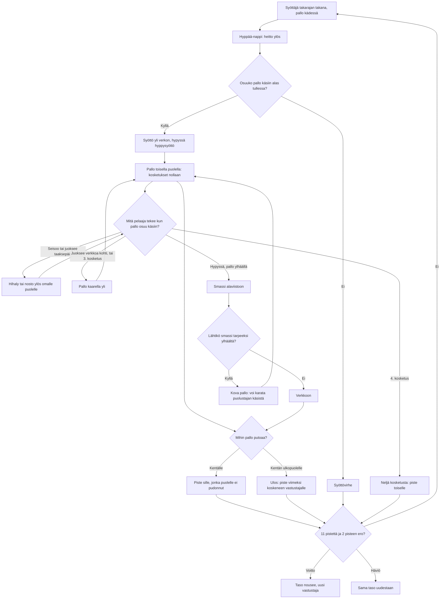

# Lentopallo: one rally, from the serve to the point

How one rally of Lentopallo plays (v1). Beach volleyball seen from the side, the player
against one computer player, rally scoring to 11 with a two-point lead. The ball is played
automatically when it touches a player's hands; what the touch does depends on what the
player is doing at that moment.

## Colours

- **blue**: what the player sees and does
- **amber**: a check that decides the path
- **teal**: the ways the ball can be played
- **violet**: the opponent's side of the rally
- **green**: a point or a win
- **rose**: a fault, a lost point or a lost match

## Boxes

- **Syöttäjä takarajan takana, pallo kädessä**: `newRally()` in `games/lentopallo/v1/index.html`; the winner of the last point serves (rally scoring), and `stepPlayer()` keeps the server behind the end line until the serve is hit.
- **Hyppää-nappi: heitto ylös**: `press()` → `toss()`; the same button jumps during play. The computer serves on its own after about a second.
- **Osuuko pallo käsiin alas tullessa?**: `touching()` checks the ball against the player's hands (0.25–2.6 m above the feet, about half a metre to each side); a tossed serve can only be hit on its way down. A toss left to fall is `land()` → "Syöttövirhe".
- **Syöttö yli verkon, hypyssä hyppysyöttö**: the serve branch of `hit()`; `arcTo()` and `clears()` lift the arc until it passes over the net.
- **Pallo toisella puolella: kosketukset nollaan**: `stepBall()` counts `crossings` and resets `touches` when the ball passes over the net.
- **Hihaly tai nosto ylös omalle puolelle**: the set branch of `hit()`: a high ball that comes down 1 m from the net on the player's own side, ready for a spike.
- **Pallo kaarella yli**: the over branch of `hit()`: an arc into the far court, always clear of the net. The third touch is always this.
- **Smassi alaviistoon**: the spike branch of `hit()` (`shotTo()`): short and sharp, or deep when running toward the net. A ball off the middle of the hands goes a little wrong.
- **Lähtikö smassi tarpeeksi ylhäältä?**: only a spike hit more than 0.35 m above the net top is aimed deeper until it clears; a lower one may go into the net.
- **Kova pallo: voi karata puolustajan käsistä**: in `hit()`, a ball faster than 8.5 m/s adds error to the dig, and sometimes flies off the arms ("Karkasi käsistä!").
- **Neljä kosketusta: piste toiselle**: `hit()` gives the point away on a fourth touch on one side.
- **Ulos: piste viimeksi koskeneen vastustajalle**: `land()`: past 4 m from the net is out.
- **11 pistettä ja 2 pisteen ero?**: `matchWinner()`.
- **Taso nousee, uusi vastustaja**: `endMatch()` saves `ai-pelit:lentopallo:taso`, `voitot` and `haviot`; `cpuSetup()` makes each level's opponent quicker, quicker to react, more accurate and more eager to spike.
