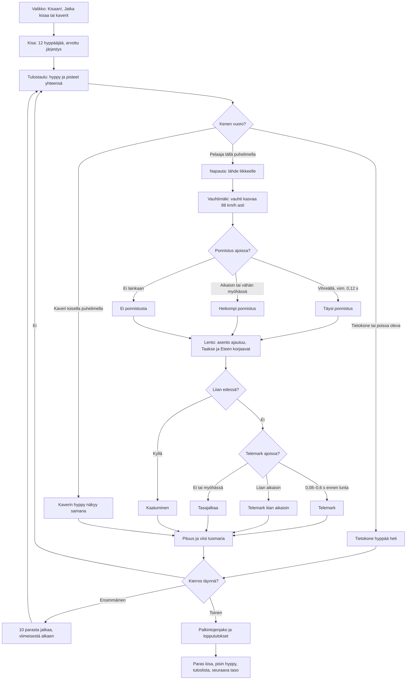

# Mäkihyppy: one jump and one meet

How Mäkihyppy plays (v1, #269). A meet has twelve jumpers on a large hill (K 120, HS 134): the
player and eleven computer jumpers alone, or 2–8 phones in a room with the computer filling the
rest. Everyone jumps once in a drawn order; the best ten jump again, the last of them first, and
the points of both jumps add up. On their turn the player taps to leave the bar, taps again just
before the table's edge to spring, steers the flight position with Taakse and Eteen, and taps
the telemark just before the snow. The meet itself (turns, saves, room, podium) is the shared
library's `kisa.js`, see `yleisurheilu-kirjasto.md`.

## Colours

- **blue**: what the player sees and does
- **violet**: someone else jumping: the computer, or a friend on another phone
- **amber**: a check that decides the path
- **teal**: the meet's rules and the judged jump
- **rose**: a fall
- **green**: the end of the meet and what it saves

## Boxes

- **Valikko: Kisaan!, Jatka kisaa tai kaverit**: `showMenu()` in `games/makihyppy/v1/index.html`: a new meet at the player's level (`taso`), "Jatka kisaa" for a meet left unfinished (`kesken`), and the room (`rooms.js`, 2–8 phones). It shows meets, wins, the longest jump (`pisin`) and the best meet (`ennatys`).
- **Kisa: 12 hyppääjää, arvottu järjestys**: `AiPelitKisa.meet()` from `public/lib/yleisurheilu-4/kisa.js` with the game's own format `totals()`: the computer jumpers average `base(level)` metres (104 m at level 1, 3 m more per level up to 126 m), spread around it.
- **Tulostaulu: hyppy ja pisteet yhteensä**: `board()` in `totals()`: the latest jump's length and the points so far; a dashed line after ten in the first round. Shown 3.5 s (`BOARD_T`); alone a tap skips it.
- **Tietokone hyppää heti**: `cpuMark()`: the skill, a scatter of 4.5 m and 2.2 m per m/s of wind, style from the skill; now and then a landing on both feet, a hand in the snow or a fall.
- **Kaverin hyppy näkyy samana**: the jumping phone sends where its jumper is twelve times a second (`p`) and the judged result (`fin`); other phones ease the jumper along (`watchStep()`) and show the same result card. The host takes a guest's jump only when it could be real (`valid()` in `totals()`): the distance to the half metre, and no more points than that distance with a perfect style.
- **Napauta: lähde liikkeelle**: `go()`: the action bar ("Lähde"), or anywhere on the scene. In a room a jumper who waits 30 s (`TURN_MAX`) is sent down.
- **Vauhtimäki: vauhti kasvaa 88 km/h asti**: `inAt()`, `inSpeed()`: a 56 m in-run (35° slope, curve, an 11° table) taken in about 4.6 s to 24.5 m/s (`V0`). The last 0.12 s before the edge is drawn green on the table, the 0.45 s before it yellow; the action bar turns green with it (`cue()`).
- **Ponnistus ajoissa?**: `action()` and `springOf()` by the time left to the edge when tapped (`tau`): within `GOOD` (0.12 s) the full spring (`UP`, 2.6 m/s off the table); earlier, less; a tap within 0.1 s after the edge (`springLate()`) still springs a little; a tap more than 0.9 s before the edge is not a take-off yet.
- **Lento: asento ajautuu, Taakse ja Eteen korjaavat**: `flyTick()`: the position `pos` drifts away from its best (`DRIFT`) and with the gusts (`gustOf()`), and holding Taakse or Eteen turns it (`TILT`); the bar in the score panel shows it, green in the middle. The better it is, the more the air carries (`carryOf()`, `flyStep()`: lift and drag; wind against the jumper carries a little more).
- **Liian edessä?**: past `FALL` forward in the air, or still well forward at the landing, the jumper falls.
- **Telemark ajoissa?**: a tap in the air (`action()`) after 0.6 s of flight sets the telemark; it counts by the time from the tap to the real touch-down (`TELE`). The action bar turns yellow when the snow is under 1.3 s away and green only inside the good window, under 0.6 s (`cue()`, `timeToLand()`); on the in-run it is green only in the last 0.12 s before the edge, the take-off judged good.
- **Pituus ja viisi tuomaria**: `landed()` and `judge()`: the distance along the slope from the edge (`distAt()`), to the half metre; 60 points at K and 1.8 a metre; five judges give style out of 20 with deductions for the take-off, the flight (the average position) and the landing, and the highest and lowest are dropped. The longest jump is saved at once (`pisin`).
- **10 parasta jatkaa, viimeisestä alkaen**: `advance()` in `totals()`: after the first round the best ten (`final`) jump again, the last of them first.
- **Palkintojenjako ja lopputulokset**: the library's podium (`K.drawPodium()`), with the meet's total points; it stays until a tap.
- **Paras kisa, pisin hyppy, tuloslista, seuraava taso**: the library's `end()` saves `kisat`, a win alone adds `voitot` and the next `taso`, the meet's total goes to `ennatys` and the high-score list (`makihyppy` in `public/scores.js` and `server/api.js`).
