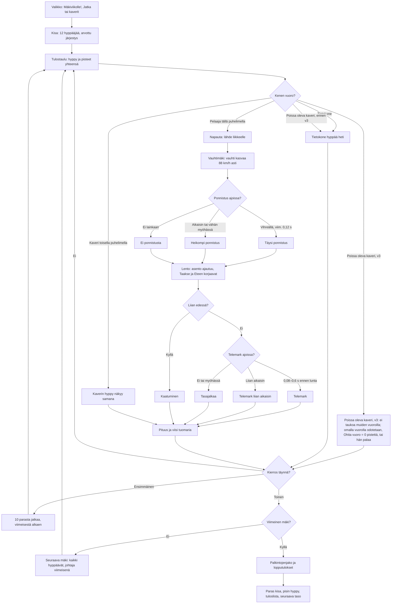

# Mäkihyppy: one jump and one ski-jumping week

How Mäkihyppy plays (v1, #269; v2, #283: a week of four hills). Twelve jumpers on a large hill
(K 120, HS 134): the player and eleven computer jumpers alone, or 2–8 phones in a room with the
computer filling the rest. On each hill everyone jumps once (in v1 in a drawn order; in v2 the
week's leader last); the hill's best ten jump again, the last of them first. v1's meet is one
hill; v2's week is four (Lahti, Kuopio, Rovaniemi, Ruka), and the points of every jump add up,
so the podium comes only after the last hill. On their turn the player taps to leave the bar, taps again just
before the table's edge to spring, steers the flight position with Taakse and Eteen, and taps
the telemark just before the snow. The meet itself (turns, saves, room, podium) is the shared
library's `kisa.js`, see `yleisurheilu-kirjasto.md`.

v3 (#297) plays as v2 on `public/lib/yleisurheilu-5/`: with friends the meet waits only for the phone on turn, a friend may leave and come back ("↩ Palaa kierrokseen"), the host's "Ohita vuoro" skips an away friend's turn as a miss (the computer never takes them), and the friends not on turn stand in a row at the bottom of the scene as spectators with "📣 Kannusta" (`K.drawFans()` in `drawScene()`, see `yleisurheilu-kirjasto.md`).

Since #346 only each game's newest version folder is kept: a `games/<slug>/v<N>/` path below that is not the newest names a version that is history now (its files are in git's history, and the site sends its address to the newest), and what it says about that version is how it was.

v5 (#337, `aanet-4`) has no crowd: a long jump (past the K point, the longest or a lead) lands with the quiet `onnistui` blip at 0.3, any other jump only its landing, a fall only its thud, the podium only the medal tune, and "📣 Kannusta" a quiet blip at 0.25 (`cheerSound`).

v7 (#355) loads `aanet-5`, where the sounds Eero still found too loud are swapped for softer ones he picked by ear, or play quieter (the winning and losing tunes); the cheer's chime plays at 0.08, not 0.25 pitched up.

v6 (#341) plays as v5 on `public/lib/yleisurheilu-7/`: the friends watching stand in front of the forest, behind the hill and the jumper, drawn before the athlete so they never cover it (`K.drawFans(x, {..., walk: true})` in `drawScene()`), and a tap on the scene walks your own figure there on every phone (`K.tapFans()` first in the canvas's `pointerdown`). See `yleisurheilu-kirjasto.md`.
v11 (#404) plays as v10, but a tap is judged at its own moment, not at the last drawn frame: see `reilu-ajoitus.md`.

v8 (#373) plays as v7 on `public/lib/yleisurheilu-8/`: the friends watching run after the athlete as the background moves, a little slower than it, and catch up once it stops (`scroll:` in the `K.drawFans()` call in `drawScene()`, 0 with the athlete at the start), and a tap on another spectator climbs onto their shoulders (`K.tapFans(px, py)` in the canvas's `pointerdown`). See `yleisurheilu-kirjasto.md`.

v10 (#395) plays as v9 on `public/lib/yleisurheilu-9/`: the friends watching no longer run. The row only slides with the background, a little slower than it, and stops when it stops; legs move only on a tapped walk.

v9 (#387) halves the week: a new week has two hills (Lahti, Kuopio), still two rounds on each, so at most four jumps for the podium instead of eight. A week left unfinished by v8 goes on as its four hills. The shorter week has its own best (`viikko2-ennatys`) and its own high-score list (`viikko2`, "Mäkiviikko"); the four-hill list stays as "Mäkiviikko, 4 mäkeä".

## Colours

- **blue**: what the player sees and does
- **violet**: someone else jumping: the computer, or a friend on another phone
- **amber**: a check that decides the path
- **teal**: the meet's rules and the judged jump
- **rose**: a fall
- **green**: the end of the meet and what it saves

## Boxes

- **Valikko: Mäkiviikolle!, Jatka tai kaverit**: `showMenu()` in `games/makihyppy/v2/index.html` (v1: "Kisaan!"): a new week at the player's level (`taso`), "Jatka mäkiviikkoa (Mäki 2/4 · kierros 1/2)" for a week left unfinished (`kesken`; one saved by v1 goes on as its one hill, `roundText()`), and the room (`rooms.js`, 2–8 phones). It shows meets, wins, the longest jump (`pisin`) and the best meet (v1: `ennatys`; v2: the best week, `viikko-ennatys`, its own record set by v2's `K.record`, so v1 keeps showing its best two-jump meet).
- **Kisa: 12 hyppääjää, arvottu järjestys**: `AiPelitKisa.meet()` from `public/lib/yleisurheilu-4/kisa.js` (from v3 `yleisurheilu-5/kisa.js`, #297) with the game's own format `totals()`: the computer jumpers average `base(level)` metres (104 m at level 1, 3 m more per level up to 126 m), spread around it.
- **Tulostaulu: hyppy ja pisteet yhteensä**: `board()` in `totals()`: the latest jump's length and the points so far over the whole week, titled by the hill and its round (`title()`, "Kuopio 2/4 · 1. kierros"); a dashed line after ten in the very first round, where the board's order is the hill's. Shown 3.5 s (`BOARD_T`); alone a tap skips it.
- **Tietokone hyppää heti**: `cpuMark()`: the skill, a scatter of 4.5 m and 2.2 m per m/s of wind, style from the skill; now and then a landing on both feet, a hand in the snow or a fall. From v3 (`yleisurheilu-5/`, #297) this is the computer's competitors only: a friend's phone is never handed over.
- **Poissa oleva kaveri, v3: ei taukoa muiden vuoroilla; omalla vuorolla odotetaan, Ohita vuoro = 0 pistettä, tai hän palaa**: from v3 (`yleisurheilu-5/`, #297) the library calls `R.turns()` with the competitor on turn, so a friend who closes the game or leaves the room stops nobody while others are on turn. On their own turn every phone shows "⏸ Odotetaan: <nimi>"; the host's "Ohita vuoro" (`R.on('skip')`) records the format's `missed` mark (0 pistettä) and the meet goes on, or the friend comes back ("↩ Palaa kierrokseen" on the room screen) and takes the turn themselves. See `yleisurheilu-kirjasto.md`.
- **Kaverin hyppy näkyy samana**: the jumping phone sends where its jumper is twelve times a second (`p`) and the judged result (`fin`); other phones ease the jumper along (`watchStep()`) and show the same result card. The host takes a guest's jump only when it could be real (`valid()` in `totals()`): the distance to the half metre, and no more points than that distance with a perfect style.
- **Napauta: lähde liikkeelle**: `go()`: the action bar ("Lähde"), or anywhere on the scene. In a room a jumper who waits 30 s (`TURN_MAX`) is sent down.
- **Vauhtimäki: vauhti kasvaa 88 km/h asti**: `inAt()`, `inSpeed()`: a 56 m in-run (35° slope, curve, an 11° table) taken in about 4.6 s to 24.5 m/s (`V0`). The last 0.12 s before the edge is drawn green on the table, the 0.45 s before it yellow; the action bar turns green with it (`cue()`).
- **Ponnistus ajoissa?**: `action()` and `springOf()` by the time left to the edge when tapped (`tau`): within `GOOD` (0.12 s) the full spring (`UP`, 2.6 m/s off the table); earlier, less; a tap within 0.1 s after the edge (`springLate()`) still springs a little; a tap more than 0.9 s before the edge is not a take-off yet.
- **Lento: asento ajautuu, Taakse ja Eteen korjaavat**: `flyTick()`: the position `pos` drifts away from its best (`DRIFT`) and with the gusts (`gustOf()`), and holding Taakse or Eteen turns it (`TILT`); the bar in the score panel shows it, green in the middle. The better it is, the more the air carries (`carryOf()`, `flyStep()`: lift and drag; wind against the jumper carries a little more).
- **Liian edessä?**: past `FALL` forward in the air, or still well forward at the landing, the jumper falls.
- **Telemark ajoissa?**: a tap in the air (`action()`) after 0.6 s of flight sets the telemark; it counts by the time from the tap to the real touch-down (`TELE`). The action bar turns yellow when the snow is under 1.3 s away and green only inside the good window, under 0.6 s (`cue()`, `timeToLand()`); on the in-run it is green only in the last 0.12 s before the edge, the take-off judged good.
- **Pituus ja viisi tuomaria**: `landed()` and `judge()`: the distance along the slope from the edge (`distAt()`), to the half metre; 60 points at K and 1.8 a metre; five judges give style out of 20 with deductions for the take-off, the flight (the average position) and the landing, and the highest and lowest are dropped. The longest jump is saved at once (`pisin`).
- **10 parasta jatkaa, viimeisestä alkaen**: `advance()` in `totals()`: after a hill's first round its best ten by that hill's points (`hillStandings()`, `final`) jump again, the last of them first. When no phone's jumper is among them, the computer's jumps are in at once and the next hill comes, with no podium.
- **Viimeinen mäki?**: v2's week has four hills (`HILLS`, `c.hills`); from v9 (#387) a new week has two (`WEEK_HILLS`), and a week saved with four keeps its four; a meet saved by v1 has none and is one hill (`hills()`), so it ends after its second round as before.
- **Seuraava mäki: kaikki hyppäävät, johtaja viimeisenä**: `advance()`: a new hill's first round has all twelve, in reverse order of the week's standings.
- **Palkintojenjako ja lopputulokset**: the library's podium (`K.drawPodium()`), with the week's total points, only after the last hill's second round (#283: in v1 it came after every two jumps); it stays until a tap.
- **Paras kisa, pisin hyppy, tuloslista, seuraava taso**: the library's `end()` saves `kisat`, a win alone adds `voitot` and the next `taso`, the meet's total goes to `ennatys` (v2's week to `viikko-ennatys`) and the high-score list (`makihyppy` in `public/scores.js` and `server/api.js`): v2's week on its own list, Mäkiviikko (`viikko`, the shelf's first, `scoreList()`: set at load, so the menu's 🏆 shows it, and again at every turn, so a guest whose meet arrives from the host sends to it too), v1's two-jump meet on `main` (Yksi kisa). This game keeps its own score entry; the shared registry’s new `minigolf` entry (#340, lowest stroke total on `main`) does not change it. Kiekkoammunta v1 adds independent `trap` and `skeet` score entries (Trap first, N/25); this box’s existing behavior is unchanged. Frisbeegolf v1 adds its own `main` entry to these registries: lowest strokes against par wins, displayed as `E`, `−2` or `+5`; this box keeps its existing behavior. Frisbeegolf now uses its separate `v3` leaderboard; versions 1–2 are not accepted there (#338). From v5 (#429) its rounds go to a new `v5` list, the shelf's first, and the `v3` list stays for v3–v4. Kaaosrata v6 (#454) adds `hihna`, `laatat` and `finaali` to its separate score entry; `main` keeps its old times and remains its first list. This box keeps its existing behaviour. Kaaosrata v7 adds separate `hihna7`, `laatat7`, `finaali7` lists to this shared registry, retains its v6 lists for v6 only and keeps `main` unchanged.
