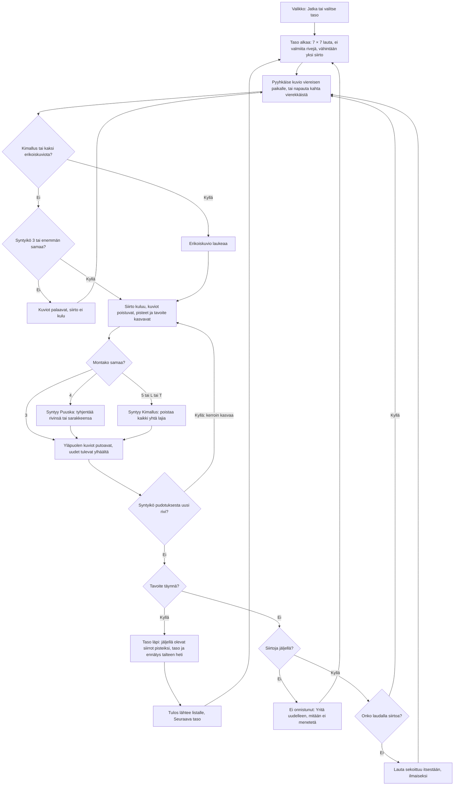

# Marjakori: yksi taso, ensimmäisestä pyyhkäisystä tulokseen

Marjakori is a swipe match-3 game. The player swaps a forest shape with its neighbour, and three or more in a row or column disappear. A level is passed by collecting its target shapes or clearing moss within a limited number of moves.

## Colours

- **blue**: what the player sees and does
- **amber**: a question the game asks
- **violet**: what the board does by itself
- **rose**: a try that did not work
- **green**: a level won and saved

## Boxes

- **Taso alkaa: 7 × 7 lauta, ei valmiita rivejä, vähintään yksi siirto**: `newLevel()` in `games/marjakori/v1/logiikka.js`, from a seed saved with the round, so a reload brings the same board.
- **Pyyhkäise kuvio viereisen paikalle, tai napauta kahta vierekkäistä**: the swap fires once the finger has moved about a third of a tile, without waiting for it to lift (`ohjaus` in `index.html`).
- **Kuviot palaavat, siirto ei kulu**: a swap that matches nothing costs nothing; the tiles slide back.
- **Syntyy Puuska: tyhjentää rivinsä tai sarakkeensa**: four in a line.
- **Syntyy Kimallus: poistaa kaikki yhtä lajia**: five in a line, or an L or T shape; swiped with a neighbour it takes every tile of that neighbour's kind.
- **Taso läpi: jäljellä olevat siirrot pisteiksi, taso ja ennätys talteen heti**: saved as `ai-pelit:marjakori:taso` and `:parhaat` the moment the level is won.
- **Tulos lähtee listalle, Seuraava taso**: the sum of each level's best points goes to `AiPelitScores.submit()`.
- **Lauta sekoittuu itsestään, ilmaiseksi**: `hasMove()` in `logiikka.js` is false, so the tiles are mixed until a move exists.
