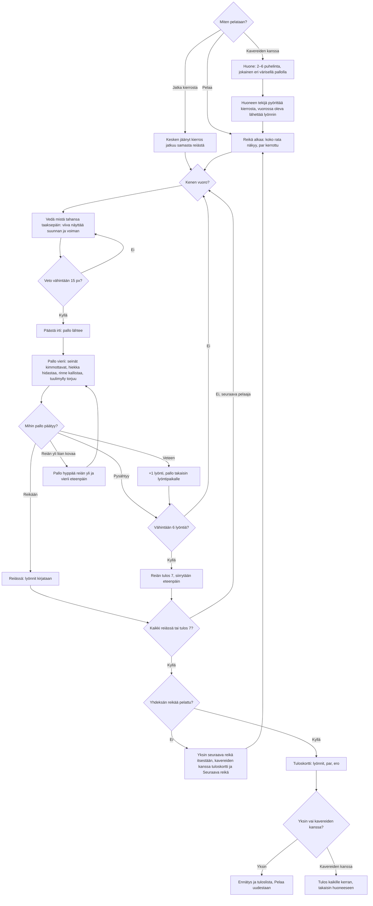

# Minigolf: one round, from the first hole to the result

How a round of Minigolf plays (#340). The course is seen from above, and the whole
hole fits on the screen. Each stroke is aimed by pulling back anywhere on the screen, like a
sling; the ball rolls, bounces off walls, slows in sand and drifts on slopes. Nine holes, each
with its par; alone the player plays against par and their own record, with friends 2–6 phones
take turns on each hole through the shared room library (see `moninpeli.md`).

## Colours

- **blue**: what the player sees and does
- **amber**: a check that decides the path
- **teal**: the ball moving
- **violet**: playing in a room
- **green**: a hole made, a record
- **rose**: a penalty or the stroke limit

## Boxes

- **Miten pelataan?**: the menu in `games/minigolf/v2/index.html`: **Pelaa** (`newRound()`), **Jatka kierrosta** when a round alone was left unfinished (saved on release, after every stroke and when the page hides as `ai-pelit:minigolf:kierros`), **👥 Pelaa kavereiden kanssa** (`AiPelitRooms.open()`), the best total, and the top 10 as a short scrolling list (`#menuBoard`, filled by `menu()` from `AiPelitScores.list`), with **🏆 Tuloslista** for the whole list.
- **Huone: 2–6 puhelinta, jokainen eri värisellä pallolla**: `rooms.js` with `data-min="2" data-max="6"`; each player's ball gets its own colour in room order, and `updateHUD()` shows the players as a row of those colours with names (`#who`), the one on turn marked.
- **Huoneen tekijä pyörittää kierrosta, vuorossa oleva lähettää lyönnin**: the host runs the physics and sends snapshots (as Curling does); the phone on turn sends `aim` while dragging and `shot` when it lets go. `turns()` makes the room wait only for the phone on turn; "Ohita vuoro" scores that player 7 on the hole.
- **Reikä alkaa: koko rata näkyy, par kerrottu**: `nextHole()` in `games/minigolf/v2/game.js` reads the hole from `holes.js`; `fit()` scales it to the screen, turned 90° when the phone is sideways.
- **Vedä mistä tahansa taaksepäin: viiva näyttää suunnan ja voiman**: `dragAim()`: the ball goes the opposite way to the finger's pull, the pull's length (up to 30 % of the screen's short side) is the power. Only the aim line shows it (`drawAimLine()` in `draw.js`, #438; no power bar since v2): an arrow from the ball that grows longer (`aimLineLength()`, 0.35–3.45 m), thicker and from pale yellow to red (`aimLineColor()`) as the pull grows. Turning the phone mid-pull keeps the aim: `fit()` marks the drag to re-anchor at the finger, and if the browser cancels the pointer in the turn the aim stays parked (`parkedAim`) until the next drag or tap; it never fires by itself.
- **Pallo vierii: seinät kimmottavat, hiekka hidastaa, rinne kallistaa, tuulimylly torjuu**: `step(dt)` in `game.js` calls `golfStep()` in `golf.js`, fixed 1/240 s steps so a fast ball never passes through a wall.
- **Pallo hyppää reiän yli ja vierii eteenpäin**: the ball drops only when it is over the cup slower than the capture speed (`CUP_SPEED`); a faster ball lips out.
- **Reiän tulos 7, siirrytään eteenpäin**: the stroke limit of Finnish rata-minigolf: a ball not holed in six strokes scores 7.
- **Tuloskortti: lyönnit, par, ero**: `showCard()` in `game.js`; alone, this round and each hole's record (`reiat`, column Ennätys); with friends, every player's column.
- **Ennätys ja tuloslista, Pelaa uudestaan**: `finishRecord()` saves `paras` and `reiat` the moment the last hole is done, in a round alone only; `AiPelitScores.submit(total, true)` with `data-order="low"`; on the phone's first score `showCard()` then calls `AiPelitScores.prompt()`, so the nickname question comes over the finished card. A round in a room counts only in `kaverit`.
- **Tulos kaikille kerran, takaisin huoneeseen**: `AiPelitRooms.deliver()`; each phone saves its result once (`once(round)`).

- **Yksin seuraava reikä itsestään, kavereiden kanssa tuloskortti ja Seuraava reikä**: alone, `advance()` shows the hole's result as a notice (a touch on the course hides any notice at once, `hideNotice()`) and `step()` calls `nextHole()` after 1.2 s, with no scorecard between holes; the card comes at the end. In a room, `showCard()` shows all nine rows and the running totals after each hole, and `nextHole()` begins the next when the host taps.
- **+1 lyönti, pallo takaisin lyöntipaikalle**: `settle()` adds one penalty, capped at 7, and restores `round.origin`. If that brings the count to at least six without holing, the hole scores 7.
- **Tulos kaikille kerran, takaisin huoneeseen**: the retained `result` includes the complete scorecard. A reloaded phone gets it in the room's expandable result card (`R.extra`), since the shared library opens the room after a completed round. New rounds clear the card; stopping a round clears game state on every phone.

`public/scores.js` and `server/api.js` register `minigolf`, lowest nine-hole total on `main`, displayed as lyöntiä. Only the host accepts shots, with matching room round, turn sequence and active player id; all other input is ignored. `draw.js` rotates both course and aiming vectors for landscape and sleeps between changes except while a ball or windmill moves. Sound uses the quiet `aanet-5` library; no crowd sounds. Kiekkoammunta v1 adds independent `trap` and `skeet` score entries (Trap first, N/25); this box’s existing behavior is unchanged. Frisbeegolf v1 adds its own `main` entry to these registries: lowest strokes against par wins, displayed as `E`, `−2` or `+5`; this box keeps its existing behavior. Frisbeegolf now uses its separate `v3` leaderboard; versions 1–2 are not accepted there (#338).
