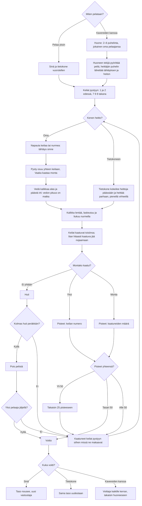

# Mölkky: one game, from the first throw to the winner

How a game of Mölkky plays. Twelve numbered pins stand 3.5 m from the throwing line in a cottage
yard drawn with three.js; each throw is the kalikka pulled down and let go, upright or crosswise.
One pin down scores its number, several score how many fell; exactly 50 wins, over 50 drops to 25,
and three misses in a row put a player out. Alone the computer is the other player; with friends,
2–6 phones each throw in turn through the shared room library (see `moninpeli.md`).

## Colours

- **blue**: what the player sees and does
- **amber**: a check that decides the path
- **teal**: the kalikka and the pins moving, and the computer's throw
- **violet**: playing in a room
- **green**: a win
- **rose**: a miss, a setback or a lost game

## Boxes

- **Miten pelataan?**: the menu in `games/molkky/v1/index.html`: **Pelaa yksin** (`newGame()`), **Jatka peliä** when a game alone was left unfinished (saved before every throw as `ai-pelit:molkky:peli` by `keepGame()` and `scoreThrow()`), or **👥 Pelaa kavereiden kanssa** (`AiPelitRooms.open()`).
- **Huone: 2–6 puhelinta, jokainen oma pelaajansa**: `setupFor()` on the host lists the players in the room's order and picks who throws first; `nextTurn()` skips a player who is out.
- **Huoneen tekijä pyörittää peliä, heittäjän puhelin lähettää tähtäyksen ja heiton**: the host runs the physics and sends `s` (`snapshot()`) about 8–25 times a second; the thrower's phone sends `aim` while it drags and `throw` when it lets go. A phone let go with "Jatka ilman heitä" is thrown for by the computer (`net.away`); a phone that comes back gets the setup and the game as it is (`on('hello')`).
- **Keilat pystyyn: 1 ja 2 edessä, 7 9 8 takana**: `setUp()` places the pins of `FORM` touching each other, the front row at `LINE` (3.5 m).
- **Napauta keilaa tai nurmea: tähtäys sinne**: `pinAt()` picks the pin under the finger (within 30 px), else `groundAt()` the grass under it; the aim's direction (`slope`) turns there.
- **Pysty osuu yhteen keilaan, Vaaka kaataa monta**: the two buttons set `aim.st`; upright the kalikka travels along its way (narrow), crosswise across it (22.5 cm wide), and it rolls further after landing.
- **Vedä kalikkaa alas ja päästä irti: vedon pituus on matka**: `dragAim()` turns the pull into where it lands, 1.5–5.5 m (shown in metres beside the pad, and as a ring on the grass); sideways fine-tunes the aim. A pull shorter than 14 px throws nothing. Every throw gets a small shake of the hand (`shaken()`).
- **Tietokone kokeilee heittoja päässään ja heittää parhaan, pienellä virheellä**: `cpuPlan()` simulates about 150 throws at each pin and into the bunch with the game's own `step()`, only throws within reach (`clampAim()`, the same limits as a real throw), and scores each with `throwValue()` (exactly 50 first, never over it, no third miss); the throw then gets an error from `skillOf()` that shrinks as the levels go up.
- **Kalikka lentää, laskeutuu ja liukuu nurmella**: `launch()` always lands where aimed; `step()` slows it on the grass and `stickHits()` knocks the pins it touches.
- **Keilat kaatuvat toisiinsa; liian hitaasti kaatuva jää nojaamaan**: `pinStep()` tips a knocked pin over on its edge; its top pushes the pins in its way (`reach()`): hard enough they fall too (`LEAN_PUSH`), softer it shoves them aside, slower than `LEAN_SLOW` it stays leaning, which does not count.
- **Pisteet: keilan numero**: `pointsOf()`; the fallen pins get green number tags while the points show.
- **Pois pelistä**: `rules()` counts misses in a row in `misses`; a hit starts the count again.
- **Takaisin 25 pisteeseen**: `rules()` sets the score to `BACK_TO`.
- **Kaatuneet keilat pystyyn siihen missä ne makaavat**: `raise()` stands each fallen pin on its middle and moves pins stood on the same spot apart.
- **Taso nousee, uusi vastustaja**: `record()` saves `taso`, `voitot` and `haviot` the moment the game is won or lost.
- **Voittaja kaikille kerran, takaisin huoneeseen**: `hostEnd()` → `AiPelitRooms.deliver()`; each phone saves its result once in `ai-pelit:molkky:kaverit` (`finish()`).
