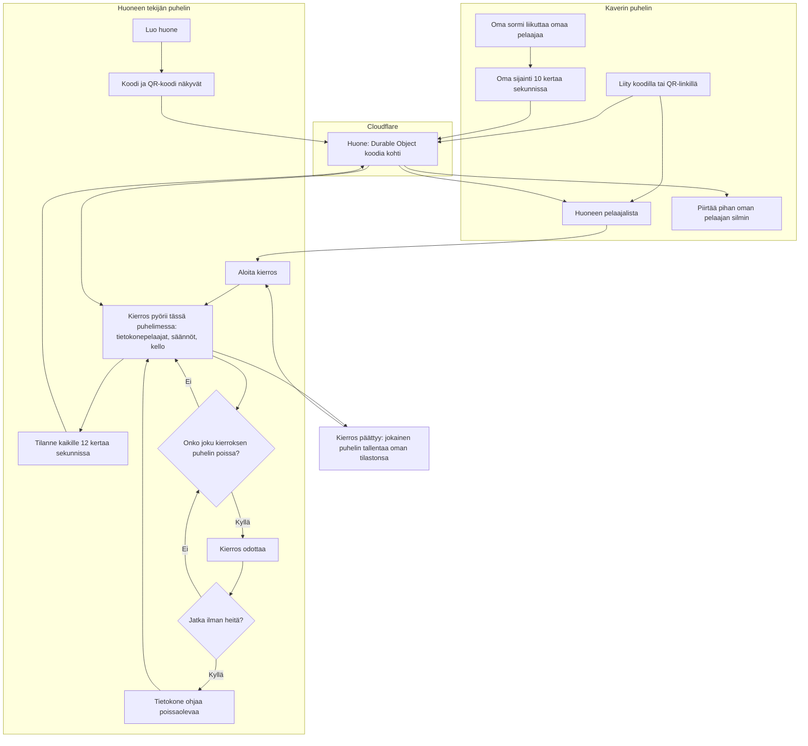

# Moninpeli: playing with friends in one room

How 2–5 phones play one game together (#27, first in Kirkkis v2). One phone makes a room and runs
the game: the computer players, the rules and the clock. Every phone moves its own player and
draws the game through its own player's eyes. The room on Cloudflare only passes messages between
the phones. When a phone drops off, the round waits for it.

## Colours

- **blue**: making and joining a room
- **violet**: the room on Cloudflare, which only passes messages on
- **teal**: the round, run on the phone that made the room
- **green**: a friend's phone playing its own player
- **amber**: a check that decides the path
- **rose**: a phone that dropped off

## Boxes

- **Luo huone**: `games/kirkkis/v2/index.html` `enterRoom(newCode(), true)`: a random 4-letter code (no I, O, Q, W, X, Z); a code already in use gets a new one.
- **Koodi ja QR-koodi näkyvät**: `renderNet()` and `drawQR()`; `qrMatrix()` draws the join link `…/games/kirkkis/v2/?huone=<KOODI>` as a QR code in the page itself, with no library.
- **Huone: Durable Object koodia kohti**: `rooms/worker.js` `Room`, in the `ai-pelit-rooms` Worker, reached at `/api/rooms/<KOODI>` through `server/api.js` (`ROOMS` binding). Each phone connects with its own secret key; the room tells it alone its public id (a hash of the key, `{t: 'you'}`), so nobody can take another phone's place, the host's included, by copying an id. Up to 5 phones; the host's messages go to all (or to `to`), the others' to the host with `from`. It tells everyone who is in and who is connected (`peers`). An empty room is forgotten after 6 hours.
- **Liity koodilla tai QR-linkillä**: typing the code, or opening the QR link, which joins at once. A reload goes back to the same room (`sessionStorage`).
- **Huoneen pelaajalista**: who is in, the host with 👑; someone without a connection is greyed out.
- **Aloita kierros**: needs 2 connected phones. The cast is the phones in the room plus computer players up to 5; the first seeker is a random phone, then the first one caught (`startMulti()`).
- **Kierros pyörii tässä puhelimessa: tietokonepelaajat, säännöt, kello**: the same `step()`, `rules()` and bots as alone. The other phones' players stand where those phones last said.
- **Tilanne kaikille 12 kertaa sekunnissa**: `hostSend()`: everyone's place, facing and state, the clock, and what happened (`happen()`: seen, saved, caught), which each phone tells from its own side.
- **Oma sijainti 10 kertaa sekunnissa**: `guestStep()` moves this phone's player at once, and sends where it is; the others glide to where the host last saw them.
- **Piirtää pihan oman pelaajan silmin**: `draw()` with this phone's `player`: the fog is cut by that player's own field of view.
- **Onko joku kierroksen puhelin poissa?**: `paused()`: a phone in the round whose connection is gone, or the host's own connection.
- **Kierros odottaa**: the clock and everyone stop; each phone shows who is being waited for.
- **Jatka ilman heitä?**: only the host's phone shows this button.
- **Tietokone ohjaa poissaolevaa**: `toBot()`. When that phone comes back, it takes its player back and gets the round as it is (`snapshot()`).
- **Liity koodilla tai QR-linkillä** (again): on every connection a guest says `hello` to the host (`hostHello()`), so a phone in the round gets it back even when its new socket replaced the old one without it ever showing as gone (a reload, a second tab).
- **Kierros päättyy: jokainen puhelin tallentaa oman tilastonsa**: `roundOver()` on every phone, into `ai-pelit:kirkkis:tilasto` as in v1; everyone goes back to the room on its own, keeping its result. The host sends `lobby` only when it comes back without its round (a reload), which sends everyone back to the room.
