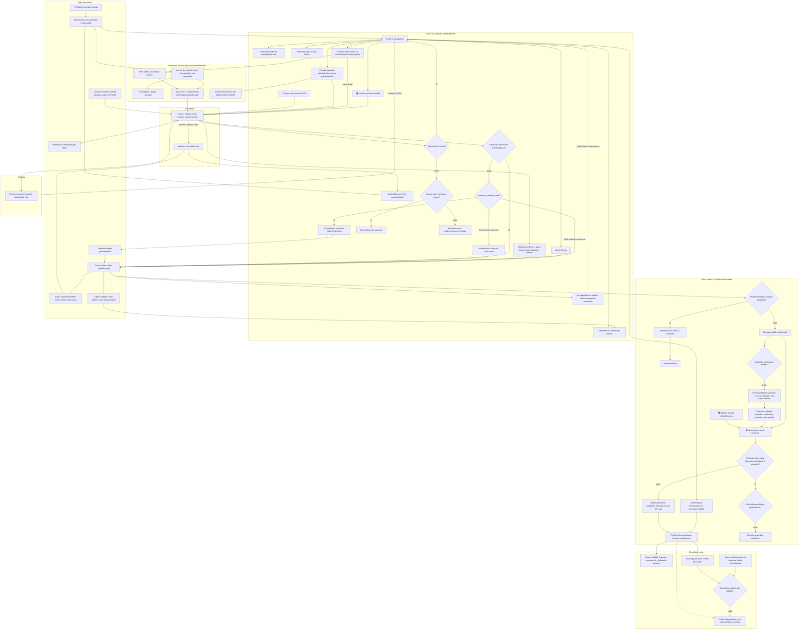

# Moninpeli: playing with friends in one room

How 2–8 phones play one game together. One phone makes a room and runs the game; every phone
moves its own player and draws the game from its own side. The room on Cloudflare only passes
messages between the phones. Everything a game needs for a room is one shared script,
`public/rooms.js` (#34): the room screen, reconnecting, the pause for a phone that dropped off, and
saving a round's result once. A game writes only its own part; where a box is a game's, it names
Kirkkis v3 (`games/kirkkis/v3/index.html`, #57), whose messages are `kr`, `ks`, `kme` and `kfin`;
v4 (#67) sends the same, with the seek clock during a recount (`sl`) and a "Kaikki pelastettu!" event.
Kirkkis v2 (#27) keeps its own copy of the whole flow, from before the library.
Voice (#322): while someone holds the 🎤 chip, the others in the room hear them; the sound goes
straight between the phones, and the room only passes on the call's setup messages.
The room page (#388): a phone that makes or joins a room moves onto `/huone/`, which keeps the
room's connection and the calls and plays the game in a frame, so a game switch changes only the
frame and the calls stay up. The 🎤 chip lives on that page too (#394), so a sentence goes on through a
game switch.

Since #346 only each game's newest version folder is kept: a `games/<slug>/v<N>/` path below that is not the newest names a version that is history now (its files are in git's history, and the site sends its address to the newest), and what it says about that version is how it was.

## Colours

- **teal**: the game's own code, the only part a new multiplayer game writes
- **blue**: the shared `public/rooms.js`, the same for every game, and the room page that uses it
- **violet**: the room on Cloudflare (`rooms/worker.js`), which only passes messages on
- **amber**: a check that decides the path
- **rose**: a phone that dropped off
- **green**: the shelf (`public/app.js`)

## Boxes

- **👥 Pelaa kavereiden kanssa**: the game's own menu button; it calls `AiPelitRooms.open()`. The game loads `<script src="../../../rooms.js" data-game="<slug>" data-min="2" data-max="5">` before its own script.
- **Huoneruutu: Luo huone tai Liity koodilla**: `public/rooms.js` `build()` and `render()`, in Finnish, the same in every game. A new room gets a random 4-letter code (no I, O, Q, W, X, Z); a code in use gets another. The name is the phone's one nickname (`ai-pelit:_pelaaja:nimi`, shared with the high-score lists), or an animal name kept in `ai-pelit:_huone:nimi`.
- **Avoimet huoneet: liity napautuksella**: `readList()` and `renderList()` on the first page of the room screen (#50): this game's public rooms from `GET /api/rooms?game=<slug>`, read on opening and every 5 seconds, as buttons "KOOD · 2/5 pelaajaa" (no names). A tap joins like a typed code, so a room of a newer version opens that version; a room on an older version is left off (#346). Hidden until the first answer, so with no connection nothing shows.
- **Etusivun avoimet huoneet: kaikki pelit, Liity**: `showRooms()` in `public/app.js` (#203): at the top of the shelf's front page, every game's public rooms from `GET /api/rooms` (no `game`: up to 30, newest first, each naming its game), read when the shelf shows, every 10 seconds while it is on screen and on coming back to it. Each row is the game's picture and name, "v<N> · koodi KOOD · 2/5 pelaajaa" and "Liity", a link to `games/<slug>/v<v>/?huone=<KOOD>`, which joins that room in the room's own version; back from it goes to the game's page, then the shelf. A room on any but the game's newest version is left out (#346: an older one's host has an old copy), and so is a game the shelf does not have; with no rooms, or when a read gets no answer (also after an earlier one did), the whole section is hidden.
- **🌍 Julkinen-kytkin isännällä**: the host's checkbox in the room (`net.pub`, off for a new room, kept over a reload in `ai-pelit:_huone:nyt`). `tellList()` sends the room `{t: '_list', on}`: on while public, no round runs and the room screen shows on the host (not during the game's own end screen), and again every minute while on.
- **Julkisten huoneiden lista**: one more object of the `Room` class, named `lobby` (`lobby()` in `rooms/worker.js`). Each room's `tell()` puts itself on it while the host's `_list` is on, the host is connected, a game is named and there is space, and takes itself off otherwise. Newest first, at most 10 per game; a listing not refreshed for 3 minutes is dropped. Only `GET /api/rooms?game=` and, for the shelf, `GET /api/rooms` reach it from outside (`publicRooms()` in `server/api.js`). The `minigolf` score registration (#340) is in this file’s separate `GAMES` map; it changes none of this box’s routing or conditions. Kiekkoammunta v1 adds independent `trap` and `skeet` score entries (Trap first, N/25); this box’s existing behavior is unchanged. Frisbeegolf v1 adds its own `main` entry to these registries: lowest strokes against par wins, displayed as `E`, `−2` or `+5`; this box keeps its existing behavior.
- **Koodi ja pelaajalista**: the code (the room screen's QR code was dropped in #354: nobody scanned it), and who is in, the host with 👑, someone without a connection greyed out. A link `<version>/?huone=<KOODI>` (an invite, the shelf's open rooms) joins at once; `rooms.js` then clears `?huone=` from the address and keeps the page's history state, so the "‹ Pelit" chip still knows where up is (#68). On a phone on its side (#95) the room screen is two columns, the code left and the players (in two columns), the game's own choices, 🌍 Julkinen and "Aloita kierros" right, so a full room of 8 fits 740 × 360 without scrolling; a CSS `@media (orientation:landscape) and (max-height:500px)` block in `rooms.js`, so upright nothing changes.
- **Pelin omat valinnat pelaajalistan alla**: `extra(node)` in `public/rooms.js`: a game's own element shown in the room under the player list, kept up to date by the game. Hiihto v3 puts the host's level and style there (`roomControls()`); Ottelu v1 (#168) puts the host's event picker there (`hostPick()`).
- **Aloita kierros**: host only, once `data-min` phones are connected. Sends `_start` with the round id and players, and fires the game's `on('start')` on every phone.
- **Kierros alkaa: isäntä pyörittää peliä**: the game's `on('start')`. The host runs the rules and the clock, and stops the clock while `AiPelitRooms.paused`. Kirkkis: `hostStart()` makes the cast (the phones in the round, up to eight from v10, then computer players up to five), picks the seeker and sends the round (`kr`); a guest waits for it (`phase = 'wait'`), and builds its cast from it (`castFrom()`).
- **Isäntä lähettää tilanteen monta kertaa sekunnissa**: the game's `AiPelitRooms.send()`. A phone that joined after the round began hears none of it (`net.listening` in `onMessage()`), and waits for the next round. Kirkkis: `hostSend()` (`ks`), 12 times a second, with what happened since (`happen()`).
- **Oma sormi liikuttaa omaa pelaajaa, sijainti isännälle**: a guest moves its own player at once and sends where it is (`send()`); the host hears it in `on('message', (msg, from))`. Kirkkis: `guestStep()` (`kme`).
- **Piirtää pelin oman pelaajan silmin**: the game's drawing, from this phone's player. Kirkkis: `draw()` with the fog cut by that player's field of view.
- **Huone: välittää viestit, muistaa pelin ja version**: `rooms/worker.js` `Room`, in the `ai-pelit-rooms` Worker, at `/api/rooms/<KOODI>` through `server/api.js` (`ROOMS` binding). Each phone connects with a secret key and is known by a hash of it, so nobody can take another phone's place. The host's messages go to all (or `to`), the others' to the host with `from`; `peers` says who is in and connected. It keeps the host's `game`, `v` and `max` (2–8, default 5) and sends `game` and `v` in `peers`. A message over `MSG_MAX` (64 000 characters; 16 000 until #375, when Last Signal v15's whole save, over 20 000 once its chart was explored, was dropped and a friend waited for good) is dropped without a word. A phone with a nickname joins with `fid`, its friend id (#324), which the room keeps and sends with that member in `peers`. An empty room is forgotten after 6 hours. Kiekkoammunta v1 adds independent `trap` and `skeet` score entries (Trap first, N/25); this box’s existing behavior is unchanged. Frisbeegolf v1 adds its own `main` entry to these registries: lowest strokes against par wins, displayed as `E`, `−2` or `+5`; this box keeps its existing behavior.
- **Väärä peli tai versio?**: `onPeers()` on a guest's first `peers`: the room's `game` and `v` against the page's own. A room that names no game (made by Kirkkis v2, from before the library) is left at once with "Huone on toisessa pelissä."
- **Saman pelin vanhempi versio?**: only each game's newest version is kept (#346), and the site sends an older version's address on to the newest, so a guest moving to a room's older version would come straight back and go round. `onPeers()` compares the room's `v` with the page's own `VERSION`.
- **Huone on pelin vanhemmassa versiossa**: the guest leaves the room with "Huone on pelin vanhemmassa versiossa. Pyydä huoneen tekijää avaamaan peli hyllyltä uudelleen." The host's phone still had an old copy; opened from the shelf it gets the newest (and `public/sw.js` drops the old copy with the next worker).
- **Avaa oikean pelin version**: another game, or a newer version of this one: the guest moves to `../../<game>/v<v>/?huone=<KOODI>`, which joins the room there. Back still goes up (#68): a game opened from the shelf has its page below it, so another version takes the game's place over that same page; another game steps back to the page, which `public/app.js` (`openFromRoom()`) turns into the new game's page once it has loaded, before opening the game over it. When the new game sits under another parent than the old one (a shelf group, #153), `openFromRoom()` first makes the history below its own: from a shelf game into a grouped one it puts the group's page between, from a grouped game into one outside the group it steps back to the group's page and turns that into the new game's page over the shelf; the room screen steps back only once, however many room updates arrive meanwhile. A game opened any other way is simply replaced.
- **Yhdistää uudelleen, palaa huoneeseen latauksen jälkeen**: `connect()` retries with a growing wait; the room this tab is in is kept in `sessionStorage` (`ai-pelit:_huone:nyt`). On every connection a guest says `hello`; the host sends a phone in the round `_start` again and fires `on('hello')`, so the game sends the round as it is. A host that comes back without its round (a reload) sends `_lobby`, and everyone goes back to the room. Kirkkis: `on('hello')` sends that phone `kr`.
- **Onko joku kierroksen puhelin poissa?**: `waitingFor()`: a phone in the round with no connection, unless the computer took it; on a guest also the host, or its own connection. The host sends the names (`_pz`).
- **⏸ Odotetaan, isännällä Jatka ilman heitä**: `renderPause()`: every phone shows who is being waited for; only the host has the button (`goOn()`).
- **Vuoroissa pelattava peli?**: `needs`, set by the game with `AiPelitRooms.turns(id => …)` (#297; the athletics meets of `lib/yleisurheilu-5/`): true while the round needs that phone now, its turn. `waitingFor()` then names only those, so nothing stops while an away phone is not on turn, and a phone that leaves the room keeps its player (`onPeers()` releases no one).
- **⏸ Odotetaan, isännällä Ohita vuoro**: the same pause, but the host's button reads "Ohita vuoro" and fires the game's `on('skip', ids)`; the meet records a missed attempt. The host looks at whom to wait for every 250 ms (`tellPause()` from `renderPause()`), since the turn changes with no room message.
- **↩ Palaa kierrokseen KOOD**: in a game played in turns a guest in a round keeps it in `localStorage` (`ai-pelit:_huone:kesken`, `keepAway()`), so it survives closing the game, and leaving the room mid-round keeps its seat (no `bye` in `leave()`), so a newcomer cannot fill a full room in its place; the first page of the room screen then offers one button back into it (`awayRound()`, same game and version, under 6 hours old). It is forgotten when the round ends for this phone, the host sends it back to the room or says it is not in the round, or the room is gone (`forgetAway()`). A phone that comes back this way after its round ended gets the round's end from the host as any away phone does, and the room screen steps aside for it (`net.rejoin` in `onMessage()`), so the game's own end shows (the athletics podium); the game then goes back to the room.
- **Tietokone ohjaa poissaolevaa**: the game's `on('continue', ids)`; `on('back', id)` when that phone returns. Someone who leaves the room for good is handed over the same way. Kirkkis: `botTakes()`; a hider walks to the nearest hiding place.
- **Kierros päättyy: tulos kaikille, myös poissa olleille**: the host's `deliver(msg)` sends the end to every phone in the round and to no other. Each phone confirms it (`_got`); until then the host keeps it, and sends it again on that phone's `hello`, after that round's `_start` (so a reloaded page knows the round). A page that reloads just as the round ends, seen as connected before its hello, gets it that way. Then `endRound()`. Kirkkis: `end()` delivers `kfin`, the whole finished round and who seeks next.
- **Tallenna tulos kerran per kierros**: the game saves only when `AiPelitRooms.once(round)` is true (kept per tab in `ai-pelit:_huone:kierros`), then `backToRoom(text)` shows the room with the result. Kirkkis: `guestEnd()`, into `ai-pelit:kirkkis:tilasto`, then `note('Seuraavaksi etsii …')`.
- **Luo tai liity: puhelin siirtyy huonesivulle, peli kehykseen**: `enter()` in `public/rooms.js` on a game's own page calls `toRoomPage()`: the page is replaced by `huone/?koodi=<KOODI>&peli=<slug>&v=<N>` (a host hands its room on with the `ai-pelit:_isanta` note, a "Palaa kierrokseen" with `ai-pelit:_huone:paluu`, and the shelf's game page below with `ai-pelit:_huone:ylos`), which loads `games/<slug>/v<N>/?huone=<KOODI>` in its frame; the game there joins as before. A game inside another frame (Ottelu's events) keeps the room in its own page, and so do the tests, through `window.__aiPelitHuoneSivu = false` (`ROOMS_IN_GAME` in `tests/conftest.py`).
- **Huonepalkki: koodi, pelaajat**: the room page's bar over the frame, 44 px (34 px on a phone on its side) under the top safe area: "Huone KOOD", each player's colour dot and name (greyed while away, 🔊 while talking), "Yhdistetään…" while the connection is down. No 🎤 in the bar: the chip sits where it does in the game alone (Eero's choice after trying the preview), but over the frame, drawn by the page itself (#394). The frame gets the left, right and bottom safe areas as padding.
- **Yksi yhteys huoneeseen ja puhelut pysyvät koko ajan**: `public/rooms.js` with `data-shell` on the room page: `window.AiPelitRoomShell` owns the room's WebSocket and every call. The game in the frame gets a stand-in socket from `open()`: a game that connects again with the same address (a guest's next game, a reload of the frame) gets the same connection, told again who it is (`you`) and who is in (`peers`); another address (the host's join for its new game) connects anew while the calls stay up. The page reads `_rtc` itself and tells the frame four times a second (`watch()`): its room screen redraws only when what it shows of the calls (voice on, who takes calls, mutes) changed, so a finger held on its buttons keeps them, and a frame that loaded the next game is no longer told (its old game's watcher goes with its document), and asks the room page to go when the game leaves (`left()`), follows an invite (`go()`, from `kaverit.js`) or goes up with the "‹ Pelit" chip (`up()`, from `back.js`).
- **Pelin vaihto: vain kehys vaihtuu**: `moveRoom()` in the frame replaces only the frame's address; the room page updates its own (`peli`, `v`) and title when the frame has loaded. Eero's phone kept its taps in a frame that changed this way, and in one that was replaced (#388 prototype).
- **Poistuu huoneesta: peli yksin omalle sivulleen**: `leave()` in the frame calls `left(why)`; the room page goes to the game's own page, with the reason (the room closed) in `ai-pelit:_huone:virhe` for its room screen. Back still goes up (#68) as from a game page: the shelf's game page below stays below.
- **🎤 Puhe-kytkin huoneruudussa, oletuksena päällä**: "🎤 Puhe" on the room screen (#322), beside 🌍 Julkinen, kept in `ai-pelit:_huone:puhe` (`setVoice()`). Off: no 🎤 chip, no calls, and the other phones are told so (`hi`, `on: false`). Shown in every room, public ones too (Eero's choice, until a friends list exists).
- **Puhelinyhteys jokaiseen huoneen puhelimeen**: `voiceSync()` in `public/rooms.js`: each phone greets each other connected one (`_rtc` `hi`, with its voice switch and a page id `sid`), and the one with the smaller id calls (`dial()`, answered in `pickUp()`): one audio-only `RTCPeerConnection` per pair, at most 7 per phone. Offers, answers and ICE candidates go as `_rtc` messages; candidates that come before their offer is in (while the servers are read) wait in `p.early` and are added after it (`flushIce()`). A phone that reloaded (new `sid`) is called again; a failed call, or one the calling phone sees not up within 20 seconds (its offer or answer lost while a phone was away, #333), is tried again after 1, 2, 4… up to 30 seconds. A failure leaves the game as it is.
- **Pitääkö pelaaja 🎤-nappia pohjassa?**: every game has the 🎤 chip; on the room page the page itself draws it and the "🔊 Nimi" bubble over the frame (#394), where it sits in the game alone (`voiceUI()`, `renderVoice()`), over the game and the room screen while this phone is in a room: upright on the right edge at 38 % height, on its side in the top bar right of the middle (the athletics events' buttons fill both edges). A version may move it with `data-voice-corner` or leave voice out with `data-voice="off"` on its `rooms.js` tag. Push to talk (`press()`, `release()`): pointerdown starts; pointerup, pointercancel or the page going hidden stops (the room page's own hiding, not its frame's: a frame loading the next game is hidden for a moment). Faded while no call is up, and then a press only says "Kukaan ei kuule vielä." (the microphone is not asked for); amber while the microphone opens, red while live. A quick tap, lifted before the microphone opened, says "Pidä pohjassa ja puhu."
- **Vaihtuuko peli kesken puheen?**: the host's switch loads a new page in the frame on every phone, while someone may be holding the 🎤 (#394). Before #394 the chip was in the frame: the old page going away fired `visibilitychange` there, which released the microphone in mid-sentence.
- **Sormi ja mikrofoni pysyvät: 🎤 on huonesivulla, vain kehys vaihtuu**: the chip is an element of `public/huone/index.html`, so its pointer capture and the finger's lift survive the frame's change; `release()` comes only from the chip or the room page itself. A game in the frame tells the page its own `data-voice-corner` and `data-voice` (`AiPelitRoomShell.chip()`); a new place takes effect once the finger is up.
- **Yhteyden palattua kerrotaan muille taas, puhuuko tämä puhelin**: the host's connection is made anew on a switch, so a `talk` sent in that gap is lost. `hi` carries `talk` too, and `voiceAgain()` sends it on each new connection: a name's 🔊 does not stay on, and `heal()` does not redial a call that only went quiet.
- **Mikrofoni auki vielä 1 s nostosta**: `release()` leaves the microphone on for `TAIL` (1 second) after the lift, so the end of a sentence is not cut (#398); the chip stays red and in its place, and the others still see 🔊. A press in that second goes on with the same microphone. `stopTalk()` ends it. A short word gets it too, whenever the microphone was already open; no second when the finger lifted before it opened, or when the browser cancels the touch (`pointercancel`, or capture lost while pressed: `cancelPress()`), the phone hides the page, voice is switched off or the phone leaves the room: then the microphone goes off at once.
- **Mikrofoni päälle, ääni muille**: `getUserMedia({audio: {echoCancellation, noiseSuppression}})` on each press (the first asks for permission), its track put on every connection with `replaceTrack()`; once it is let go the track is stopped, so the phone's microphone light is off between presses. Just before `getUserMedia`, `press()` sets `navigator.audioSession.type = 'play-and-record'` where Safari has it (#381), since `back.js` asks for `playback`, which does not record; it also plays through the iPhone's silent switch.
- **🔊 Nimi puhuu: muut kuulevat**: each call's sound plays through its own hidden `<audio>` (`hear()`; a tap anywhere starts one the phone held back); the speaker's name shows next to the chip while they hold theirs (`_rtc` `talk` on and off), in a bubble that wraps rather than cuts; while the sound is held back it adds "Napauta ruutua" on its own line (#333).
- **🔇 Mykistä pelaaja pelaajalistassa**: a 🔊 button beside each other player who has voice on (`render()`); a tap makes it 🔇 and mutes that player on this phone for as long as it is in the room (`toggleMute()`).
- **Huone välittää yhteyden avausviestit _rtc kenelle tahansa**: `rooms/worker.js` `webSocketMessage()`: a `_rtc` message from any phone goes only to the phone named in `to`, with `from` set, guest to guest too. Every other message is routed as before.
- **GET /api/voice/ice: TURN-tunnukset**: `iceServers()` in `server/api.js`: asks Cloudflare's TURN service for credentials that last 2 hours, kept half an hour (`TURN_KEY_ID`, `TURN_KEY_TOKEN` secrets, bound by `scripts/cloudflare_setup.py` from `~/.local/share/ai-pelit/turn.env`) and returns `iceServers`. Without them, or when Cloudflare does not answer, only Cloudflare's public STUN server. Relay credentials only to a request the browser marks same-origin (`Sec-Fetch-Site`); another site's is refused, an unmarked one gets STUN alone. `getIce()` in `rooms.js` reads it every half hour. Kiekkoammunta v1 adds independent `trap` and `skeet` score entries (Trap first, N/25); this box’s existing behavior is unchanged. Frisbeegolf v1 adds its own `main` entry to these registries: lowest strokes against par wins, displayed as `E`, `−2` or `+5`; this box keeps its existing behavior.
- **TURN-välityspalvelin, jos suora yhteys ei onnistu**: Cloudflare Realtime TURN passes the sound on when two phones cannot reach each other directly (some mobile networks). Nothing is recorded or kept.
- **Tämän kuun käyttö alle 800 Gt?**: `underCap()` in `server/api.js`: the relay is free up to 1000 GB a month and billed after, with no cap at Cloudflare, so credentials are handed out only while this month's row in `turn_usage` (migration 0008) is under `TURN_CAP` (800 GB, Eero's choice) and was written within 3 days. No: only STUN; calls then go only directly. Read at most every 10 minutes. Kiekkoammunta v1 adds independent `trap` and `skeet` score entries (Trap first, N/25); this box’s existing behavior is unchanged. Frisbeegolf v1 adds its own `main` entry to these registries: lowest strokes against par wins, displayed as `E`, `−2` or `+5`; this box keeps its existing behavior.
- **Koneen tarkistus kerran tunnissa: käyttö Cloudflarelta**: `scripts/turn_usage.py`, run hourly from `origin/main` by `scripts/systemd/ai-pelit-turn.timer` on the AgentDeck host: the whole account's TURN bytes this month from Cloudflare's GraphQL (`callsTurnUsageAdaptiveGroups`), written with the admin key to `POST /api/admin/turn-usage`. A host that is off for 3 days turns the relay off.
- **➕ Kaveriksi ja 📨 Kutsu kaveri**: friends in the room (#324), drawn by `friendButton()` and `renderFriends()` in `public/rooms.js` once `public/kaverit.js` is on the page: "➕ Kaveriksi" beside each other player with a `fid`, the requests to this phone with Hyväksy / Ei under the list (read every 10 s while the room screen shows), and "📨 Kutsu kaveri", a list of friends that sends an invite to this room; a friend who switched on "🔔 Ilmoitukset kutsuista" also gets it as a phone notification with the site closed (#367). See `kaverit.md`.
- **🎲 Vaihda peliä: isäntä vie koko huoneen toiseen peliin**: between rounds the host picks a game whose `room.max` in `catalog.json` fits everyone (#354); its phone opens that game with the same code (a one-minute `ai-pelit:_isanta` note keeps it host), `rooms/worker.js` takes the new `game`, `v` and `max` from the host's join, and `onPeers()` moves every guest, also one already in the room or coming back from a lost connection. See `porukka.md`.
- **Viimeinen poistuu tarkoituksella: huone poistetaan heti**: a `bye` that leaves no member ("Poistu huoneesta", or the "‹ Pelit" chip through `AiPelitRooms.leaveIfAlone()` in `public/back.js`) deletes the room and its public listing at once (#354); a phone that only drops off still keeps its seat for 6 hours (`IDLE`).
- **Koko näyttö huonesivulla**: `public/back.js` in the game's frame asks the room page to go full screen, and passes on a request from a frame inside the game (Ottelu's `laji.js`), so the room bar and the 🎤 stay on screen (#394).
- **⏹ Lopeta kierros kaikilta: isäntä keskeyttää kierroksen**: while a round is still going, the host's "‹ Pelit" chip menu (`public/back.js`) has "⏹ Lopeta kierros kaikilta"; the first tap turns it into "✓ Kyllä, lopeta kaikilta", the second calls `AiPelitRooms.stopRound()` (#392). The host forgets the round and whatever of it was still owed to an away phone, sends `_lobby` with `stop: true`, and fires the game's own `on('lobby')` on its phone too. Every phone in the round goes back to the room screen ("Lopetit kierroksen." on the host, "<host> lopetti kierroksen." on the others), where a new round can start or the game change; a phone that was away hears `_lobby` on its `hello`. No result is saved.
- **Puhuuko joku, mutta häneltä ei tule ääntä 3 sekuntiin?**: `heal()` in `public/rooms.js`, every second while another phone says it is talking (`_rtc` `talk` on): it reads the call's incoming sound bytes (`getStats()`, `inbound-rtp`). A call that is not up, or is up but has brought no new sound for 3 seconds of that phone's talking, is broken even if it says "connected" (#386: after a game switch some players could not hear each other until they switched voice off and on).
- **Soitetaan hänelle uudelleen, enintään kerran 10 s:ssa**: the phone with the smaller id hangs up and calls again (`dial()`); the other asks it to (`_rtc` `again`). At most once per 10 seconds per pair, so a phone that truly cannot be reached is not called in a loop. When the new call is up while a phone talks, it says so again (`talk` on, from `newPc()`), since hanging up made the other phone forget; so the name bubble stays and the check goes on. `AiPelitRooms.voice.heals` counts these calls.
- **Onko ääni pysähtynyt puhelimessa?**: sound is arriving, but that player's hidden `<audio>` is paused (the phone held it back or stopped it).
- **Ääni käynnistetään uudelleen**: `play()` on it, as a tap does (`replay()`); when the phone still refuses, the "Napauta ruutua" hint shows as before.
