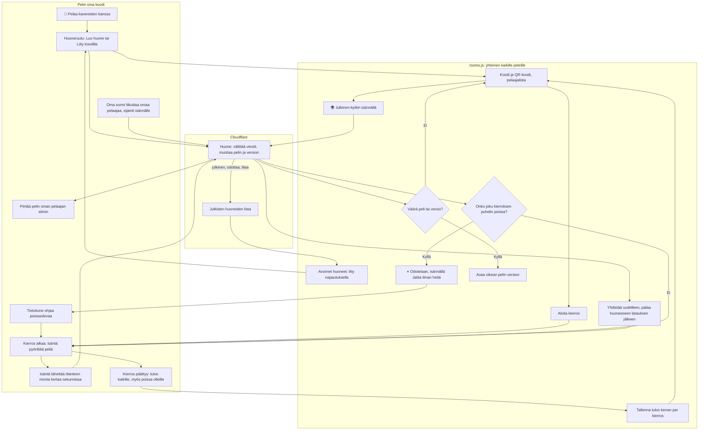

# Moninpeli: playing with friends in one room

How 2–8 phones play one game together. One phone makes a room and runs the game; every phone
moves its own player and draws the game from its own side. The room on Cloudflare only passes
messages between the phones. Everything a game needs for a room is one shared script,
`public/rooms.js` (#34): the room screen, reconnecting, the pause for a phone that dropped off, and
saving a round's result once. A game writes only its own part. Kirkkis v2 (#27), the first such
game, has its own copy of the same flow, from before the library; each box says where.

## Colours

- **teal**: the game's own code, the only part a new multiplayer game writes
- **blue**: the shared `public/rooms.js`, the same for every game
- **violet**: the room on Cloudflare (`rooms/worker.js`), which only passes messages on
- **amber**: a check that decides the path
- **rose**: a phone that dropped off

## Boxes

- **👥 Pelaa kavereiden kanssa**: the game's own menu button; it calls `AiPelitRooms.open()`. The game loads `<script src="../../../rooms.js" data-game="<slug>" data-min="2" data-max="5">` before its own script.
- **Huoneruutu: Luo huone tai Liity koodilla**: `public/rooms.js` `build()` and `render()`, in Finnish, the same in every game. A new room gets a random 4-letter code (no I, O, Q, W, X, Z); a code in use gets another. The name is the phone's one nickname (`ai-pelit:_pelaaja:nimi`, shared with the high-score lists), or an animal name kept in `ai-pelit:_huone:nimi`. Kirkkis v2: `enterRoom()`, `renderNet()`.
- **Avoimet huoneet: liity napautuksella**: `readList()` and `renderList()` on the first page of the room screen (#50): this game's public rooms from `GET /api/rooms?game=<slug>`, read on opening and every 5 seconds, as buttons "KOOD · 2/5 pelaajaa" (no names). A tap joins like a typed code, so a room of another version opens that version. Hidden until the first answer, so with no connection nothing shows.
- **🌍 Julkinen-kytkin isännällä**: the host's checkbox in the room (`net.pub`, off for a new room, kept over a reload in `ai-pelit:_huone:nyt`). `tellList()` sends the room `{t: '_list', on}`: on while public and no round runs, and again every minute while on.
- **Julkisten huoneiden lista**: one more object of the `Room` class, named `lobby` (`lobby()` in `rooms/worker.js`). Each room's `tell()` puts itself on it while the host's `_list` is on, the host is connected, a game is named and there is space, and takes itself off otherwise. Newest first, at most 10 per game; a listing not refreshed for 3 minutes is dropped. Only `GET /api/rooms?game=` reaches it from outside (`publicRooms()` in `server/api.js`).
- **Koodi ja QR-koodi, pelaajalista**: the code, a QR code of `<version>/?huone=<KOODI>` drawn in the page (`qrMatrix()`), and who is in, the host with 👑, someone without a connection greyed out. A QR link joins at once.
- **Aloita kierros**: host only, once `data-min` phones are connected. Sends `_start` with the round id and players, and fires the game's `on('start')` on every phone. Kirkkis v2: `startMulti()`.
- **Kierros alkaa: isäntä pyörittää peliä**: the game's `on('start')`. The host runs the rules and the clock, and stops the clock while `AiPelitRooms.paused`.
- **Isäntä lähettää tilanteen monta kertaa sekunnissa**: the game's `AiPelitRooms.send()`. A phone that joined after the round began hears none of it (`net.listening` in `onMessage()`), and waits for the next round. Kirkkis v2: `hostSend()`, 12 times a second.
- **Oma sormi liikuttaa omaa pelaajaa, sijainti isännälle**: a guest moves its own player at once and sends where it is (`send()`); the host hears it in `on('message', (msg, from))`. Kirkkis v2: `guestStep()`.
- **Piirtää pelin oman pelaajan silmin**: the game's drawing, from this phone's player. Kirkkis v2: `draw()` with the fog cut by that player's field of view.
- **Huone: välittää viestit, muistaa pelin ja version**: `rooms/worker.js` `Room`, in the `ai-pelit-rooms` Worker, at `/api/rooms/<KOODI>` through `server/api.js` (`ROOMS` binding). Each phone connects with a secret key and is known by a hash of it, so nobody can take another phone's place. The host's messages go to all (or `to`), the others' to the host with `from`; `peers` says who is in and connected. It keeps the host's `game`, `v` and `max` (2–8, default 5) and sends `game` and `v` in `peers`. An empty room is forgotten after 6 hours.
- **Väärä peli tai versio?**: `onPeers()` on a guest's first `peers`: the room's `game` and `v` against the page's own. A room that names no game (made by Kirkkis v2, from before the library) is left at once with "Huone on toisessa pelissä."
- **Avaa oikean pelin version**: the guest moves to `../../<game>/v<v>/?huone=<KOODI>`, which joins the room there.
- **Yhdistää uudelleen, palaa huoneeseen latauksen jälkeen**: `connect()` retries with a growing wait; the room this tab is in is kept in `sessionStorage` (`ai-pelit:_huone:nyt`). On every connection a guest says `hello`; the host sends a phone in the round `_start` again and fires `on('hello')`, so the game sends the round as it is. A host that comes back without its round (a reload) sends `_lobby`, and everyone goes back to the room. Kirkkis v2: `hostHello()`.
- **Onko joku kierroksen puhelin poissa?**: `waitingFor()`: a phone in the round with no connection, unless the computer took it; on a guest also the host, or its own connection. The host sends the names (`_pz`).
- **⏸ Odotetaan, isännällä Jatka ilman heitä**: `renderPause()`: every phone shows who is being waited for; only the host has the button (`goOn()`).
- **Tietokone ohjaa poissaolevaa**: the game's `on('continue', ids)`; `on('back', id)` when that phone returns. Someone who leaves the room for good is handed over the same way. Kirkkis v2: `toBot()`.
- **Kierros päättyy: tulos kaikille, myös poissa olleille**: the host's `deliver(msg)` sends the end to every phone in the round and to no other. Each phone confirms it (`_got`); until then the host keeps it, and sends it again on that phone's `hello`, after that round's `_start` (so a reloaded page knows the round). A page that reloads just as the round ends, seen as connected before its hello, gets it that way. Then `endRound()`. Kirkkis v2: `end()` and `net.owed`.
- **Tallenna tulos kerran per kierros**: the game saves only when `AiPelitRooms.once(round)` is true (kept per tab in `ai-pelit:_huone:kierros`), then `backToRoom(text)` shows the room with the result. Kirkkis v2: `guestFinish()`, into `ai-pelit:kirkkis:tilasto`.
