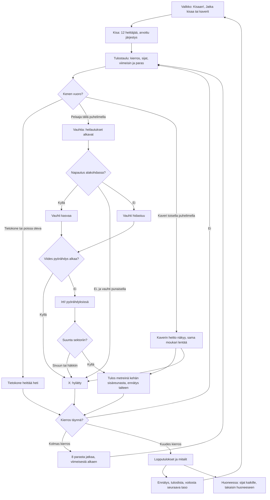

# Moukarinheitto: one throw and one meet

How Moukarinheitto plays (v1; v2 plays the same, with the meet, the results board, the saves and the
room handling from the shared athletics library, see `yleisurheilu-kirjasto.md`). A meet has twelve throwers: the player and eleven computer
throwers alone, or 2–8 phones in a room with the computer filling the rest. Everyone throws three
times in a drawn order; the best eight throw three more, the last in the standings first. The
circle, the cage and the sector are seen from above. On their turn the player starts the swings
with "Vauhtia", taps it each time the hammer passes its low point (two wind-up swings, then the
turns), and presses "Irti!" in the third or fourth turn when the hammer is on the yellow arc, so it
flies into the 34.92° sector. The computer's throws are worked out at once.

## Colours

- **blue**: what the player sees and does
- **violet**: someone else throwing: the computer, or a friend on another phone
- **amber**: a check that decides the path
- **teal**: the meet's rules and the measured throw
- **rose**: a foul, marked X
- **green**: the end of the meet and what it saves

## Boxes

- **Valikko: Kisaan!, Jatka kisaa tai kaverit**: `showMenu()` in `games/moukari/v1/index.html`. "Kisaan!" starts a new meet at the player's level (`taso`); "Jatka kisaa (kierros N/6)" shows when a meet alone was left unfinished (`kesken`, saved after each of the player's throws); "👥 Pelaa kavereiden kanssa" opens the room (`public/rooms.js`, 2–8 phones). The menu shows meets, wins and the record (`kisat`, `voitot`, `ennatys`).
- **Kisa: 12 heittäjää, arvottu järjestys**: `newComp()` (v2: `meet()` and `rounds()` in `public/lib/yleisurheilu-1/kisa.js`): the players, then computer throwers up to twelve (`FIELD`), each with a skill around `base(level)` metres (48 m at level 1, 4 m more per level up to 76 m); the order of rounds 1–3 is drawn once (`order0`).
- **Tulostaulu: kierros, sijat, viimeisin ja paras**: `drawBoard()` (v2: the library's `K.drawBoard()`), shown for 3.5 s (`BOARD_T`) before each player's turn; alone a tap skips it. The standings (`standings()`) go by the best throw, then the second best, as in a real meet; a dashed line shows the cut after eight.
- **Kenen vuoro?**: `advance()` (v2: the library's) throws for every computer thrower up to the next player on a phone; `follow()` makes the turn each phone draws (`th`), its own (`mine`) or someone else's.
- **Tietokone heittää heti**: `cpuMark()`: the skill plus a scatter of 3 m, a foul one time in seven. In a room the host's "Jatka ilman heitä" hands an away phone's throws to the computer (`R.on('continue')`) until it is back (`R.on('back')`); while a phone is away the meet waits (`R.paused`).
- **Vauhtia: heilautukset alkavat**: `press(1)` in the `ready` phase: the hammer starts round the thrower at 9 m/s (`V0`), anticlockwise seen from above. It goes round at 0.6 times its real pace (`SLOW`), so a lap takes about 1.8 s in the first swing and 0.7 s at full speed. The first two laps are the wind-up swings, the next four the turns (`SWINGS`, `TURNS`, `LAPS` in all), each later lap starting at a low point; the thrower moves across the circle during the turns (`geo()`).
- **Napautus alakohdassa?**: `press(1)` in the `spin` phase. The low point (`PHI_LOW`, behind and left) is drawn green on the hammer's path, as wide as 0.1 s (`WIN`) either side at the speed it goes, so the window is the same length in time at every speed.
- **Vauhti kasvaa**: a tap in the window adds up to 10.8 m/s (`GAIN`), less the faster the hammer goes and the later or earlier the tap; one tap per low point, the five that start the second swing and the four turns. All five perfect (four turns) reach about 29.7 m/s and throw about 85 m; four (let go in the third turn) about 28 m/s, about 78 m.
- **Vauhti hidastuu**: a tap outside the window takes 1.6 m/s (`LOSS`); a low point with no tap 0.8 m/s (`MISS`) (`step()`).
- **X: hylätty**: from 26 m/s (`RED`, the red end of the speed bar) a tap out of rhythm pulls the thrower out of the circle, "Rytmi petti: ulos ympyrästä"; not letting go before the low point that would start a fifth turn, "Ei irti ajoissa: ulos ympyrästä"; in a room a minute in the `ready` phase with no tap (`TURN_MAX`, the rules' minute for an attempt), "Aika loppui"; a throw outside the sector, "Sektorin ulkopuolelle"; a throw into the cage's net or doors, "Osui häkkiin" (`flight()`, `cageHit()`).
- **Viides pyörähdys alkaa?**: `step()`: the hammer reaching the low point at the end of the fourth turn (`TAU * LAPS`) before it is let go is the foul above, so a fifth turn never starts and nothing is let go in it.
- **Irti! pyörähdyksissä**: `release()`: only in the turns, from the first turn's low point on. The hammer leaves along its path at that moment; the thrower's pull halves the error (`HELP`), so the yellow arc where letting go lands in the sector is about 70° of the lap, round the thrower's right side (`PHI_REL`).
- **Suunta sektoriin?**: `flight()`: the landing is on the line from the circle's centre in the throw's direction; within 17.46° of the middle it is in the sector (the lines themselves are out); past the mouth of the cage (about 23.5°) it is in the net. The flight drawn from the hammer stops at the net and drops.
- **Kaverin heitto näkyy, sama moukari lentää**: the thrower's phone sends where its hammer is twelve times a second (`p`: the angle gone round, the speed) and the release (`rel`, rounded before its own phone throws it, so every phone flies the same throw); the host passes both on, and every phone flies the same hammer with `throwNow()`, landing at the same mark. A foul in the circle goes as `rel` with its reason.
- **Tulos metreinä kehän sisäreunasta, ennätys talteen**: `flight()` and `landed()`: the mark is the distance from the circle's centre less its radius (1.0675 m), down to the centimetre, as World Athletics measures it; the range comes from the speed (`range()`: out at 42° from 1.6 m with a little air drag, `hammerFly()`, `flySub()`). A new record is saved at once (`ennatys`). The thrower's phone reports it (`res`); the host records it once (`seq`) and sends the meet to everyone (`c`).
- **8 parasta jatkaa, viimeisestä alkaen**: after round 3 `advance()` keeps the best eight (`final`), each later round in reverse order of the standings. With no player on a phone left in the final the rest is thrown at once.
- **Lopputulokset ja mitalit**: `over()` and `netEnd()` (v2: the library's `over()`, `end()` and `K.step()`): the standings with 🥇🥈🥉, shown for a few seconds.
- **Ennätys, tuloslista, voitosta seuraava taso**: `netEnd()` saves `kisat`, and alone a win adds `voitot` and the next level (`taso`); the meet's best throw goes to the high-score list with `AiPelitScores.submit()` (`moukari` in `public/scores.js` and `server/api.js`, see `tuloslistat.md`).
- **Huoneessa: sijat kaikille, takaisin huoneeseen**: the host sends the results with `R.deliver()`; each phone saves its own meet once (`R.once()`), shows its place and the top eight in the room (`afterEnd()`, `R.note()`, `R.backToRoom()`).
