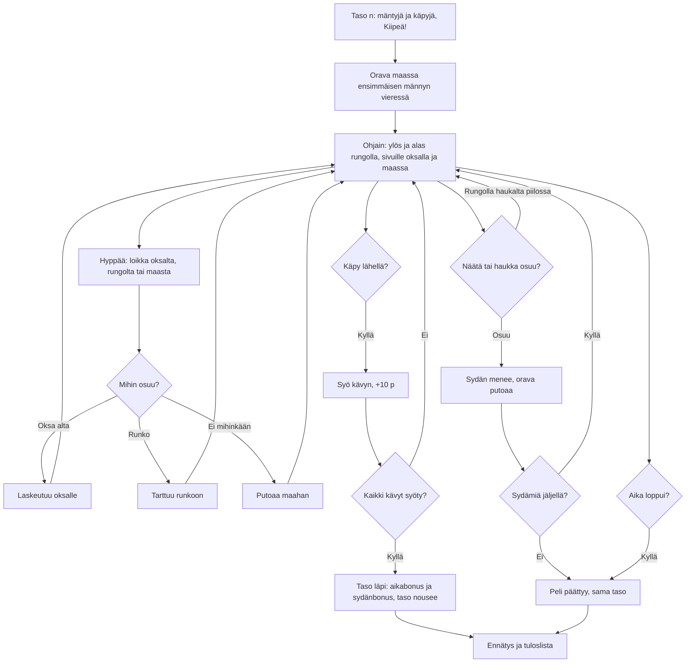

# Orava: one go at a level

How one go of Orava plays (v1). The player is a red squirrel in a row of pines: it climbs the
trunks, runs along the branches and leaps from branch to branch and tree to tree, eating every
cone in the forest before the time runs out. A pine marten climbs a trunk from level 2 and a
goshawk swoops from level 3.

## Colours

- **blue**: what the player sees and does
- **amber**: a check that decides the path
- **teal**: where a move ends up, and eating
- **rose**: a hit or a lost go
- **green**: a won level or a record

## Boxes

- **Taso n: mäntyjä ja käpyjä, Kiipeä!**: `showMenu()` in `games/orava/v1/index.html` shows the level (saved as `taso`), how many pines (`treesFor()`, 4 to 8) and cones (`conesFor()`, 8 + 2 a level) it has, and the dangers of the level. `makeForest()` grows the same forest for the same level every time: pines in a row 150–200 px apart, branches from about 110 px up on both sides, each reaching at most halfway to the next trunk, and the cones on branches and treetops, so every cone can be reached by climbing.
- **Orava maassa ensimmäisen männyn vieressä**: `setup()` puts the squirrel (`S`) on the ground left of the first pine and gives the go 40 s plus 6 s a cone and three hearts.
- **Ohjain: ylös ja alas rungolla, sivuille oksalla ja maassa**: the round stick (`readStick()`) sets `input` in eight directions. On a trunk or a branch a slanted stick does only what it leans to more (`input.vert`, with some give so a thumb near the diagonal does not flip), so the squirrel never steps on and off a branch. `move()`: on a trunk up and down climb, and a side steps onto a branch on that side within 16 px (`branchAt()`); on a branch the sides run along it, towards the trunk back onto it, ▲ near the trunk climbs, ▼ drops through, and running off the tip falls; on the ground the sides run and ▲ at a trunk climbs.
- **Hyppää: loikka oksalta, rungolta tai maasta**: the button sets a 0.15 s jump buffer (`pressJump()`); `leap()` throws the squirrel about 190 px across and 95 px up the way the stick points (straight up with no side), a little lower off a trunk. In the air the stick steers a little.
- **Mihin osuu?**: in the air `move()` lands on a branch the squirrel falls onto from above, catches any trunk it crosses (not the one it just left), or lands on the ground.
- **Käpy lähellä? / Syö kävyn, +10 p**: `eat()`: a cone within 22 px of the squirrel's middle is eaten; every cone ever eaten is counted in `kavyt`. Arrows at the screen's edge point to the three nearest cones out of sight, none on top of another.
- **Taso läpi: aikabonus ja sydänbonus, taso nousee**: `win()` adds 2 points a second left and 25 a heart; `finish()` saves the next level.
- **Näätä tai haukka osuu?**: `hazards()`. The marten (`martens`, from level 2, two from level 5) climbs one trunk up and down, faster each level, and stops now and then. The goshawk (`hawk`, from level 3) shrieks and shows a red ! over the squirrel for 1.2 s, then swoops through where the squirrel was; a squirrel on a trunk is safe from it.
- **Sydän menee, orava putoaa**: `hurt()` takes a heart, knocks the squirrel into the air and keeps it safe for 1.8 s.
- **Peli päättyy, sama taso**: three hits or the time running out (`finish(false)`); the level stays.
- **Ennätys ja tuloslista**: the most points in one go are saved as `ennatys` and sent with `AiPelitScores.submit()` (`scores.js`, `GAMES.orava`; `server/api.js` keeps the `main` list).
