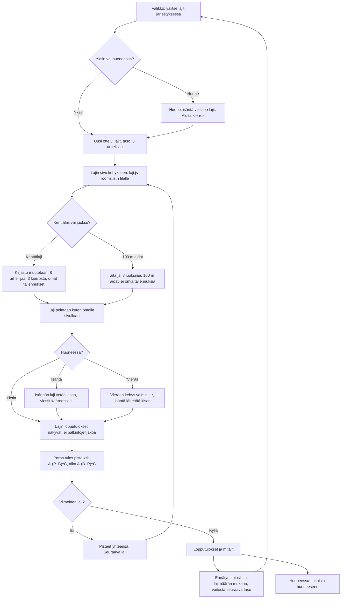

# Ottelu: several athletics events in one match

How Ottelu v1 plays (#168); v2 plays the same, but a room starts only once the host has picked at least two events, and the event in the frame gets the phone's safe areas; v3 starts each next event alone in a freshly loaded page; v4 (#287) adds the shot put and the 100 m hurdles, plays the newest version of each event and shows no medal ceremony after an event. The player, or the host of a room, picks two to five (v4: up to seven) events and
their order. Each event runs a published version of that event's own game in a frame, unchanged:
`laji.js` stands in for `rooms.js` and changes the shared athletics library as it loads, so the event
has the match's eight athletes, three rounds and saves of its own. Each athlete's best mark becomes
points by the combined-event tables, and the points add up.

## Colours

- **blue**: what the player sees and does
- **violet**: phones in a room working together
- **amber**: a check that decides the path
- **teal**: the match's own work: the field, the frame, the points
- **green**: results and saves

## Boxes

- **Valikko: valitse lajit järjestyksessä**: `drawPick()` in `games/ottelu/v1/index.html`; the pick is saved as `ai-pelit:ottelu:lajit`, and two to five events name the match (Kaksiottelu … Viisiottelu); v4 offers seven, in the decathlon's order (100 m aidat, Pituushyppy, Kuulantyöntö, Korkeushyppy, Seiväshyppy, Keihäänheitto, then Moukarinheitto), up to Seitsenottelu.
- **Huone: isäntä valitsee lajit, Aloita kierros**: `hostPick()` moves the same picker into the room screen with `AiPelitRooms.extra()` on the host. v2: `roomStart()` keeps the room's "Aloita kierros" off with the note "Valitse ainakin kaksi lajia." while fewer than two events are picked, and a start that gets through anyway starts nothing (v1 quietly played all five).
- **Uusi ottelu: lajit, taso, 8 urheilijaa**: `newMatch()`; M is plain data, saved as `ai-pelit:ottelu:kesken` alone and sent as `{t: 'M'}` in a room.
- **Lajin sivu kehykseen: laji.js rooms.js:n tilalle**: `lajiHtml()` and `loadEvent()` fetch the event's published page (`LAJIT`: Pituushyppy v4, Korkeushyppy v2, Seiväshyppy v2, Keihäänheitto v4, Moukarinheitto v2; v4: Aitajuoksu v7, Pituushyppy v7, Kuulantyöntö v1, Korkeushyppy v4, Seiväshyppy v4, Keihäänheitto v6, Moukarinheitto v4), add a `<base>`, hide its menu, (v2) give it this page's safe areas (`safeCss()`: a frame's own `env(safe-area-inset-*)` is 0, so on a phone with a notch the event's panel went under the chips and its buttons into the gesture bar), swap `rooms.js` for `laji.js` and drop `scores.js` and `back.js`.
- **Kirjasto muutetaan: 8 urheilijaa, 3 kierrosta, omat tallennukset**: `patch()`: `rounds()` gets three rounds, `meet()` gets the match's field and names and the slug `ottelu:<event>`, so the event saves under `ai-pelit:ottelu:<event>:…`; `K.step` scores the event as soon as its results appear (`eventScored()`, saved at once, since the library drops the event's own save then) and moves the match on once they have been shown (`eventOver()`). v4 (#287; Eero's choice in #283: no ceremony per event): `K.drawPodium` draws the event's final results board instead of the podium, without the medal chimes, and the results leave by themselves after 6 s alone (4 s in a room) or, alone, at one tap. `prefetch()` fetches every event's page and scripts once online, so the service worker keeps them for offline play.
- **Kenttälaji vai juoksu?**: v4: `LAJIT[…].adapter`. Aitajuoksu has no athletics library to change, so `lajiHtml()` adds `games/ottelu/v4/aita.js` after the race's own script.
- **aita.js: 8 juoksijaa, 100 m aidat, ei omia tallennuksia**: a classic script in the race's frame that replaces the race's functions by name: `soloRace()` and the room's `start` run 100 m with ten hurdles with the match's eight athletes (`Ottelu.field()`: the same ids, names and colours as the field events), the computer's runners by the match's level; `finish()` hands the results to the match (`Ottelu.scored()`) and saves nothing under `ai-pelit:aitajuoksu:`; `afterResults()` moves the match on (`Ottelu.over()`); `drawResults()` fits all eight rows above the pads. Alone, a red card puts the player out of this race only (no time, 0 points); the race goes on.
- **Isännän laji vetää kisaa, viestit kääreessä L**: `newProxy()` is the event's `AiPelitRooms`; the event's messages go as `{t: 'L', at, m}`, so one from an event already over never reaches the next.
- **Vieraan kehys valmis: Lr, isäntä lähettää kisan**: a guest's frame sends `{t: 'Lr'}` once loaded; the host's event hears it as `hello` and sends that phone the meet.
- **Pisteet yhteensä, Seuraava laji**: `showBoard()`; "Seuraava" on the host or alone. v3: alone it saves the match, marks the next event in sessionStorage (`ai-pelit:ottelu:seuraava`) and reloads the page (marked `ai-pelit:_jatkuu`, so `back.js` does not count it as a new play), which starts that event at once; a tap inside the event asks for full screen again in a browser tab (`laji.js`), as the reload leaves it: on Eero's phone a second frame swapped into the same page took no taps. In a room the event still changes in place.
- **Paras tulos pisteiksi: A·(P−B)^C**: `LAJIT[…].pts`, World Athletics combined-event tables (the decathlon's jumps, shot put and javelin; the hammer by the throws pentathlon; v4's 100 m hurdles by the heptathlon's, A·(B−P)^C in seconds), rounded down; no mark is 0 points.
- **Ennätys, tuloslista lajimäärän mukaan, voitosta seuraava taso**: `ended()`; the high-score list is `lajit-<number of events>` (v4: up to `lajit-7`, allowed in `server/api.js` and named in `public/scores.js`).
