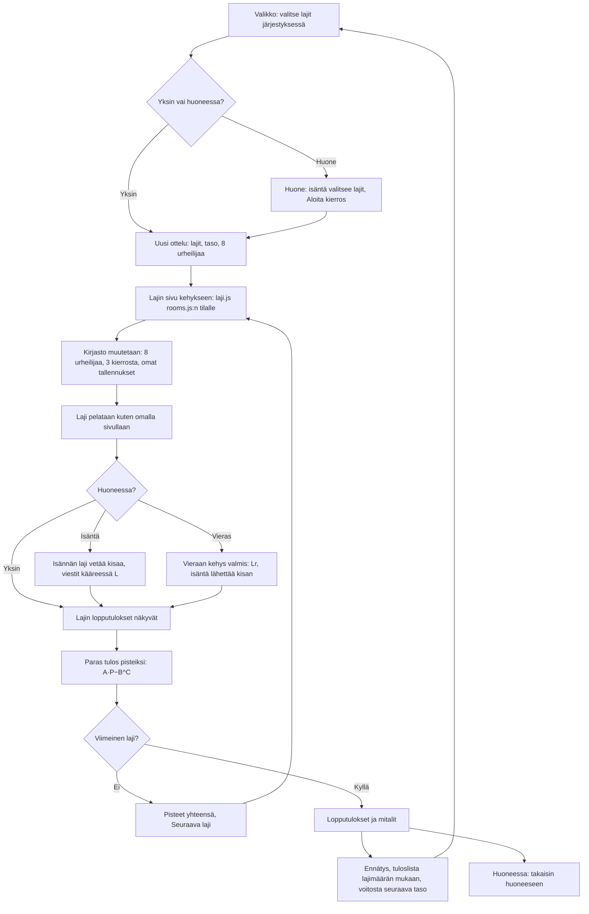

# Ottelu: several athletics events in one match

How Ottelu v1 plays (#168). The player, or the host of a room, picks two to five field events and
their order. Each event runs a published version of that event's own game in a frame, unchanged:
`laji.js` stands in for `rooms.js` and changes the shared athletics library as it loads, so the event
has the match's eight athletes, three rounds and saves of its own. Each athlete's best mark becomes
points by the combined-event tables, and the points add up.

## Colours

- **blue**: what the player sees and does
- **violet**: phones in a room working together
- **amber**: a check that decides the path
- **teal**: the match's own work: the field, the frame, the points
- **green**: results and saves

## Boxes

- **Valikko: valitse lajit järjestyksessä**: `drawPick()` in `games/ottelu/v1/index.html`; the pick is saved as `ai-pelit:ottelu:lajit`, and two to five events name the match (Kaksiottelu … Viisiottelu).
- **Huone: isäntä valitsee lajit, Aloita kierros**: `hostPick()` moves the same picker into the room screen with `AiPelitRooms.extra()` on the host.
- **Uusi ottelu: lajit, taso, 8 urheilijaa**: `newMatch()`; M is plain data, saved as `ai-pelit:ottelu:kesken` alone and sent as `{t: 'M'}` in a room.
- **Lajin sivu kehykseen: laji.js rooms.js:n tilalle**: `lajiHtml()` and `loadEvent()` fetch the event's published page (`LAJIT`: Pituushyppy v4, Korkeushyppy v2, Seiväshyppy v2, Keihäänheitto v4, Moukarinheitto v2), add a `<base>`, hide its menu, swap `rooms.js` for `laji.js` and drop `scores.js` and `back.js`.
- **Kirjasto muutetaan: 8 urheilijaa, 3 kierrosta, omat tallennukset**: `patch()`: `rounds()` gets three rounds, `meet()` gets the match's field and names and the slug `ottelu:<event>`, so the event saves under `ai-pelit:ottelu:<event>:…`; `K.step` scores the event as soon as its results appear (`eventScored()`, saved at once, since the library drops the event's own save then) and moves the match on once they have been shown (`eventOver()`). `prefetch()` fetches every event's page and scripts once online, so the service worker keeps them for offline play.
- **Isännän laji vetää kisaa, viestit kääreessä L**: `newProxy()` is the event's `AiPelitRooms`; the event's messages go as `{t: 'L', at, m}`, so one from an event already over never reaches the next.
- **Vieraan kehys valmis: Lr, isäntä lähettää kisan**: a guest's frame sends `{t: 'Lr'}` once loaded; the host's event hears it as `hello` and sends that phone the meet.
- **Paras tulos pisteiksi: A·P−B^C**: `LAJIT[…].pts`, World Athletics combined-event tables (the decathlon's jumps and javelin; the hammer by the throws pentathlon), rounded down; no mark is 0 points.
- **Ennätys, tuloslista lajimäärän mukaan, voitosta seuraava taso**: `ended()`; the high-score list is `lajit-<number of events>`.
