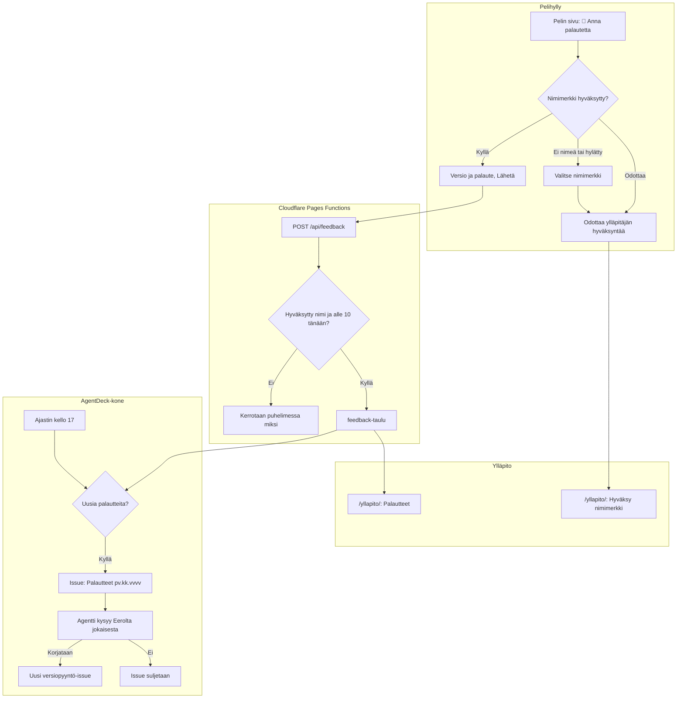

# Palaute: players' feedback, and the agent asking Eero what to fix

How a player's feedback on a game gets to Eero (#184). A player whose nickname the admin approved
writes it on the game's page in the shelf; only the admin sees it. Once a day the AgentDeck host
files the new ones as one "Palautteet" issue, whose agent asks Eero about each, and a yes becomes
a normal version request.

## Colours

- **blue**: what the player sees and taps
- **amber**: a check that decides the path
- **teal**: where feedback is sent and kept
- **violet**: Eero's part
- **green**: the host's daily check and the issues it makes

## Boxes

- **Pelin sivu: 💬 Anna palautetta**: `feedbackSection()` in `public/app.js`, between the scores and the versions on every game's page; one button that opens the box, so the page is no longer than before. Styles in `public/app.css` (`.feedback`).
- **Nimimerkki hyväksytty?**: `AiPelitScores.me()` in `public/scores.js` sends a waiting name first, then asks `GET /api/players/<id>` for the admin's word. The nickname is the phone's one name, the same as on the high-score lists (`tuloslistat.md`).
- **Valitse nimimerkki**: `AiPelitScores.setName()`: saves the name as the list's own name field does and sends it; a rejected or taken name is asked again.
- **Versio ja palaute, Lähetä**: the newest version first in the picker; up to 1000 characters. Offline or refused, the text stays in the box to send again; if the name was rejected meanwhile, it is kept for the tab (sessionStorage `ai-pelit:_palaute:<slug>`) and back in the box once a new name is approved.
- **POST /api/feedback**: `addFeedback()` in `server/api.js`: only a real game and version from `catalog.json`, and only a player whose current name is `approved` (403 otherwise; a changed name waits again).
- **Hyväksytty nimi ja alle 10 tänään?**: `FEEDBACK_PER_DAY` per player in 24 hours (429), counted in the same statement as the insert so posts at once cannot pass it, `FEEDBACK_MAX` characters (`cleanText()` keeps line breaks).
- **feedback-taulu**: `migrations/0006_feedback.sql`: the name as it was when written, the game and version, the text, and `issue`, the "Palautteet" issue it was filed in (NULL until then). No route shows it to players.
- **/yllapito/: Palautteet**: `showFeedback()` in `public/yllapito/index.html`, under the nicknames: newest first, each with its game, version, writer, time and its issue (or "uusi"), from `GET /api/admin/feedback`.
- **Ajastin kello 17**: `scripts/systemd/ai-pelit-palautteet.timer` on the AgentDeck host runs `scripts/feedback_issue.py` as it is on `origin/main`, with the admin key from `~/.local/share/ai-pelit/admin-key`.
- **Issue: Palautteet pv.kk.vvvv**: `gh issue create` with the `claude` label, through AgentDeck's gh shim so its GitHub App files it, so AgentDeck starts a Work. The repository is public and the feedback private: the issue lists only each item's number and game, never a nickname or a player's words (`issue_body()`). The script then marks the items with the issue's number (`POST /api/admin/feedback`), so each is filed once. A run that filed the issue but stopped before marking finds it next time by its `feedback-ids` marker (`filed_earlier()`), trusting only issues the App filed, so a marker anyone else writes cannot hide new feedback.
- **Agentti kysyy Eerolta jokaisesta**: the Work's agent follows AGENTS.md, "Palautteet": it reads the items on the host with `feedback_issue.py --show <issue>` (`GET /api/admin/feedback?issue=`), looks at each game, asks Eero in the question box, and closes the issue when all are answered.
- **Uusi versiopyyntö-issue**: a yes becomes a normal "<Peli> v<N> (<slug>): …" issue in the agent's own words (no nickname, no quote), which starts its own Work.
