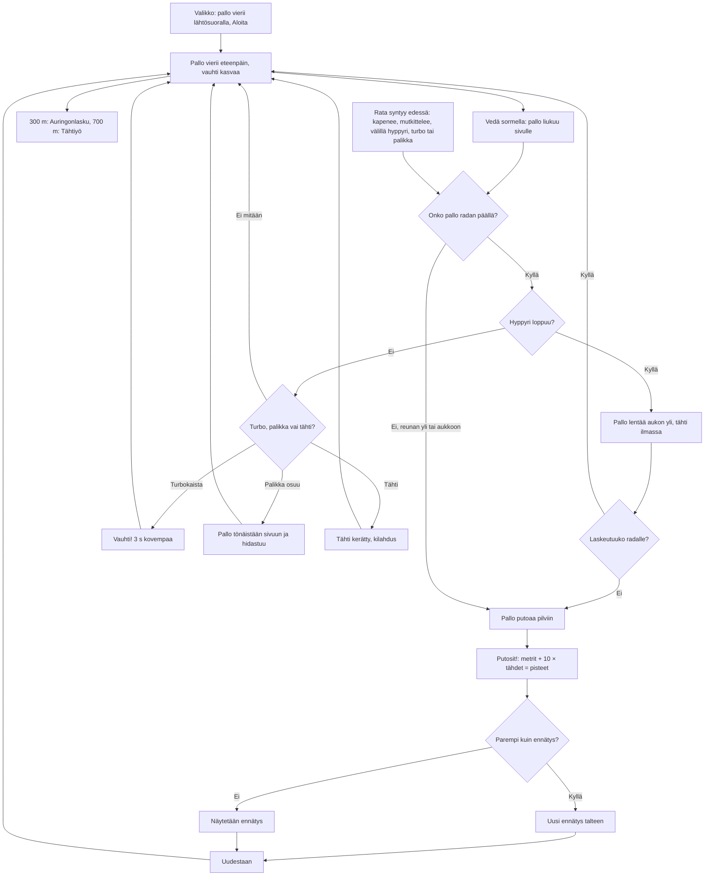

# Pallorata: one round of the ball run

How one round of Pallorata plays (v1, #102). A striped ball rolls along a narrow track of
tiles high above the clouds, drawn in 3D with the shared three.js. The player drags a finger
left and right to keep it on the track and roll it over stars; orange ramps throw it over gaps
in the track, cyan turbo strips speed it up, and purple blocks sliding across the track bump it
aside. The sky turns from day to sunset to a starry night the further it gets. The round ends when the ball rolls off the edge or into a gap and falls.

## Colours

- **blue**: what the player sees and does
- **amber**: a check that decides the path
- **green**: a star or a record won
- **rose**: the fall that ends the round
- **teal**: how the track is made, and the jump

## Boxes

- **Valikko: pallo vierii lähtösuoralla, Aloita**: `games/pallorata/v1/index.html`; the animation loop rolls the ball slowly on the start straight behind the menu (`#menu`), which shows the record (`ai-pelit:pallorata:ennatys`). "Aloita" calls `start()`, which also unlocks the sounds.
- **Pallo vierii eteenpäin, vauhti kasvaa**: `step()`: the speed starts at 6 and grows 0.12 per second up to 15 track units a second; the ball turns about the axis across its path, so the stripes roll. The camera follows behind and above the ball (`draw()`), and the sun light and its shadow box move with it.
- **Vedä sormella: pallo liukuu sivulle**: the canvas's pointer events call `steer()`: a drag across the screen moves the ball's aim (`ball.aimX`) about six units sideways, and the ball eases towards it.
- **Onko pallo radan päällä?**: `bounce()`: the ball's middle must be over the row it is on (`row(i)`, its middle `cx` and width `w`), and that row must not be a gap. Off it, the ball starts to drop; once it is 0.3 below the track top, the round is lost.
- **Hyppyri loppuu?**: a ramp row (`kind: 'ramp'`, orange with white arrows) lifts the ball from 0 to `H` (0.7) along its length; when the ball rolls past its end, `bounce()` throws it up at its speed's share of the slope plus 3.
- **Pallo lentää aukon yli, tähti ilmassa**: in the air the ball falls under `G` and can still be steered. Each gap row holds a star 1.5 up, which only a jump can reach.
- **Laskeutuuko radalle?**: `bounce()` lands the ball when it comes down onto a solid row; the six rows after a gap are straight and at least 2.6 wide, so a jump at any speed lands on them.
- **Rata syntyy edessä: kapenee, mutkittelee, välillä hyppyri ja aukko**: `makeRow()`: the first ten rows are a wide straight start; after that each row may turn the drift sideways, and rows get narrower from 3 to 1.5 units over 400 rows, with a narrower row now and then. About one row in four gets a star, and after row 120 some rows get a sliding block instead. Two turbo rows come at least 40 rows apart. At least 18 rows apart, a ramp may start a planned run (`plan`): ramp, one gap (two after row 150), then six landing rows. `placeRows()` reuses one pool of tile meshes for the rows just behind and 45 ahead of the ball.
- **Turbo, palikka vai tähti?**: `step()` checks every star and block close to the ball; a collected star is hidden and counted in the top-right chip.
- **Vauhti! 3 s kovempaa**: rolling on a turbo row (`kind: 'boost'`, cyan with yellow arrows) sets `ball.boost` to 3 s; `ball.rush` eases up to +8 speed and back down after. The view widens with it (`draw()`), and a "Vauhti!" chip shows. No ramp comes within 35 rows after a turbo, so a faster jump cannot overshoot its landing.
- **Pallo tönäistään sivuun ja hidastuu**: a purple block (from row 120, on rows at least 1.8 wide) slides from edge to edge of its row; touching it moves the ball's aim 1.4 away from it and sets `ball.rush` to −4, so it slows for a moment. The push can drop it off a narrow track.
- **300 m: Auringonlasku, 700 m: Tähtiyö**: `ZONES` and `paintSky()` blend the sky, fog and light over 60 m into each new zone and show its name (`toast()`); at night white sky stars (`skyDots`) appear and the stars glow brighter.
- **Pallo putoaa pilviin**: off the track the ball keeps rolling forward and falls under gravity; after 1.3 s `over()` ends the round.
- **Putosit!: metrit + 10 × tähdet = pisteet**: `over()` shows the distance, the stars and the points, and counts the round in `ai-pelit:pallorata:pelit`.
- **Uusi ennätys talteen**: a better score is saved in `ai-pelit:pallorata:ennatys` on the phone.
