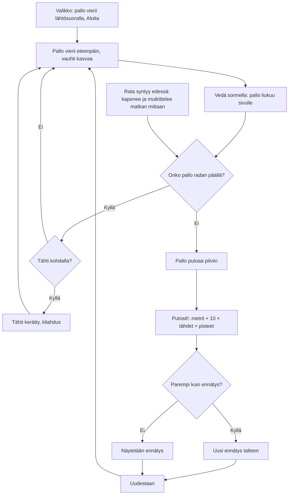

# Pallorata: one round of the ball run

How one round of Pallorata plays (v1, #102). A striped ball rolls along a narrow track of
tiles high above the clouds, drawn in 3D with the shared three.js. The player drags a finger
left and right to keep it on the track and roll it over stars; the round ends when the ball
rolls off the edge and falls.

## Colours

- **blue**: what the player sees and does
- **amber**: a check that decides the path
- **green**: a star or a record won
- **rose**: the fall that ends the round
- **teal**: how the track is made

## Boxes

- **Valikko: pallo vierii lähtösuoralla, Aloita**: `games/pallorata/v1/index.html`; the animation loop rolls the ball slowly on the start straight behind the menu (`#menu`), which shows the record (`ai-pelit:pallorata:ennatys`). "Aloita" calls `start()`, which also unlocks the sounds.
- **Pallo vierii eteenpäin, vauhti kasvaa**: `step()`: the speed starts at 6 and grows 0.12 per second up to 15 track units a second; the ball turns about the axis across its path, so the stripes roll. The camera follows behind and above the ball (`draw()`), and the sun light and its shadow box move with it.
- **Vedä sormella: pallo liukuu sivulle**: the canvas's pointer events call `steer()`: a drag across the screen moves the ball's aim (`ball.aimX`) about six units sideways, and the ball eases towards it.
- **Onko pallo radan päällä?**: `onTrack()`: the ball's middle must be over the row it is on (`row(i)`, its middle `cx` and width `w`).
- **Rata syntyy edessä: kapenee ja mutkittelee matkan mittaan**: `makeRow()`: the first ten rows are a wide straight start; after that each row may turn the drift sideways, and rows get narrower from 3 to 1.5 units over 400 rows, with a narrower row now and then. About one row in four gets a star. `placeRows()` reuses one pool of tile meshes for the rows just behind and 45 ahead of the ball.
- **Tähti kohdalla?**: `step()` checks every star close to the ball's position; a collected star is hidden and counted in the top-right chip.
- **Pallo putoaa pilviin**: off the track the ball keeps rolling forward and falls under gravity; after 1.3 s `over()` ends the round.
- **Putosit!: metrit + 10 × tähdet = pisteet**: `over()` shows the distance, the stars and the points, and counts the round in `ai-pelit:pallorata:pelit`.
- **Uusi ennätys talteen**: a better score is saved in `ai-pelit:pallorata:ennatys` on the phone.
