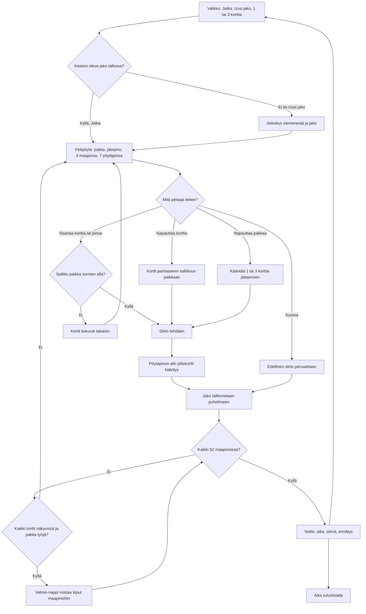

# Pasianssi: one deal from shuffle to win

How Pasianssi (Klondike solitaire, planned v1) plays. A deal is shuffled from a seed, the player
moves cards by tapping (the card goes to the best legal place) or dragging, and the deal is
saved after every move so a reload or a turned phone carries on. A won deal saves the time and
the moves and sends the time to the high-score list.

## Colours

- **blue**: what the player sees and does
- **amber**: a check that decides the path
- **teal**: what the game does by itself: the shuffle, turning a card, the save, the undo
- **violet**: the game finishing the deal for the player
- **green**: a won deal, the record and the list

## Boxes

- **Valikko: Jatka, Uusi jako, 1 tai 3 korttia**: the menu in `games/pasianssi/v1/index.html`. "Jatka" shows only when an unfinished deal is saved; "1 kortti / 3 korttia" is saved as `ai-pelit:pasianssi:veto`. Shows wins, deals played and the best times.
- **Sekoitus siemenestä ja jako**: `deal(seed, draw)` shuffles 52 cards with a seeded random (so a test can deal a known game) and lays out 1 to 7 cards in the seven tableau piles, the top one face up; the rest is the stock.
- **Pelipöytä: pakka, jätepino, 4 maapinoa, 7 pöytäpinoa**: `layout()` sizes the cards from the canvas's own box each frame: upright the stock, waste and four foundations on top and the seven piles under them; sideways stock and waste on the left, foundations on the right, piles in the middle.
- **Kortti parhaaseen sallittuun paikkaan**: `bestMove(card)` tries a foundation first, then a tableau pile that starts a longer run, then an empty pile (a king only); no legal place shakes the card.
- **Sallittu paikka sormen alla?**: `drop()` checks the pile under the dragged card's middle: a tableau pile takes one rank lower in the other colour, a foundation the next of the same suit.
- **Edellinen siirto peruutetaan**: `undo()` pops the move list; there is no limit.
- **Jako tallennetaan puhelimeen**: `save()` writes the whole deal, its moves and the clock as `ai-pelit:pasianssi:jako1` after every move.
- **Valmis-nappi nostaa loput maapinoihin**: when the stock and waste are empty and every card is face up, "Valmis" moves the cards up one by one.
- **Voitto: aika, siirrot, ennätys**: `win()` adds to `voitot` and `parhaat` (best time per draw mode) and shows the end screen with "Uusi jako".
- **Aika tuloslistalle**: `AiPelitScores.submit(seconds)` to the `veto1` or `veto3` list, `order: 'low'` (`public/scores.js` and `server/api.js`, `GAMES.pasianssi`).
