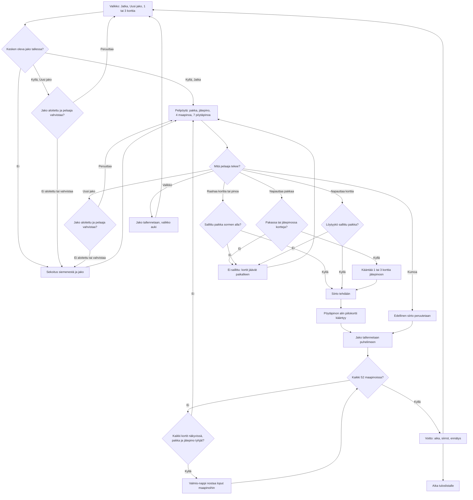

# Pasianssi: one deal from shuffle to win

How Pasianssi (Klondike solitaire v2) plays. A deal is shuffled from a seed, the player
moves cards by tapping (the card goes to the best legal place) or dragging, and the deal is
saved after every move so a reload or a turned phone carries on. A won deal saves the time and
the moves and sends the time to the high-score list.

## Colours

- **blue**: what the player sees and does
- **amber**: a check that decides the path
- **teal**: what the game does by itself: the shuffle, turning a card, the save, the undo
- **violet**: the game finishing the deal for the player
- **green**: a won deal, the record and the list

## Boxes

- **Valikko: Jatka, Uusi jako, 1 tai 3 korttia**: the menu in `games/pasianssi/v2/index.html`. "Jatka" shows only when an unfinished deal is saved; "1 kortti / 3 korttia" is saved as `ai-pelit:pasianssi:veto`. Shows wins, deals played and the best times. `menuBoard()` points the 🏆 chip at the list of the chosen draw mode from page load on.
- **Sekoitus siemenestä ja jako**: `deal(seed, draw)` shuffles 52 cards with a seeded random (so a test can deal a known game) and lays out 1 to 7 cards in the seven tableau piles, the top one face up; the rest is the stock.
- **Pelipöytä: pakka, jätepino, 4 maapinoa, 7 pöytäpinoa**: The table is drawn only when something changes (`ask()`: a move, a drag, the shake, a resize, coming back to the page), and the clock is page text a half-second timer updates. A `ResizeObserver` runs `fitCheck()`, which compares the canvas's own box with `W` and `H` and calls `fit()` when they differ, and `layout()` then sizes the cards: upright the stock, waste and four foundations on top and the seven piles under them; sideways stock and waste on the left, foundations on the right, piles in the middle.
- **Jako aloitettu ja pelaaja vahvistaa?**: `askNew()`, behind "Uusi jako" in the menu and on the play screen: a deal with a move made, also one read back from the save after a reload, is replaced only after "Aloitetaanko uusi jako?"; cancelling keeps it and its save, and stays where the player was: on the menu or at the table.
- **Pakassa tai jätepinossa kortteja?**: `drawStock()` turns cards, or turns an empty stock's waste back over; with both empty it refuses, and no move is made.
- **Jako tallennetaan, valikko auki**: "Valikko" calls `saveDeal()` and `showMenu()`, which also sets the score list back to the menu's draw mode.
- **Löytyykö sallittu paikka?**: `bestMove(card)` tries a foundation first, then the first tableau pile with cards that fits, then an empty pile (a king only).
- **Ei sallittu: kortit jäävät paikalleen**: `invalid()` shows the short notice, plays the error sound and shakes the pile's top card; a dragged card drops back where it was with no slide. No move is added or saved.
- **Sallittu paikka sormen alla?**: `targetAt()` finds the pile under the dragged card's middle and `move()` checks it: a tableau pile takes one rank lower in the other colour, a foundation the next of the same suit.
- **Edellinen siirto peruutetaan**: `undo()` pops the move list; there is no limit, and with no moves the button is disabled.
- **Jako tallennetaan puhelimeen**: `saveDeal()` writes the whole deal, its moves and the clock as `ai-pelit:pasianssi:jako1` after every move, and asks for a redraw; every five seconds of play the clock's `writeDeal()` saves the same without one.
- **Valmis-nappi nostaa loput maapinoihin**: when the stock and waste are empty and every card is face up, "Valmis" (`finishAll()`) moves them all up at once.
- **Voitto: aika, siirrot, ennätys**: `win()` adds to `voitot` and `parhaat` (best time per draw mode) and shows the end screen with "Uusi jako".
- **Aika tuloslistalle**: `AiPelitScores.submit(seconds)` to the `veto1` or `veto3` list, `order: 'low'` (`public/scores.js` and `server/api.js`, `GAMES.pasianssi`). This game keeps its own score entry; the shared registry’s new `minigolf` entry (#340, lowest stroke total on `main`) does not change it. Kiekkoammunta v1 adds independent `trap` and `skeet` score entries (Trap first, N/25); this box’s existing behavior is unchanged. Frisbeegolf v1 adds its own `main` entry to these registries: lowest strokes against par wins, displayed as `E`, `−2` or `+5`; this box keeps its existing behavior. Frisbeegolf now uses its separate `v3` leaderboard; versions 1–2 are not accepted there (#338).
