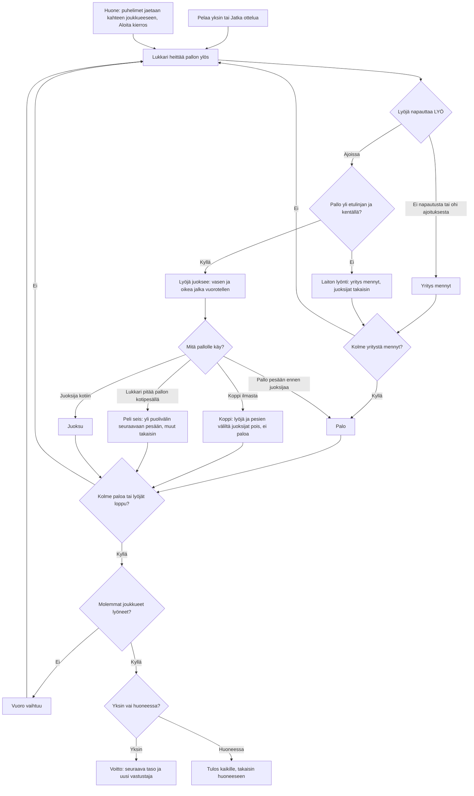

# Pesis: one match of Finnish baseball

How a match of Pesis plays (v1, #504). Two teams of nine on a field seen from above. The batter
times a tap to the lukkari's (the pitcher's) toss, then runs from base to base by tapping the two
feet in turn; the fielders pick the ball up and race it to a base or back to the lukkari. Each team
bats once (one short period); three palot (outs) change sides, and the team with more runs wins.
Alone the phone plays its whole team against a computer team; in a room the phones are split into
the two teams and the computer fills every place left.

## Colours

- **blue**: what the player sees and does
- **amber**: a check that decides the path
- **teal**: a run made, or the play stopped
- **rose**: a try spent or a player out
- **violet**: the match in a room with friends
- **green**: a change of sides, a win and a new level

## Boxes

- **Pelaa yksin tai Jatka ottelua**: the menu of `games/pesis/v1/index.html`. Alone the phone's team (blue, team 0) bats first against the level's foe (`FOES`, level `stats.taso` from `ai-pelit:pesis:stats`); the phone's own team plays at level 4 (`ROOM_LEVEL`). A match alone is saved as `ai-pelit:pesis:ottelu` before each pitch (`keep()`, only when it changed), and "Jatka ottelua" goes on from it (`restore()`); a finished match clears it.
- **Huone: puhelimet jaetaan kahteen joukkueeseen, Aloita kierros**: `rooms.js` with `data-min="2" data-max="8"`. The host's `setupFor()` deals the phones to the teams in turn (blue, red, blue...); a phone bats the batting-order places `i % m` equal to its own index among its team's m phones, and fields the fixed place `FIX[index]` (never the lukkari, who is always the computer). Every other place on both teams is a computer player of level 4. Team 0 bats first. The host runs the only real match (`games/pesis/v1/engine.js`) and sends it as `s` messages; a guest sends its tap (`bat` with the pitch number and the moment) and its foot presses. A guest draws everyone and the ball through `lib/sulava-1/sulava.js` (`applySnapshot()`, `drawnSpots()`), snapping the tracks when a new batter steps up (`ready`).
- **Lukkari heittää pallon ylös**: `toss()` gives the toss a new pitch number (`tossN`) and a height. On the host, a pause (`R.paused`) or the batting phone coming back (`on('hello')`) calls `retoss()`: a toss cut short is thrown again with a new number, and no try is spent. A tap with an old pitch number is dropped.
- **Lyöjä napauttaa LYÖ**: the LYÖ button. A tap within `HIT_WIN` (0.2 s) of the best moment, as the ball falls back to hand height, hits; early goes left, late right, and the nearer the best moment, the harder (`hit()`). Most hits are grounders; about a third fly. A friend's tap is waited for up to `LATE_OK` (0.5 s) after the toss ends. The computer batter taps near the best moment with an error that shrinks with its level.
- **Pallo yli etulinjan ja kentällä?**: a ball whose first landing is outside the side lines or short of the front line (`FRONT`, 4 m) is foul (`foul()`): the runners go back to where they stood before the hit (`saved`).
- **Lyöjä juoksee: vasen ja oikea jalka vuorotellen**: the two foot buttons; each press on the other foot than the last adds speed, the same foot twice loses some (`step()`). A runner on a base starts only on its own press; the computer's runners on the bases wait until a fly has landed, then run when the ball looks slower to the next base than they are (`cpuRuns()`). A fielder steered by a phone runs with the same feet: alone it is the fielder nearest the ball, in a room the phone's fixed place. A phone fielder holding the ball throws it to the lukkari by itself after 4 s.
- **Koppi ilmasta**: a fly caught before it lands, past the front line (`pickUp()`): the batter and every runner between bases are taken off the field, with no palo.
- **Pallo pesään ennen juoksijaa**: a fielder with the ball within `BASE_R` of the base a runner is heading to (`checkBases()`) makes that runner palo (`burn()`).
- **Lukkari pitää pallon kotipesällä**: `stopPlay()`: a runner past halfway to the next base makes it, one short of it goes back, and the batter not yet on 1st base is palo. The same stop ends a play that lasted `PLAY_MAX` (25 s).
- **Juoksu**: a runner who reaches home after 3rd base scores a run, and stands with the others who scored; a player who scored does not bat again.
- **Kolme paloa tai lyöjät loppu?**: three palot (`OUTS`), or no batter left in the order who is neither out nor home, ends the team's turn at bat (`endInning()`).
- **Voitto: seuraava taso ja uusi vastustaja**: alone, a win raises `stats.taso` (the next match meets the next foe, a stronger team) and counts in `voitot`; a loss in `haviot`, a tie in `tasapelit`. The phone's own runs are counted in `juoksut`.
- **Tulos kaikille, takaisin huoneeseen**: the host sends the end with `deliver()` and calls `endRound()`; every phone in the round counts its team's win, loss or tie once (`R.once()`) under `stats.kaverit`, and shows the score with `backToRoom()`.
