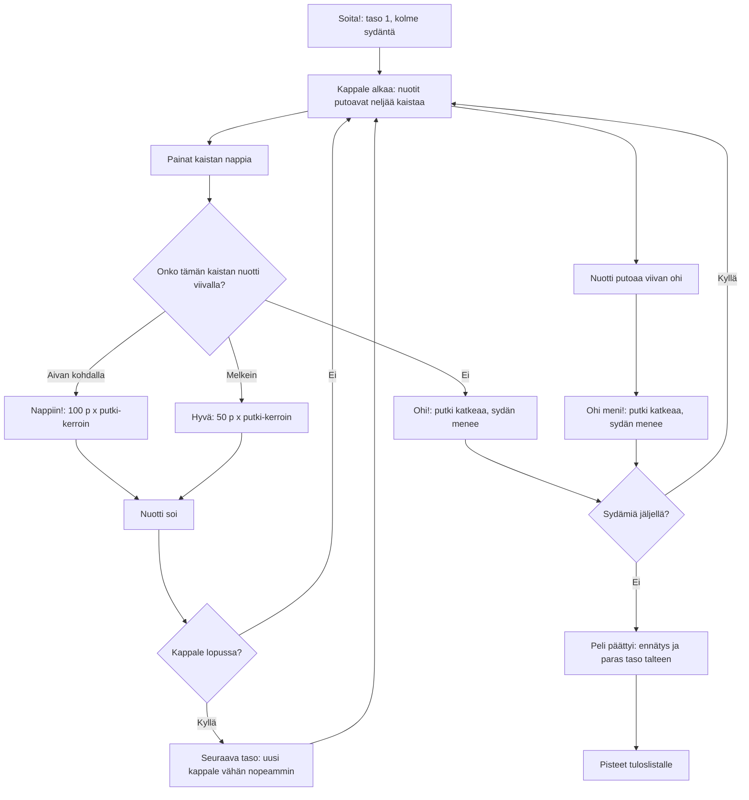

# Piano: one game, from the first note to the last heart

How a game of Piano plays (v1). Notes of a familiar tune fall down four lanes, and the
player presses the lane's key at the bottom when a note reaches the line, which plays that
note. Each finished song is a level; the next song is a little faster. A missed note or a
press with no note near the line costs one of three hearts.

## Colours

- **blue**: what the player sees and does
- **amber**: a check that decides the path
- **teal**: a hit: points and the note's sound
- **green**: on to a faster song
- **rose**: a miss that costs a heart
- **violet**: the end of the game and what is saved

## Boxes

- **Kappale alkaa: nuotit putoavat neljää kaistaa**: `startLevel()` → `levelNotes()` in `games/piano/v1/index.html`. Four songs in `SONGS` (Tuiki tuiki tähtönen, Ukko Nooa, Jaakko kulta, Oodi ilolle), then round again. `nextLane()` puts each note one lane right for a step up in the tune, one left for a step down, two for a leap, and the same lane for a repeated note.
- **Painat kaistan nappia**: the `pointerdown` handler: anywhere in a lane below the top bar counts as that lane's key, so several fingers can play at once.
- **Onko tämän kaistan nuotti viivalla?**: `tap()` takes the nearest unplayed note of that lane within `GOOD` (0.16 s); within `PERFECT` (0.07 s) is "Nappiin!".
- **Nappiin!: 100 p x putki-kerroin**: `mult()`: every 10 hits in a row add one to the multiplier, up to x4.
- **Nuotti soi**: `piano()`: a triangle wave with a quiet octave above it and a long fade, at the note's pitch.
- **Nuotti putoaa viivan ohi**: `update()` marks a note missed once it is more than `GOOD` past the line.
- **Seuraava taso: uusi kappale vähän nopeammin**: `speedOf()`: each level plays 10 % faster, and `lead()` makes the notes fall a little faster too. The highest level reached is saved as `ai-pelit:piano:taso`.
- **Peli päättyi: ennätys ja paras taso talteen**: `gameOver()` saves the best score as `ai-pelit:piano:ennatys`.
- **Pisteet tuloslistalle**: `AiPelitScores.submit(score)`; the list is set up as `piano` in `GAMES` in `public/scores.js` and `server/api.js`.
