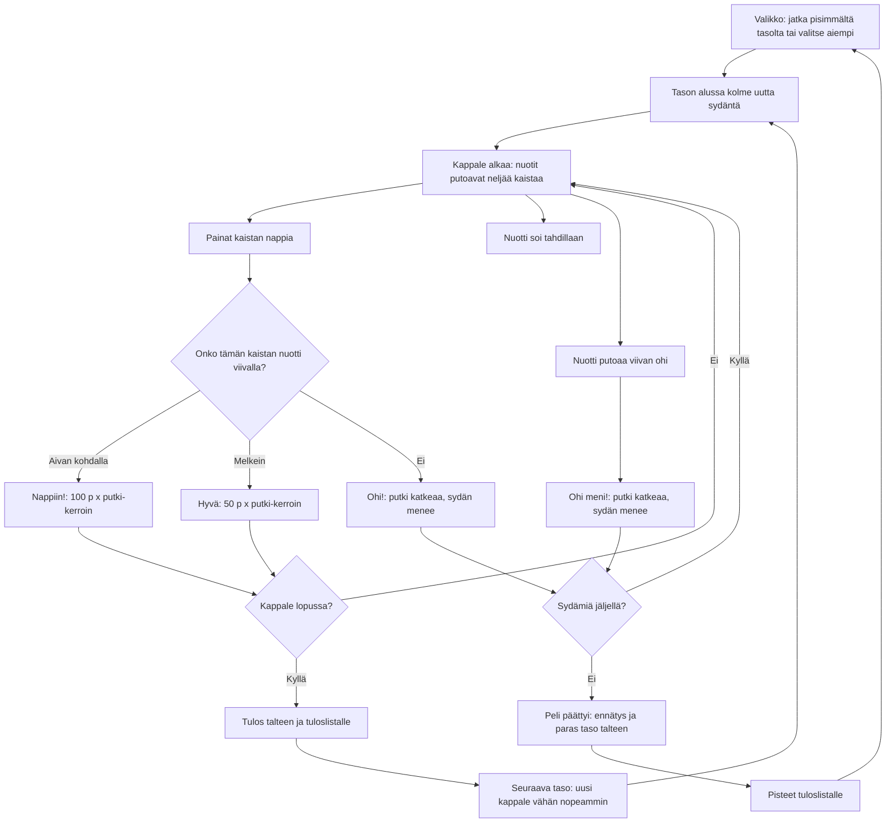

# Piano: one game, from the first note to the last heart

How a game of Piano plays (v1–v5). Notes of a familiar tune fall down four lanes, and the
player presses the lane's key at the bottom when a note reaches the line, which plays that
note. Each finished song is a level; the next song is a little faster. A missed note or a
press with no note near the line costs one of three hearts. From v2 the score is also kept
after every finished song, not only when the last heart goes, and there are nine songs. From v3
a game starts from the furthest level reached (or an earlier one picked in the menu), every
level starts with three fresh hearts, and four fast, hard songs end the list. From v4 the hit
zone is drawn in every lane, and a note counts when its middle is in it. From v5 a press always
takes the oldest note still in the zone, so a late press no longer steals the next note, and the
tune plays by itself, each note on its beat; a press makes no sound.

## Colours

- **blue**: what the player sees and does
- **amber**: a check that decides the path
- **teal**: a hit and its points, and the tune's notes
- **green**: a finished song: the score is kept (v2) and a faster song starts
- **rose**: a miss that costs a heart
- **violet**: the end of the game and what is saved

## Boxes

- **Valikko: jatka pisimmältä tasolta tai valitse aiempi**: v3 `showMenu()` / `showPick()` in `games/piano/v3/index.html`: the button reads "Jatka tasolta N" for the furthest level reached (`ai-pelit:piano:taso`), and ‹ › pick any earlier one; `newGame(pick)` starts there with the score at 0. v1 and v2 always start from level 1.
- **Tason alussa kolme uutta sydäntä**: v3 `startLevel()` sets `lives = LIVES` (3) on every level; in v1 and v2 the three hearts last the whole game.
- **Kappale alkaa: nuotit putoavat neljää kaistaa**: `startLevel()` → `levelNotes()` in `games/piano/v1/index.html`. Four songs in `SONGS` (Tuiki tuiki tähtönen, Ukko Nooa, Jaakko kulta, Oodi ilolle), then round again; v2 has nine, adding Maija pikkuinen, Piippolan vaari, Lontoon silta, Paljon onnea vaan and Kulkuset; v3 adds four hard ones at the end: Vuorenpeikkojen luolassa, Turkkilainen marssi, Kimalaisen lento and Tulimyrsky (written for the game), with sixteenth notes down to 0.1 s apart. A dense song falls faster (`lead` per song) so its notes do not overlap. `nextLane()` puts each note one lane right for a step up in the tune, one left for a step down, two for a leap, and the same lane for a repeated note. From v2 a leap that would go past the edge takes one step instead of turning right round.
- **Painat kaistan nappia**: the `pointerdown` handler: anywhere in a lane below the top bar counts as that lane's key, so several fingers can play at once.
- **Onko tämän kaistan nuotti viivalla?**: `tap()` takes an unplayed note of that lane within `GOOD` (0.16 s): in v1–v4 the nearest, from v5 the oldest (v4 gave a slightly late press on fast songs to the next note in the lane, losing the one at the line); within `PERFECT` (0.07 s) is "Nappiin!". The window is the same time for every note and song, however fast it falls. From v4 `drawZone()` shows it in every lane: the band is ±`GOOD`, its bright middle ±`PERFECT`, the line the beat; `zonePx()` turns the window into pixels at the current fall speed, so a faster note's zone is taller; `placeLine()` sets the line per level just high enough that the whole zone, its late half too, shows above the keys. A note's middle is its beat (v1–v3 used its bottom edge), it gets a white outline while `inZone()`, and its lane lights up.
- **Nappiin!: 100 p x putki-kerroin**: `mult()`: every 10 hits in a row add one to the multiplier, up to x4.
- **Nuotti soi tahdillaan**: `piano()`: a triangle wave with a quiet octave above it and a long fade, at the note's pitch. In v1–v4 a hit played its note at the moment of the press. From v5 `update()` hands every note to the audio clock `SOUND_AHEAD` (0.05 s) before its beat so it sounds exactly on the beat, pressed or not, and a press makes no sound.
- **Nuotti putoaa viivan ohi**: `update()` marks a note missed once it is more than `GOOD` past the line.
- **Seuraava taso: uusi kappale vähän nopeammin**: `speedOf()`: in v1 and v2 each level plays 10 % faster; from v3 a song plays at its own tempo the first time round and 15 % faster on each later lap, and `lead()` makes the notes fall a little faster too. The highest level reached is saved as `ai-pelit:piano:taso`.
- **Tulos talteen ja tuloslistalle**: v2 `songDone()` → `keepScore()`: saves the record and calls `AiPelitScores.submit(score)` after every finished song, so a run counts even if the phone is closed mid-song; the banner of the next level says "Tulos tallennettu". While the high-score list (or its first nickname question) is open, `update()` holds the song still.
- **Peli päättyi: ennätys ja paras taso talteen**: `gameOver()` saves the best score as `ai-pelit:piano:ennatys`.
- **Pisteet tuloslistalle**: `AiPelitScores.submit(score)`; the list is set up as `piano` in `GAMES` in `public/scores.js` and `server/api.js`.
