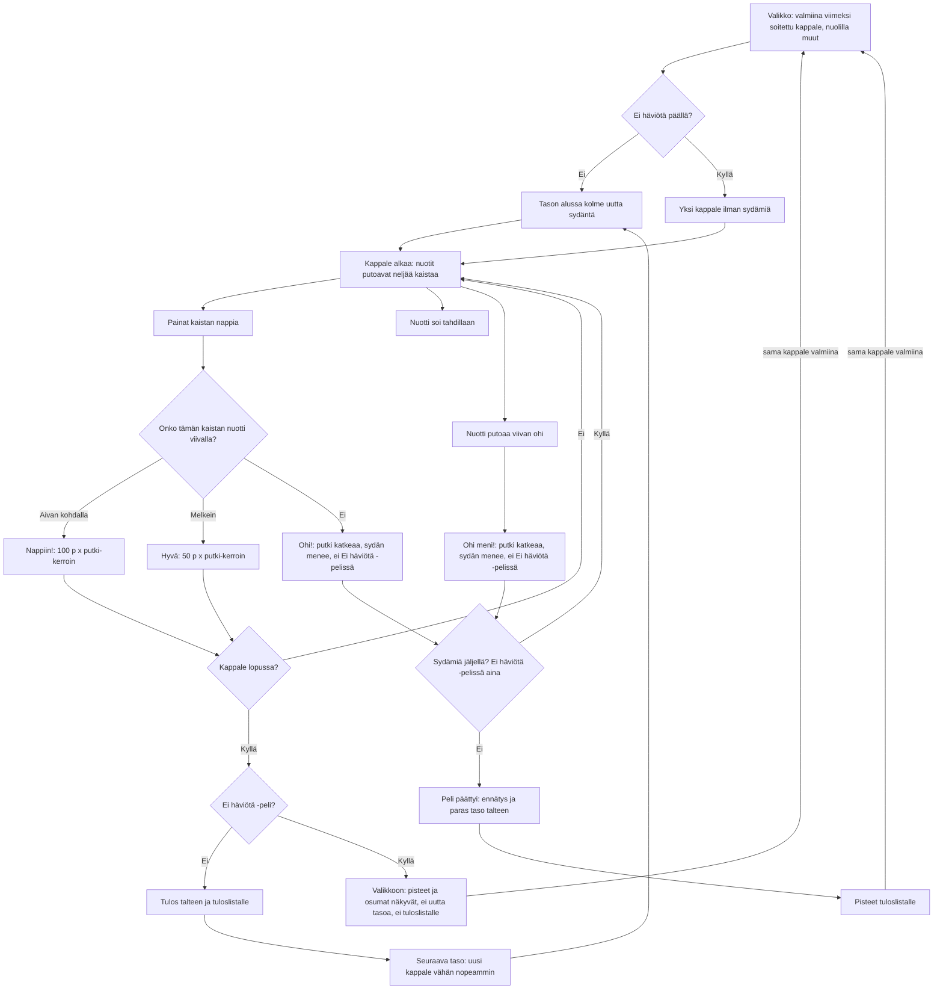

# Piano: one game, from the first note to the last heart

How a game of Piano plays (v1–v10). Notes of a familiar tune fall down four lanes, and the
player presses the lane's key at the bottom when a note reaches the line, which scores that
note (in v1–v4 the press also played it; from v5 the tune plays by itself). Each finished song is a level; the next song is a little faster. A missed note or a
press with no note near the line costs one of three hearts. From v2 the score is also kept
after every finished song, not only when the last heart goes, and there are nine songs. From v3
a game starts from the furthest level reached (or an earlier one picked in the menu), every
level starts with three fresh hearts, and four fast, hard songs end the list. From v4 the hit
zone is drawn in every lane, and a note counts when its middle is in it. From v5 a press always
takes the oldest note still in the zone, so a late press no longer steals the next note, and the
tune plays by itself, each note on its beat; a press makes no sound. From v7 the hit zone is half
as wide again, so a press a little early or late still counts. From v8 a "Ei häviötä" switch in the menu
makes a game one song with no hearts to lose: misses cost nothing, and when the song ends the
menu shows the score and the hits, which go to neither the record nor the high-score list. From v9
the menu starts on the song played last (also after the game is closed), not the furthest one;
› still goes up to the furthest, and a no-fail song no longer opens the next level. In v10 a saved
furthest level above 5 went down to 5, once per phone, undoing the levels no-fail had opened.

Since #346 only each game's newest version folder is kept: a `games/<slug>/v<N>/` path below that is not the newest names a version that is history now (its files are in git's history, and the site sends its address to the newest), and what it says about that version is how it was.

v11 (#404) plays as v10, but a tap is judged at its own moment, not at the last drawn frame: see `reilu-ajoitus.md`.

## Colours

- **blue**: what the player sees and does
- **amber**: a check that decides the path
- **teal**: a hit and its points, and the tune's notes
- **green**: a finished song: the score is kept (v2) and a faster song starts
- **rose**: a miss that costs a heart (in a no-fail game, from v8, it costs none)
- **violet**: the end of the game and what is saved

## Boxes

- **Valikko: valmiina viimeksi soitettu kappale, nuolilla muut**: from v9 (#356) `showMenu()` sets `pick` to the level last started, saved by `startLevel()` as `ai-pelit:piano:viimeisin` (clamped to 1…`topLevel`; a phone with no such save falls back to `topLevel`), so after a game over or a no-fail song the same song is ready, and after a reload too. v10 (#356, Eero's choice) lowers a saved `taso` above 5 to 5 once per phone, marked done in `ai-pelit:piano:tasoraja`, before the menu reads it. Before v9: v3 `showMenu()` / `showPick()` in `games/piano/v3/index.html`: the button reads "Jatka tasolta N" for the furthest level reached (`ai-pelit:piano:taso`), and ‹ › pick any earlier one; `newGame(pick)` starts there with the score at 0. v1 and v2 always start from level 1.
- **Ei häviötä päällä?**: v8 (#318) the "🛡️ Ei häviötä: pois/päällä" switch (`#nofail`) under the play button in `games/piano/v8/index.html`; `noFail` is kept as `ai-pelit:piano:eihaviota`, and `newGame(pick, noFail)` sets `safe` for that game.
- **Yksi kappale ilman sydämiä**: v8 with `safe` set, `miss()` breaks the streak and shows the miss but takes no heart, so `gameOver()` never runs; the HUD shows "🛡️ Ei häviötä" in place of the hearts, and the level's banner says so.
- **Ei häviötä -peli?**: v8 `songDone()` checks `safe` first.
- **Valikkoon: pisteet ja osumat näkyvät, ei uutta tasoa, ei tuloslistalle**: v8 `songDone()` with `safe`: `state = 'over'`; in v8 the next level opened in `ai-pelit:piano:taso` as after any finished song, from v9 (#356, Eero's choice) it does not and the text adds "Ei häviötä -tila ei avaa tasoja"; and `showMenu()` says "Kappale soitettu: N pistettä, osuit H/T"; `keepScore()` is not called, so neither the record nor `AiPelitScores.submit()` sees it (Eero's choice).
- **Tason alussa kolme uutta sydäntä**: v3 `startLevel()` sets `lives = LIVES` (3) on every level; in v1 and v2 the three hearts last the whole game.
- **Kappale alkaa: nuotit putoavat neljää kaistaa**: `startLevel()` → `levelNotes()` in `games/piano/v1/index.html`. Four songs in `SONGS` (Tuiki tuiki tähtönen, Ukko Nooa, Jaakko kulta, Oodi ilolle), then round again; v2 has nine, adding Maija pikkuinen, Piippolan vaari, Lontoon silta, Paljon onnea vaan and Kulkuset; v3 adds four hard ones at the end: Vuorenpeikkojen luolassa, Turkkilainen marssi, Kimalaisen lento and Tulimyrsky (written for the game), with sixteenth notes down to 0.1 s apart. A dense song falls faster (`lead` per song) so its notes do not overlap. `nextLane()` puts each note one lane right for a step up in the tune, one left for a step down, two for a leap, and the same lane for a repeated note. From v2 a leap that would go past the edge takes one step instead of turning right round.
- **Painat kaistan nappia**: the `pointerdown` handler: anywhere in a lane below the top bar counts as that lane's key, so several fingers can play at once.
- **Onko tämän kaistan nuotti viivalla?**: `tap()` takes an unplayed note of that lane within `GOOD` (0.16 s; from v7 0.24 s, #316): in v1–v4 the nearest, from v5 the oldest (v4 gave a slightly late press on fast songs to the next note in the lane, losing the one at the line); within `PERFECT` (0.07 s; from v7 0.1 s) is "Nappiin!". The window is the same time for every note and song, however fast it falls. From v4 `drawZone()` shows it in every lane: the band is ±`GOOD`, its bright middle ±`PERFECT`, the line the beat; `zonePx()` turns the window into pixels at the current fall speed, so a faster note's zone is taller; `placeLine()` sets the line per level just high enough that the whole zone, its late half too, shows above the keys. A note's middle is its beat (v1–v3 used its bottom edge), it gets a white outline while `inZone()`, and its lane lights up.
- **Nappiin!: 100 p x putki-kerroin**: `mult()`: every 10 hits in a row add one to the multiplier, up to x4.
- **Nuotti soi tahdillaan**: `piano()`: a triangle wave with a quiet octave above it and a long fade, at the note's pitch. In v1–v4 a hit played its note at the moment of the press. From v5 `update()` hands every note to the audio clock `SOUND_AHEAD` (0.05 s) before its beat so it sounds exactly on the beat, pressed or not, and a press makes no sound.
- **Nuotti putoaa viivan ohi**: `update()` marks a note missed once it is more than `GOOD` past the line (from v7 0.24 s).
- **Seuraava taso: uusi kappale vähän nopeammin**: `speedOf()`: in v1 and v2 each level plays 10 % faster; from v3 a song plays at its own tempo the first time round and 15 % faster on each later lap, and `lead()` makes the notes fall a little faster too. The highest level reached is saved as `ai-pelit:piano:taso`.
- **Tulos talteen ja tuloslistalle**: v2 `songDone()` → `keepScore()`: saves the record and calls `AiPelitScores.submit(score)` after every finished song, so a run counts even if the phone is closed mid-song; the banner of the next level says "Tulos tallennettu". While the high-score list (or its first nickname question) is open, `update()` holds the song still.
- **Sydämiä jäljellä? Ei häviötä -pelissä aina**: `miss()` takes a heart and calls `gameOver()` at none; from v8 not in a no-fail game.
- **Peli päättyi: ennätys ja paras taso talteen**: `gameOver()` saves the best score as `ai-pelit:piano:ennatys`.
- **Pisteet tuloslistalle**: `AiPelitScores.submit(score)`; the list is set up as `piano` in `GAMES` in `public/scores.js` and `server/api.js`. From v10 (#356) `addScore()` in `server/api.js` cuts a level above 5 sent by Piano v1–v9 to 5, so a page of an older version left open cannot undo the cut; the one-time cut in the game also lowers Piano's entry in `ai-pelit:_tulokset:lahetetyt` to 5, so `scores.js` sends levels 6 and up again. This game keeps its own score entry; the shared registry’s new `minigolf` entry (#340, lowest stroke total on `main`) does not change it. Kiekkoammunta v1 adds independent `trap` and `skeet` score entries (Trap first, N/25); this box’s existing behavior is unchanged. Frisbeegolf v1 adds its own `main` entry to these registries: lowest strokes against par wins, displayed as `E`, `−2` or `+5`; this box keeps its existing behavior.
