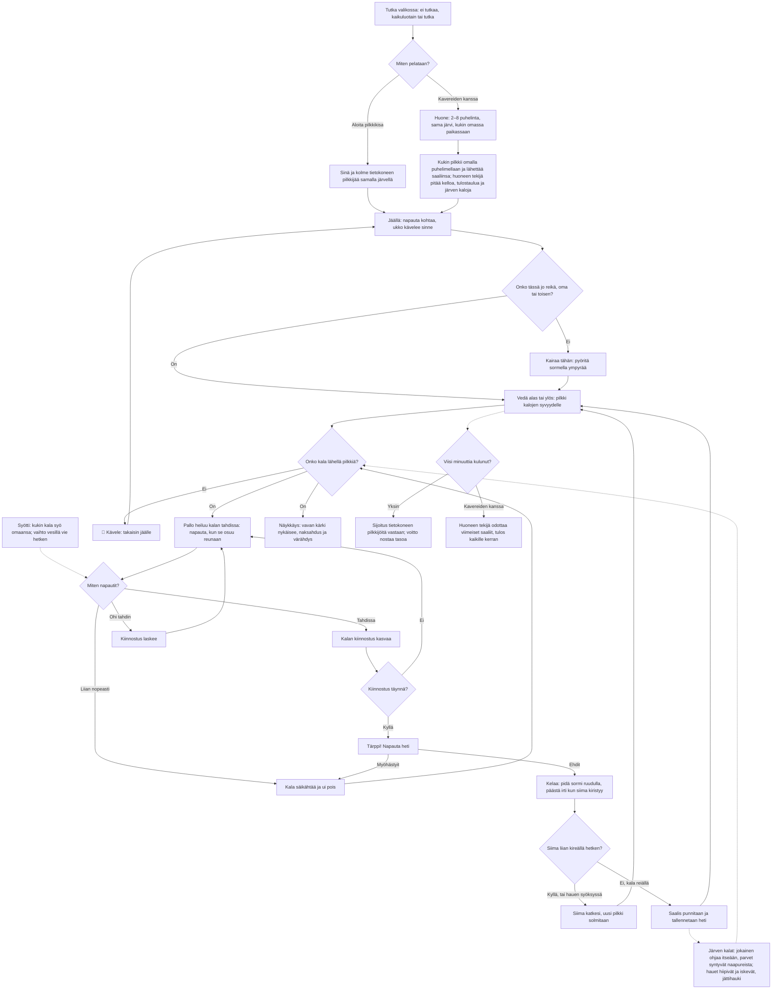

# Pilkkiminen: one contest, from the first hole to the result

How a contest of Pilkkiminen (ice fishing) plays, as of v3 (#291). On the ice the view is from
above and follows the angler over a lake far bigger than the screen; at a hole it is from the side:
the angler, the hole, and the water down to the bottom. Five minutes on the clock; each fish is drilled
for, jigged in rhythm, struck and reeled in, and the biggest total catch wins. Alone three computer
anglers fish the same lake; with friends, 2–8 phones fish it each on its own phone through the
shared room library (see `moninpeli.md`).

## Colours

- **blue**: what the player sees and does
- **amber**: a check that decides the path
- **teal**: the fish coming closer, and a fish landed
- **violet**: playing in a room
- **green**: the contest's result alone
- **rose**: a fish lost or scared away

## Boxes

- **Miten pelataan?**: the menu in `games/pilkki/v3/index.html`: **Aloita pilkkikisa** (`newContest()`), **Jatka kisaa** when a contest alone was left unfinished (kept every two seconds as `ai-pelit:pilkki:kisa3` by `keepContest()`, with where the angler stands, the holes and every fish; v1 and v2 keep their own under `kisa` and `kisa2`), or **👥 Pelaa kavereiden kanssa** (`AiPelitRooms.open()`).
- **Sinä ja kolme tietokoneen pilkkijää samalla järvellä**: `cpuAnglers()`: each rival walks to near a spot, drills a hole (it stays, and the player may fish it), fishes it a while and moves on; now and then it lands a fish in sight of its hole, and that fish is gone from the lake; how often, and how often the bigger of two, grows with the level (`rivalRate()`).
- **Tutka valikossa: ei tutkaa, kaikuluotain tai tutka**: the `#gear` buttons, kept in `ai-pelit:pilkki:tutka` (`radar`). Without one no fish are drawn and a hole's depth is found when the jig touches the bottom (`bottom()`); the flasher (`kaikuluotain`) shows marks for the fish right under the hole, their width only roughly the size, and the depth (`drawFlasher()`); the sonar (`tutka`) shows blurred blobs round the hole, never exactly where the fish are (`shownFish()`). Both tell the depth on the ice where the angler stands.
- **Jäällä: napauta kohtaa, ukko kävelee sinne**: `drawIce()` follows the angler (`me`) at about 36 m across the screen's short side (two fingers pinch it between about 100 m and a few metres, `setZoom()`; never the whole lake), on a lake of 260 × 190 m (`LAKE_W`, `LAKE_H`) with its depths from `depthAt()`; a finger lifted without moving sets where to walk (6 m/s, `walk()`), never past the shore (`onIce()`). With `?kalat` in the address every fish shows through the ice, pike and burbot lettered (`DEBUG`), for trying the game out. The others and every hole are drawn (`others()`, `allHoles()`).
- **Huone: 2–8 puhelinta, sama järvi, kukin omassa paikassaan**: `setupFor()` on the host sends the lake's seed (`makeLake()`) and a starting point by the shore for each phone (`starts`); each phone sends where it is and its holes in `me` (`whereAmI()`), so the others see it on the ice and may fish its holes.
- **Kukin pilkkii omalla puhelimellaan ja lähettää saaliinsa; huoneen tekijä pitää kelloa, tulostaulua ja järven kaloja**: each guest sends `me` (only where it is fishing, `sendMe()`) every second; its catch is what the host accepted, never its own report; the host sends `s` (the clock and everyone's catch, `snapshot()`) twice a second. A catch on the host's list only grows, so a phone that reloads gets its catch back. The lake's fish are shared: the host swims them and sends them to every phone once a second (`pondMsg()`, `applyPond()`), and a guest moves them on between those (`follow()`). A fish that starts looking at a phone's jig is that phone's (`claim()`, first come first served, `taken()` on the others), so jigging and reeling run on that phone alone; let go or scared it goes back to the host (`release()`), landed it is gone on every phone (`caught()`, `gone`). A guest's catch counts only if the host accepts the fish was that phone's: the host then adds it to that player's total itself, once (`hostFish()`), with a receipt per fish (`fish` in the host's list), so it counts even if the phone drops before it hears so, and a returning phone adds any fish it missed to its lifetime records once (`fromHost()`, `receipted()`, `ai-pelit:pilkki:kuitatut`), and tells the phone (`credit()` on `gone`; `nocatch` otherwise), and a phone that hears another got the fish first loses it, even mid-bite or on the line (`lost()`). A phone that comes back or is let go holds no fish (`freeClaims()`); one that comes back still reeling or biting claims that fish again (`applyPond()`). While the room waits for a phone that is away (`AiPelitRooms.paused`), the clock stops and no phone takes fishing input.
- **Onko tässä jo reikä, oma tai toisen?**: `holeHere()` within 1.6 m; the big button says **🎣 Pilkki reikään** or **⛏ Kairaa tähän** (`iceAction()`, `atHole()`).
- **Kairaa tähän: pyöritä sormella ympyrää**: `turnAuger()`; six turns of the finger round the auger (`TURNS`). The hole stays in `holes`.
- **Syötti: kukin kala syö omaansa; vaihto vesillä vie hetken**: `BAITS`: kirkas pilkki, tasapainopilkki, mormyska ja toukka, kalanpala; `likes()` scales how fast a fish gets keen, and a fish that hardly cares for the bait (under 0.25) does not come at all. Changed with **🪱** (`pickBait()`): at once on the ice, in three seconds with the jig in the water (phase `bait`); kept in `ai-pelit:pilkki:syotti`.
- **Vedä alas tai ylös: pilkki kalojen syvyydelle**: a drag in the water moves the jig (`jigD`); after a catch or a broken line it sinks back to the last depth by itself (`jigGoal`).
- **🚶 Kävele: takaisin jäälle**: `toIce()`; the fish the jig was working are let go. (v1 had a map of twelve places instead.)
- **Järven kalat: jokainen ohjaa itseään, parvet syntyvät naapureista; hauet hiipivät ja iskevät, jättihauki**: `pond`, some 600–900 single fish (`newFish()`, `SPECIES`, `HABITS`), tuned to `docs/research/pilkkiminen-kalat.md`. A schooling fish (perch, roach, bream, ruffe, zander) steers itself five times a second (`steer()`, the common "boids" rules): keep `gap` from neighbours, swim their way, stay near them, head for its plan (`plan()`, a spot that suits its kind) and take up a neighbour's newer plan, so schools travel together, split and merge. Speeds about 0.08–0.15 m/s; perch keep near the bottom by day, roach deeper. Twelve pike each keep a 45 m home area by a shallow spot (`hunt()`): hungry, one creeps unnoticed to about a body length of a fish up to a third of its length, strikes in a fraction of a second at 4 m/s, takes it 36 % of the time (gone from the lake) and then hunts no more; fish keep a few metres off a pike swimming in the open (`steer()`). Six burbot crawl on deep bottoms; one giant pike of 12–16 kg (`GIANT`). The neighbours are found through a 6 m grid (`buildGrid()`, `near()`). In a room the host sends only the fish within 45 m of some angler (`pondMsg()`).
- **Näykkäys: vavan kärki nykäisee, naksahdus ja värähdys**: `nibble()`: a fish coming to look, now and then while it looks (more often the keener it is), and firmer at half and nearly full interest; the rod tip dips (`rodPull()`), a quiet click, a short buzz (`navigator.vibrate`). So a fish is felt without a sounder.
- **Pallo heiluu kalan tahdissa: napauta, kun se osuu reunaan**: `period()` is the tempo of the fish the jig is working on (`target`); a perch likes fast twitches, a zander or a burbot slow ones.
- **Miten napautit?**: `twitch()`: within `WIN` (0.17 s) of the beat is good, faster than half a beat is a frenzy.
- **Tärppi! Napauta heti**: `bite()`, then `strike()` within about a second.
- **Kelaa: pidä sormi ruudulla, päästä irti kun siima kiristyy**: `fightStep()`: holding reels in and tightens the line, letting go gives the fish line; a fish pulls harder in rushes and tires over time (`pullOf()`).
- **Siima katkesi, uusi pilkki solmitaan**: `snap()`, when the tension stays over the limit for 0.4 s, or when a pike is still held tight 0.35 s into its rush: its teeth may bite the line off ("Hauki katkaisi siiman hampaillaan!", 30 %, the giant 45 %). The game says "Hauki syöksyy: päästä irti!" in a rush.
- **Saalis punnitaan ja tallennetaan heti**: `land()` saves the lifetime catch per kind (`kalat`) and the biggest fish ever (`suurin`).
- **Sijoitus tietokoneen pilkkijöitä vastaan; voitto nostaa tasoa**: `endContest()` saves `taso`, `ennatys` and `kisat`, and sends the catch in grams to the high-score list.
- **Huoneen tekijä odottaa viimeiset saaliit, tulos kaikille kerran**: `timeUp()` and `closing()` → `AiPelitRooms.deliver()`; each phone saves its result once in `ai-pelit:pilkki:kaverit` (`finish()`). The place comes from the end message's own player list (`roomStandings()`), so a phone that reloads after the end still gets its real place.
