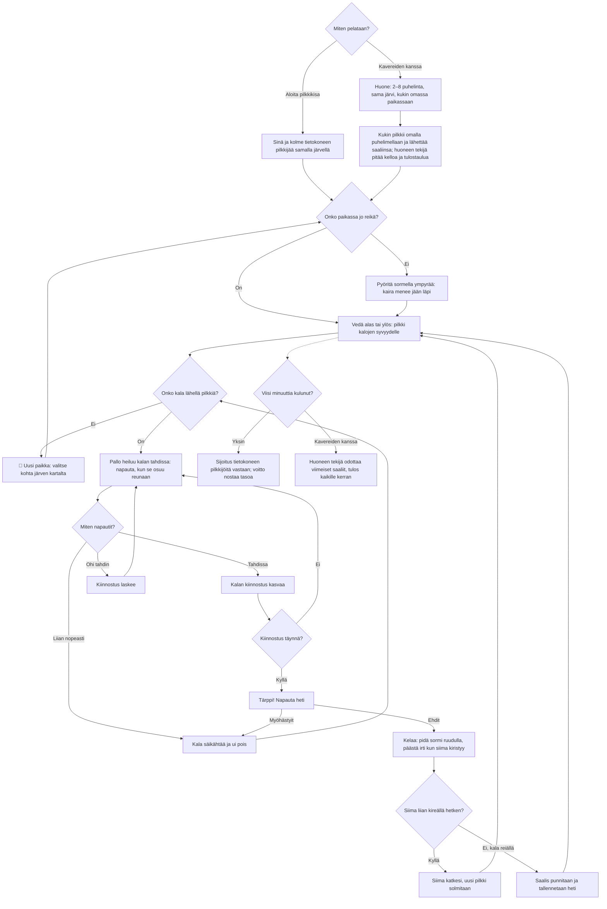

# Pilkkiminen: one contest, from the first hole to the result

How a contest of Pilkkiminen (ice fishing) plays. The view is from the side: the angler on the
ice, the hole, and the water down to the bottom. Five minutes on the clock; each fish is drilled
for, jigged in rhythm, struck and reeled in, and the biggest total catch wins. Alone three computer
anglers fish the same lake; with friends, 2–8 phones fish it each on its own phone through the
shared room library (see `moninpeli.md`).

## Colours

- **blue**: what the player sees and does
- **amber**: a check that decides the path
- **teal**: the fish coming closer, and a fish landed
- **violet**: playing in a room
- **green**: the contest's result alone
- **rose**: a fish lost or scared away

## Boxes

- **Miten pelataan?**: the menu in `games/pilkki/v1/index.html`: **Aloita pilkkikisa** (`newContest()`), **Jatka kisaa** when a contest alone was left unfinished (kept every two seconds as `ai-pelit:pilkki:kisa` by `keepContest()`), or **👥 Pelaa kavereiden kanssa** (`AiPelitRooms.open()`).
- **Sinä ja kolme tietokoneen pilkkijää samalla järvellä**: `cpuAnglers()` lands a fish now and then for each rival; how often and how big grows with the level (`rivalRate()`).
- **Huone: 2–8 puhelinta, sama järvi, kukin omassa paikassaan**: `setupFor()` on the host sends the lake's seed (`makeLake()`) and a starting place for each phone.
- **Kukin pilkkii omalla puhelimellaan ja lähettää saaliinsa; huoneen tekijä pitää kelloa ja tulostaulua**: each phone sends `me` (its catch, `sendMe()`) every second and after each fish; the host sends `s` (the clock and everyone's catch, `snapshot()`) twice a second. A catch on the host's list only grows, so a phone that reloads gets its catch back.
- **Onko paikassa jo reikä?**: `goTo()`; holes drilled this contest are in `holes`.
- **Pyöritä sormella ympyrää: kaira menee jään läpi**: `turnAuger()`; six turns of the finger round the auger (`TURNS`).
- **Vedä alas tai ylös: pilkki kalojen syvyydelle**: a drag in the water moves the jig (`jigD`); after a catch or a broken line it sinks back to the last depth by itself (`jigGoal`).
- **🚶 Uusi paikka: valitse kohta järven kartalta**: `drawMap()` and `moveTo()`; twelve places, shallow by the shore and deep in the middle, each with its own fish (`newFish()`, `SPECIES`). A walk takes a couple of seconds.
- **Pallo heiluu kalan tahdissa: napauta, kun se osuu reunaan**: `period()` is the tempo of the fish the jig is working on (`target`); a perch likes fast twitches, a zander or a burbot slow ones.
- **Miten napautit?**: `twitch()`: within `WIN` (0.17 s) of the beat is good, faster than half a beat is a frenzy.
- **Tärppi! Napauta heti**: `bite()`, then `strike()` within about a second.
- **Kelaa: pidä sormi ruudulla, päästä irti kun siima kiristyy**: `fightStep()`: holding reels in and tightens the line, letting go gives the fish line; a fish pulls harder in rushes and tires over time (`pullOf()`).
- **Siima katkesi, uusi pilkki solmitaan**: `snap()`, when the tension stays over the limit for 0.4 s.
- **Saalis punnitaan ja tallennetaan heti**: `land()` saves the lifetime catch per kind (`kalat`) and the biggest fish ever (`suurin`).
- **Sijoitus tietokoneen pilkkijöitä vastaan; voitto nostaa tasoa**: `endContest()` saves `taso`, `ennatys` and `kisat`, and sends the catch in grams to the high-score list.
- **Huoneen tekijä odottaa viimeiset saaliit, tulos kaikille kerran**: `timeUp()` and `closing()` → `AiPelitRooms.deliver()`; each phone saves its result once in `ai-pelit:pilkki:kaverit` (`finish()`).
