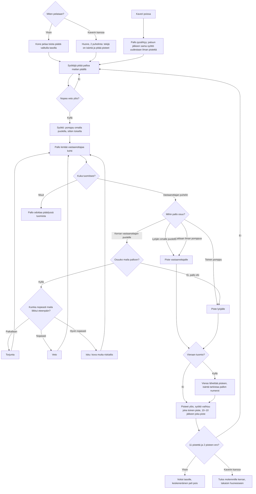

# Pingis: one rally, from the serve to the point

How a game and one rally of Pingis play (v1, #502). Table tennis in 3D, the camera behind the
player's own end; the bat follows the finger, and how the finger moves when the ball meets the bat
decides the shot. One game to 11 with a two-point lead, against the computer on three levels or
against a friend's phone in a room (see `moninpeli.md`), where each phone plays its own end and
calls the flights coming its way.

## Colours

- **amber**: a question the game asks
- **violet**: playing with a friend in a room
- **teal**: the shot the finger makes
- **green**: a point, and the score

## Boxes

- **Kone pelaa toista päätä valitulla tasolla**: `cpuBrain()`, `cpuThink()` and `cpuServes()` in `games/pingis/v1/ai.js`, with the level's reaction time, speed, aim error and misses from `LEVELS` in `world.js` (Helppo, Keskitaso, Vaikea).
- **Huone, 2 puhelinta: tekijä on isäntä ja pitää pisteet**: `netStart()` in `games/pingis/v1/net.js`; the host is side 0, the friend side 1, and each phone's camera is behind its own end (`placeCamera()` in `draw3d.js`). The friend's bat glides through `lib/sulava-1` (`glide()`).
- **Syöttäjä pitää palloa mailan päällä**: `heldBall()` in `ui.js`; the server is `serverAt()` in `world.js`.
- **Nopea veto ylös?**: `myBat()` in `ui.js` measures the bat's speed over the last 80 ms; a quick push up calls `tryServe()`. The touch-down itself never counts (`bats[view].jump`).
- **Syöttö: pomppu omalla puolella, sitten toisella**: `serveLaunch()` in `world.js` solves both hops, so every serve clears the net and lands on both halves.
- **Kuka tuomitsee?**: `judgeHere()`: alone, this phone judges everything; in a room, the phone the ball flies towards (the host also for a friend the computer plays). Others let the ball fly to the end and wait (`f.held` in `stepOnce()`).
- **Mihin pallo osuu?**: `judge()` in `world.js`, from the ball's events in `ballStep()`.
- **Toinen pomppu**: a second bounce on the receiver's half, or the floor after one, is the hitter's point.
- **Osuuko maila palloon?**: `meets()` in `world.js`: the ball crossed the bat's line within `REACH` (26 cm) sideways, with the ball between 35 cm under the table top and 1 m above it.
- **Kuinka nopeasti maila liikkui eteenpäin?**: `hitBy()` in `ui.js`: forward speed over 3.0 is a smash, over 0.8 a drive, else a block; the sideways swing and where on the bat it met give the aim. `shotLaunch()` in `world.js` adds risk to fast and off-centre hits.
- **Isku: kova mutta riskialtis**: a smash doubles the aim error, and more again at a low ball.
- **Vieras lähettää pisteen, isäntä tarkistaa pallon numerot**: `netPoint()` sends `pt`; `hostHeard()` takes it only for the current rally number `r`, from a friend playing their own bat, for the flight number it expects. Anything older or heard twice is dropped.
- **Pisteet ylös, syöttö vaihtuu joka toinen piste, 10–10 jälkeen joka piste**: `addPoint()` and `serverAt()` in `world.js`; in a room `hostPoint()` sends the new rally to the friend. Alone the score is saved each point (`saveSolo()`, `ai-pelit:pingis:kesken`).
- **Voitot tasolle, keskeneräinen peli pois**: `soloRecord()` in `ui.js` adds the win or loss to `ai-pelit:pingis:voitot` once, and drops `kesken`.
- **Tulos molemmille kerran, takaisin huoneeseen**: `hostEnd()` delivers the end; `netEnd()` counts it once in `ai-pelit:pingis:kaverit` (`RM.once`).
- **Pallo pysähtyy; paluun jälkeen sama syöttö uudestaan ilman pistettä**: while a phone is away the room pauses; the friend's phone stops judging (`net.stale`) and asks for the rally (`sync`), and the host replays it (`hostReplay()`). With "Jatka ilman heitä" the computer plays the friend's end until they are back, and gives the bat back at the next rally (`net.gNext`).
