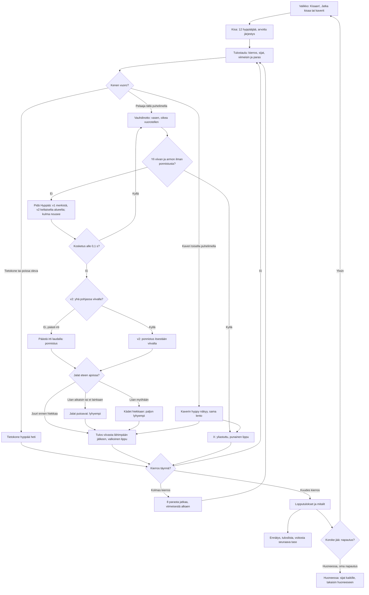

# Pituushyppy: one jump and one meet

How Pituushyppy plays (v1; v2 plays the same, with the meet, the results board, the saves and the
room handling from the shared athletics library, see `yleisurheilu-kirjasto.md`; v3 plays as v2, with the run-up's legs running forwards, #170; v4 plays as v3, with the jump bar higher and the gap under it the feet's, #177; v5 plays as v4 and ends the meet with the medal ceremony from `yleisurheilu-2`, #176; v6 plays as v5 and the podium stays until a tap, `yleisurheilu-3`, #176). A meet has twelve jumpers: the player and eleven computer jumpers
alone, or 2–8 phones in a room with the computer filling the rest. Everyone jumps three times in a
drawn order; the best eight jump three more, the last in the standings first. On their turn the
player takes a run-up by tapping the left and right foot in turn, holds "Hyppää" from the check
mark so the take-off angle rises, and lets go on the board before the line. In the air a tap throws
the legs forward for the landing. The computer's jumps are worked out at once.

## Colours

- **blue**: what the player sees and does
- **violet**: someone else jumping: the computer, or a friend on another phone
- **amber**: a check that decides the path
- **teal**: the meet's rules and the measured jump
- **rose**: a foul, marked X
- **green**: the end of the meet and what it saves

## Boxes

- **Valikko: Kisaan!, Jatka kisaa tai kaverit**: `showMenu()` in `games/pituushyppy/v1/index.html`. "Kisaan!" starts a new meet at the player's level (`taso`); "Jatka kisaa (kierros N/6)" shows when a meet alone was left unfinished (`kesken`, saved after each of the player's jumps, so a reload or a trip to the shelf keeps it); "👥 Pelaa kavereiden kanssa" opens the room (`public/rooms.js`, 2–8 phones). The menu shows meets, wins and the record (`kisat`, `voitot`, `ennatys`).
- **Kisa: 12 hyppääjää, arvottu järjestys**: `newComp()` (v2: `meet()` and `rounds()` in `public/lib/yleisurheilu-1/kisa.js`, from v5 `yleisurheilu-2/kisa.js`, from v6 `yleisurheilu-3/kisa.js`, with `base`, `spread` and `init` from the game): the players, then computer jumpers up to twelve (`FIELD`), each with a skill around `base(level)` metres (5.20 m at level 1, 25 cm more per level up to 7.00 m); the order of rounds 1–3 is drawn once (`order0`), and a seed (`seed`) gives every jump its wind.
- **Tulostaulu: kierros, sijat, viimeisin ja paras**: `drawBoard()` (v2: the library's `K.drawBoard()`), shown for 3.5 s (`BOARD_T`) before each player's turn; alone a tap skips it. The standings (`standings()`) go by the best jump, then the second best, as in a real meet; a dashed line shows the cut after eight.
- **Kenen vuoro?**: `advance()` (v2: the library's) jumps for every computer jumper up to the next player on a phone; `follow()` makes the turn each phone draws (`th`), its own (`mine`) or someone else's, with the wind for it (`windFor(seq)`, −1.5 to +2.5 m/s, shown as "Tuuli").
- **Tietokone hyppää heti**: `cpuMark()`: the skill plus a scatter of 20 cm and 5 cm per m/s of wind, a foul about one time in seven. In a room the host's "Jatka ilman heitä" hands an away phone's jumps to the computer (`R.on('continue')`) until it is back (`R.on('back')`); while a phone is away the meet waits (`R.paused`).
- **Vauhdinotto: vasen, oikea vuorotellen**: `press()`: a step on the other foot adds speed, more the slower the jumper goes (as in Keihäänheitto and Aitajuoksu), the same foot twice slows; about 8.3 m/s at eight taps a second. v3: `runLegs()` in `drawJumper()` (`games/pituushyppy/v3/index.html`) bends the knee as each leg swings forward and keeps it near straight as it pushes back; v1–v2 had it the other way round, so the jumper looked to run backwards. The bar in the score panel shows the speed; the green part of the runway is the last 120 ms of running before the line at the speed now (`ZONE`), so with the grace past the line the clean take-off zone is 200 ms; an earlier release is legal but shorter, as the jump is measured from the line, the yellow "merkki" 2.8 m before it is where to start holding. v2 (Keihäänheitto v3's controls, #166): no "merkki"; a yellow zone at the speed now (`zones()`) shows where to start holding so the angle is green at the line, and a strip under the runway (`drawStrip()`) shows the whole run-up from the first step: you, the yellow and the green part.
- **Yli viivan ja armon ilman ponnistusta?**: `step()` and `overLimit()`: timing is measured in time, not distance, and holding Hyppää never fouls by itself. The foot may pass the line by up to 80 ms of running (`GRACE`, at least 8 cm); a release within it takes off at the line (`release()`), so it is legal and measured from the line. Only running on past that, holding or not, is a foul, "Yliastuttu", with the shoe's print in the plasticine. v2: still holding when the foot reaches the line takes off by itself, from the line (`leap()`), so only running on without holding fouls. In a room 45 s with no tap (`TURN_MAX`, counted in `th.idle`) is a foul, "Aika loppui".
- **Pidä Hyppää: v1 merkistä, v2 keltaiselta alueelta; kulma nousee**: `startAim()`: holding the middle pad (upright; v2: a full-width bar above the two feet, 18 px apart, `PAD_GAP`, and a touch in the gap does nothing, upright and sideways; v4, #177: 44 px apart, and the gap and the jump's bottom 12 px, `JUMP_EDGE`, are the foot under it, upright and sideways, so a thumb drumming the feet does not jump), the top pad of either side column or anywhere on the scene (sideways) raises the take-off angle from 5° at 45° a second (`AIM_RATE`); the dial beside the jumper shows it, green from 16° to 24° (`GREEN`), the angles within about 20 cm of the best. The jumper crouches and keeps most of the speed.
- **v2: yhä pohjassa viivalla?**: `step()` in `games/pituushyppy/v2/index.html`: while the player holds Hyppää (`th.phase === 'aim'`), the foot reaching the line (`th.x >= 0`) takes off by itself; a release before it is the normal take-off. v1 has no such check: holding on past the grace is a foul there.
- **v2: ponnistus itsestään viivalta**: `leap()`: the same take-off as letting go, from the line (`relX` 0) with the angle reached so far; started in the yellow zone (`zones()`), that angle is green. Other phones get it as `rel`.
- **Kosketus alle 0,1 s?**: `release()`: a touch shorter than `TAP_MIN` is a slip of the thumb and goes back to running.
- **Päästä irti laudalla: ponnistus**: `jumpNow()` and `takeoff()`: the take-off is from where the foot is (`relX`); the speed is the run-up plus 1.2 m/s, less the steeper the take-off (`STEEP`), so the best angle is about 20°: 8.3 m/s jumps about 6.4 m, 9.5 m/s about 7.6 m. The camera turns to the board and the whole pit.
- **Jalat eteen ajoissa?**: `legs()` and `reachOf()`: a tap in the air (any pad or the scene) throws the legs forward, once; it counts by how long was left before the sand (`q`). 0.12–0.34 s (`LEGS`) is a good landing, the heels about 0.55–0.6 m ahead of the body.
- **Jalat putoavat: lyhyempi**: earlier than that, or no tap at all, the feet come down under the body ("Liian aikaisin: jalat putosivat", "Jalat jäivät alas"), some 40–55 cm shorter.
- **Kädet hiekkaan: paljon lyhyempi**: later, the jumper falls back and the hands make the nearest mark ("Liian myöhään: kädet hiekkaan"), up to a metre shorter.
- **Tulos viivasta lähimpään jälkeen, valkoinen lippu**: `jumpMark()` and `landed()`: the mark is measured from the take-off line to the nearest break in the sand, down to the centimetre (rounded down), plus 5 cm per m/s of wind; landing short of the pit is a foul. The official by the board raises a white flag (red for a foul), a tape runs from the line to the mark, and a new record is saved at once (`ennatys`). The jumper's phone reports it (`res`); the host records it once (`seq`) and sends the meet to everyone (`c`).
- **Kaverin hyppy näkyy, sama lento**: the jumper's phone sends where its jumper is twelve times a second (`p`), the take-off (`rel`) and when the legs went forward (`leg`); the host passes them on, and every phone flies the same jump with `jumpNow()`, waiting at the sand for `leg`, and lands on the same mark.
- **8 parasta jatkaa, viimeisestä alkaen**: after round 3 `advance()` keeps the best eight (`final`), each later round in reverse order of the standings. With no player on a phone left in the final the rest is jumped at once.
- **Lopputulokset ja mitalit**: `over()` and `netEnd()` (v2: the library's `over()`, `end()` and `K.step()`): the standings with 🥇🥈🥉, shown for a few seconds. From v5 (#176) it is the medal ceremony, `K.drawPodium()` in `draw()` over the whole screen: the top three on the podium, an official hangs their medals, a chime each (`look`, `chime` in the meet's options), the final standings under it. In v5 it goes on by itself after 11 s (alone a tap finishes the ceremony and the next leaves it).
- **Koroke jää: napautus?**: from v6 (`yleisurheilu-3`, #176) nothing leaves the podium by itself: the game's tap handler calls `K.skip()` alone and with friends; a tap during the ceremony finishes it (alone only), and a tap after it sets `leave`, and `K.step()` then shows the menu alone, or `R.backToRoom()` in a room, each phone by its own tap. Before v6 this step came by itself after a few seconds (11 s in v5).
- **Ennätys, tuloslista, voitosta seuraava taso**: `netEnd()` saves `kisat`, and alone a win adds `voitot` and the next level (`taso`); the meet's best jump goes to the high-score list with `AiPelitScores.submit()` (`pituushyppy` in `public/scores.js` and `server/api.js`, see `tuloslistat.md`).
- **Huoneessa: sijat kaikille, takaisin huoneeseen**: the host sends the results with `R.deliver()`; each phone saves its own meet once (`R.once()`), shows its place and the top eight in the room (`afterEnd()`, `R.note()`, `R.backToRoom()`).
