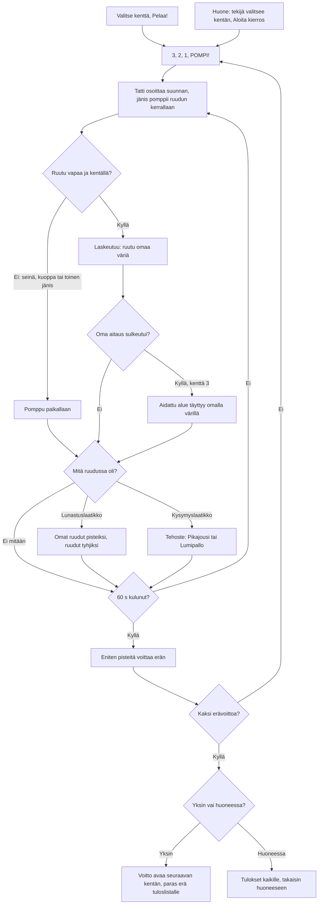

# Pomppukeppi: one round on the tile board

How a match of Pomppukeppi plays (v2, #482, #492). Four hares on pogo sticks hop square by
square over a board seen from above at a slant (three.js). Each landing paints the square in the
hare's own colour; a hop onto a cash-in box turns all of that hare's squares into points and
clears them. After 60 s the hare with most points wins the round; two round wins take the match.
Alone the player meets three computer hares; in a room 2–4 phones play the same board.

## Colours

- **blue**: what the player sees and does
- **amber**: a check that decides the path
- **teal**: painting and scoring, the heart of the game
- **rose**: a blocked hop, or a power-up that hinders others
- **violet**: the match in a room with friends
- **green**: a win or a new board opened

## Boxes

- **Valitse kenttä, Pelaa!**: the menu offers three boards (`BOARDS` in `games/pomppukeppi/v2/world.js`): Niitty (plain 8 × 8), Kivikko (8 × 8 with rocks and holes), Aitaus (enclosures fill). The next opens when the player wins a match alone on the newest open one, saved as `ai-pelit:pomppukeppi:auki`; the last board picked is `ai-pelit:pomppukeppi:kentta`. "👥 Pelaa kavereiden kanssa" opens the room.
- **Huone: tekijä valitsee kentän, Aloita kierros**: `rooms.js` with `data-min="2" data-max="4"`; the host picks one of its own open boards (`RM.extra()`, `games/pomppukeppi/v2/net.js`). The host runs the only real board and sends it 10 times a second; computer hares fill up to four. A guest sends its stick direction when it changes and at least every 0.5 s (the host counts it let go after 1 s of silence); a guest keeps only states of the round it got in its latest `start`, with a `seq` above the last one it kept. The guest's own hare hops at once on its phone; each predicted hop is matched to the host's hop by hop number and squares, and only a host hop that is not in the list snaps it to the host (`guestState()`), except the host's in-place bounce at the first hop of a new direction, which only renumbers the guest's hops (`lateStart()`). A hop made from a flick counts as a new direction there too. The squares are painted only from the host's state, never by a guest's predicted landing. The other hares are drawn through `lib/sulava-1/sulava.js` (one track each, stamped with the host's clock, `glide()`), a moment back between two states, so none stands frozen at a landing.
- **Tatti osoittaa suunnan, jänis pomppii ruudun kerrallaan**: a finger anywhere is a floating stick; its direction, snapped to up, down, left or right, is the next hop. A hop takes 0.32 s; a hare with no stick held bounces in place. The hop's direction is read when the hare lands, and a flick between landings is kept for the next one, so a quick turn is never lost; in a room a guest's flick goes to the host with the hop number it is for, and the host uses it once, at that landing or the next one when it came late. With no WebGL the board is drawn flat from above (`draw2d()` in `games/pomppukeppi/v2/ui.js`).
- **Ruutu vapaa ja kentällä?**: the board's edge, a rock or a hole blocks the hop, and so does a square another hare is on or hopping to (the first to start the hop gets it; a tie goes to the one with fewer points).
- **Laskeutuu: ruutu omaa väriä**: any square, blank or another hare's, turns the lander's colour, with a `jousi` sound and a little flash.
- **Oma aitaus sulkeutui?**: only on Aitaus. After each landing, once the lander's own squares and the board's edge split the other squares into two or more parts, every part with no other hare inside (standing or on its way), however big, fills with the lander's colour; a square another hare is on counts as open even when it is the lander's (`fillEnclosed()` in `world.js`).
- **Lunastuslaatikko**: one box at a time on a blank square, a new one 3 s after it is taken. Hopping onto it turns each of the hare's own squares into one point (`kello` sound) and makes them blank again.
- **Kysymyslaatikko**: a box every 12 s; Pikajousi makes the taker's hops 0.2 s for 5 s; Lumipallo throws a white snowball by itself (#492): it flies 0.8 s (`BALL_T`) in an arc from the taker's square to the hare with most points, following it as it hops (`ballPos()` in `games/pomppukeppi/v2/world.js`), and only on the hit stuns it for 1.5 s (it bounces in place, 💫 over its head) with a puff of snow (`puffs` in `ui.js`, drawn in `draw3d.js` and on the flat board). An erä's end drops a ball still in the air. In a room the host sends the balls in flight with each state (`bl`); a guest flies them on between states and shows the puff when the host's state drops a ball and stuns its target. `nousu` sound on the take, `suhahdus` on the throw, `lumi` and `osuma` on the hit.
- **Eniten pisteitä voittaa erän**: squares still painted at the end count nothing; only cashed points count. A tie for most gives the erä to no one, and it is played again.
- **Voitto avaa seuraavan kentän, paras erä tuloslistalle**: alone, the best erä's points go to the high-score list per board (`scores.js`, `data-order="high"`) (`kentta-N`) and to `ai-pelit:pomppukeppi:ennatys`. A match alone is saved as `ai-pelit:pomppukeppi:kesken1` at its start and after each erä that does not end it; a reload goes on from the next erä, and a save whose wins already decide the match, or that does not read, is dropped. A room match saves nothing lasting.
