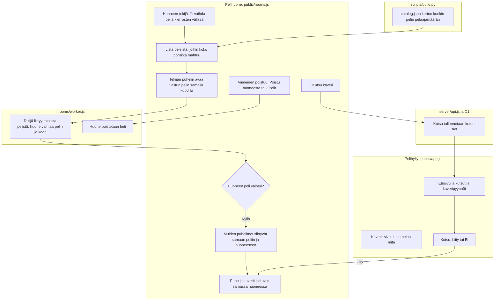

# Porukka: one room for a whole evening of games

Plan for #354. A group of friends stays in one room code from game to game: the phone that made
the room picks the next game, and every phone in it moves there by itself, voice chat included.
Open invites show on the shelf's front page. Phone notifications for invites are a follow-up of their own. What
friends are playing shows only on the friends page;. A room is deleted at once when its last player leaves it.

## Colours

- **amber**: what the room's maker taps to change the game
- **violet**: how the room and the other phones follow the change
- **blue**: what the build tells the room screen about each game
- **teal**: an invite into the room
- **green**: what the shelf shows of friends: invites, requests, who plays what

## Boxes

- **Huoneen tekijä: 🎲 Vaihda peliä kierrosten välissä**: a new button on the room screen in `public/rooms.js`, shown only on the host's phone and only between rounds.
- **Lista peleistä, joihin koko porukka mahtuu**: every game in `catalog.json` that has rooms and whose player limit fits the phones in the room now; the current game is marked.
- **Tekijän puhelin avaa valitun pelin samalla koodilla**: the host leaves a note in `sessionStorage` (code and time) so the new game's page joins the same code as host, then opens `games/<slug>/v<N>/?huone=<CODE>`.
- **Tekijä liittyy toisesta pelistä: huone vaihtaa pelin ja koon**: when the room's own host joins with another `game`, `v` or `max`, the worker keeps the members and takes the new game, then sends `peers` to everyone (and updates the public list).
- **Muiden puhelimet siirtyvät samaan peliin ja huoneeseen**: `onPeers()` already opens the room's game for a phone that is joining; it now does the same for a phone already in the room, using the same back-button handling.
- **catalog.json kertoo kunkin pelin pelaajamäärän**: `build_catalog()` reads `data-max` from the newest version's `rooms.js` tag and writes it as `"room": {"max": N}`.
- **Etusivulla kutsut ja kaveripyynnöt**: `drawPlaying()` in `public/app.js` no longer lists friends playing; it lists open invites ("Kutsut") and requests, both needing an answer. The friends page lists the invites too, and the invite banner stays off on these two pages.
- **Kutsu: Liity tai Ei**: Liity opens the room's game the way the banner does (`openInvite()`); Ei answers the invite.
- **Viimeinen poistuu: Poistu huoneesta tai ‹ Pelit**: the last phone in the room, host or guest, taps "Poistu huoneesta", or the top chip's way back to the shelf (`public/back.js` calls `AiPelitRooms.leaveIfAlone()`), with nobody else in the room; switching games, or a phone only dropping off, is not leaving.
- **Huone poistetaan heti**: on that `bye` the worker takes the room off the public list and clears its storage at once, instead of after the 6-hour `IDLE` alarm.
