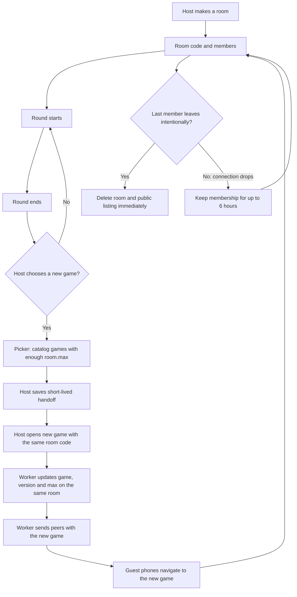

# Porukka: pelihuone säilyy, vaikka peli vaihtuu (#354)

One room can be used for a whole games evening. The room's creator chooses the next game **between rounds**; nobody needs a new invite or room code. The game picker reads the current `catalog.json` and offers only games with room capacity for all members. A disconnected member still occupies a place. The phone that created the room keeps its host role through a short sessionStorage handoff.

The same shared `public/rooms.js` and `rooms/worker.js` work with published games without changing their version directories. Host transitions do not send `bye`; a deliberate leave does. The usual game back-chip navigation remains intact.

The shelf and friends page show **Kutsut** (pending room invitations) above **Kaveripyynnöt**, with `Liity` and `Ei`. Friend activity remains on the friends page but is no longer shown on the front page. Invitation banners do not duplicate those entries.

The second part of #354, web push notifications for invitations while the site is closed, is implemented separately and does not change this room-switching flow.
