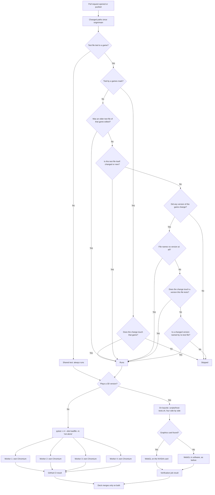

# Pull request tests: which run, and how fast

Which tests a pull request runs, and where. The shared tests always run. A game's own test file runs
only when the change touches one of the game versions that file tests, or the game's tests
themselves. Old, published versions never change, so their tests stay quiet. The chosen test
files then run on four Chromium workers side by side, one whole file per worker at a time, except
the 3D games' tests. Those never run in GitHub CI: they run on the AgentDeck host (bazzite) as
the deck's verification job for the pull request's head, and the deck merges only when that job
and GitHub CI are both green on the same head (#123). On the host, Chromium draws 3D on its graphics
card instead of in software on the processor (#248).

## Colours

- **blue**: what starts a run
- **amber**: a check that decides whether a test file runs
- **green**: a test file that runs
- **rose**: a test file left out
- **teal**: the tests running side by side
- **violet**: the results the deck merges on

## Boxes

- **Changed paths since origin/main**: `changed_paths()` in `tests/conftest.py`: `git diff` against the base, plus uncommitted and new files.
- **Test file tied to a game?**: `games_of()` in `tests/conftest.py`: the file is `tests/test_<slug>*.py`, or its tests carry `@pytest.mark.games("<slug>")`.
- **Tied by a games mark?**: a test in a shared file marked `@pytest.mark.games("<slug>")` keeps the game-level rule: it runs for any change to that game.
- **Was an older test file of that game edited?**: `whole_games_changed()` in `tests/conftest.py`: a `tests/test_<slug>*.py` that already existed on `main` and changed, or a file under `games/<slug>/` beside the version folders other than `game.json` and `thumb.webp`. Then every test file of that game runs, because they import helpers from each other (`test_kirkkis_v4.py` imports from `test_kirkkis_v3.py`).
- **Is this test file itself changed or new?**: `Changes.test_files`: a test file in the change always runs. A test file new on the branch, as each new version brings, runs only itself: no other test imports it yet.
- **Did any version of the game change?**: `changed_versions()`: only `game.json` or `thumb.webp` changing runs none of the game's tests; `scripts/build.py` already checks both.
- **File names no version at all?**: the safe fallback: a game test file that names no version runs whenever a version of its game changes.
- **Does the change touch a version this file tests?**: a file's versions are the `_v<N>` in its name plus every `games/<slug>/v<N>` written in it (`versions_of_test_file()`). `test_areena.py` names `games/areena/v3`, so it runs for v3; `test_voimistelu_v4.py` builds its address from a parameter but its name gives v4.
- **Is a changed version named by no test file?**: `versions_with_tests()`: a new version with no tests of its own runs every test file of its game, as before.
- **Plays a 3D version?**: `is_3d()` in `tests/conftest.py`: a version the test file tests loads `lib/three` (Hiihto v7 on, Pallorata, Jään alla), or the file says `pytestmark = pytest.mark.alone` (`test_lib_three.py`). Such tests get the `alone` mark.
- **On bazzite: scripts/host-tests.sh, four side by side**: `scripts/host-tests.sh`, run by each Work agent with `agentdeck job submit --verification` on the AgentDeck host, never in `.github/workflows/ci.yml` (#123). On GitHub's 4-core runner software WebGL beside other Chromiums dropped too many frames for the 3D games' timed races, so they ran one at a time and took 9 of 14 minutes. On bazzite they first ran two side by side, since four in software failed a Hiihto v8 race on a busy host; drawn on the graphics card (#248), four (`-n 4`, under `nice`) passed every 3D test three times in a row. Exit code 5 (nothing selected) counts as a pass.
- **pytest -n 4 --dist loadfile -m 'not alone'**: `pytest-xdist` in `requirements-dev.txt`; the step in `.github/workflows/ci.yml`. `loadfile` keeps a file's tests on one worker, so the per-file Chromium (`browser` fixture, scope `module`) still starts once per file.
- **Worker 1: own Chromium**: each worker is its own Python process with its own Playwright and Chromium; each test's `site` fixture already serves on its own free port.
- **GitHub CI result**: the `test` job in `.github/workflows/ci.yml`: server tests, the published-version check, the non-3D browser tests and the build.
- **Graphics card found?**: the `browser` fixture in `tests/conftest.py` starts Chromium with `--use-angle=vulkan --enable-features=Vulkan --enable-gpu --ignore-gpu-blocklist` unless `CI` is set. Chromium's WebGL already runs on Vulkan; these flags only let it pick the real card instead of SwiftShader (software). With no card it still gets SwiftShader, so the flags are harmless. After a run with 3D tests, the summary names the renderer it got (`webgl_renderer()`).
- **WebGL on the NVIDIA card**: on bazzite's GTX 1660 SUPER, three 3D test files took 1 min 12 s of processor time instead of 20 min 52 s, and 2 min 11 s instead of 3 min 35 s on the clock (#248). 2D games' tests barely use the processor either way.
- **Verification job result**: the deck's record of a green `agentdeck job submit --verification` run for the exact head.
- **Deck merges only on both**: AgentDeck's ai-pelit setting `verification = "agentdeck_job"` (eerovil/agentdeck#3919): a green verification job and finished, green GitHub checks on the same head.
