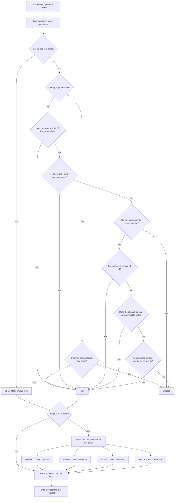

# Pull request tests: which run, and how fast

What GitHub CI runs on a pull request. The shared tests always run. A game's own test file runs
only when the change touches one of the game versions that file tests, or the game's tests
themselves. Old, published versions never change, so their tests stay quiet. The chosen test
files then run on four Chromium workers side by side, one whole file per worker at a time, except
the 3D games' tests, which run after them one at a time.

## Colours

- **blue**: what starts a run
- **amber**: a check that decides whether a test file runs
- **green**: a test file that runs
- **rose**: a test file left out
- **teal**: the tests running side by side
- **violet**: what the pull request shows

## Boxes

- **Changed paths since origin/main**: `changed_paths()` in `tests/conftest.py`: `git diff` against the base, plus uncommitted and new files.
- **Test file tied to a game?**: `games_of()` in `tests/conftest.py`: the file is `tests/test_<slug>*.py`, or its tests carry `@pytest.mark.games("<slug>")`.
- **Tied by a games mark?**: a test in a shared file marked `@pytest.mark.games("<slug>")` keeps the game-level rule: it runs for any change to that game.
- **Was an older test file of that game edited?**: `whole_games_changed()` in `tests/conftest.py`: a `tests/test_<slug>*.py` that already existed on `main` and changed, or a file under `games/<slug>/` beside the version folders other than `game.json` and `thumb.webp`. Then every test file of that game runs, because they import helpers from each other (`test_kirkkis_v4.py` imports from `test_kirkkis_v3.py`).
- **Is this test file itself changed or new?**: `Changes.test_files`: a test file in the change always runs. A test file new on the branch, as each new version brings, runs only itself: no other test imports it yet.
- **Did any version of the game change?**: `changed_versions()`: only `game.json` or `thumb.webp` changing runs none of the game's tests; `scripts/build.py` already checks both.
- **File names no version at all?**: the safe fallback: a game test file that names no version runs whenever a version of its game changes.
- **Does the change touch a version this file tests?**: a file's versions are the `_v<N>` in its name plus every `games/<slug>/v<N>` written in it (`versions_of_test_file()`). `test_areena.py` names `games/areena/v3`, so it runs for v3; `test_voimistelu_v4.py` builds its address from a parameter but its name gives v4.
- **Is a changed version named by no test file?**: `versions_with_tests()`: a new version with no tests of its own runs every test file of its game, as before.
- **Plays a 3D version?**: `is_3d()` in `tests/conftest.py`: a version the test file tests loads `lib/three` (Hiihto v7 on, Pallorata, Jään alla), or the file says `pytestmark = pytest.mark.alone` (`test_lib_three.py`). Such tests get the `alone` mark.
- **pytest -m alone: one at a time**: the second browser step in `.github/workflows/ci.yml`. Beside other Chromiums, software WebGL drops too many frames for the 3D games' timed races; even two at once failed one Hiihto test (#116). Exit code 5 (nothing selected) counts as a pass.
- **pytest -n 4 --dist loadfile -m 'not alone'**: `pytest-xdist` in `requirements-dev.txt`; the step in `.github/workflows/ci.yml`. `loadfile` keeps a file's tests on one worker, so the per-file Chromium (`browser` fixture, scope `module`) still starts once per file.
- **Worker 1: own Chromium**: each worker is its own Python process with its own Playwright and Chromium; each test's `site` fixture already serves on its own free port.
