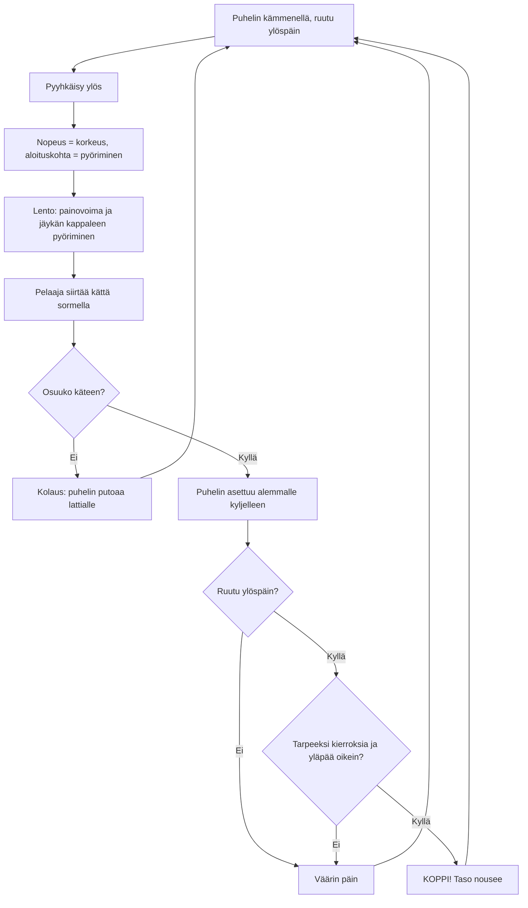

# Puhelinkoppi: one throw, from swipe to catch

How one Puhelinkoppi throw plays (v1). The player swipes the phone up out of their palm; the
swipe's speed sets the height and where it starts on the phone sets the spin. The phone then
flies as a real rigid box: an end-over-end flip turns into a twist by itself (the middle axis
is unstable), a spin about the long axis stays steady. The player moves the hand under it, and
the throw passes when it lands screen up with enough turns for the level.

## Colours

- **blue**: what the player sees and does
- **amber**: a check that decides the result
- **teal**: the physics of the throw and the landing
- **green**: a pass, saved on the phone
- **rose**: a fail; the same level again

## Boxes

- **Puhelin kämmenellä, ruutu ylöspäin**: `newRound()` in `games/puhelinkoppi/v1/index.html`; the palm is tilted towards the player, as you hold a phone to read it.
- **Nopeus = korkeus, aloituskohta = pyöriminen**: `throwFromSwipe()`: upward speed 2–6 m/s from the swipe's last 90 ms; starting below the phone's middle gives an end-over-end flip, at a side a twist about the long axis, sideways speed a drift.
- **Lento: painovoima ja jäykän kappaleen pyöriminen**: `physics()`: Euler's equations for a 7.5 × 15.5 × 0.8 cm box (RK4, 1 ms steps) and a quaternion orientation; `launch()` adds a small random wobble, as no hand throws perfectly.
- **Pelaaja siirtää kättä sormella**: dragging anywhere during the flight moves the hand sideways (`onMove()`).
- **Osuuko käteen?**: when the phone comes down to the palm, it must be within 8.5 cm sideways of the hand's middle.
- **Puhelin asettuu alemmalle kyljelleen**: `caught()`: the phone settles flat on whichever face points more down, keeping its heading.
- **Tarpeeksi kierroksia ja yläpää oikein?**: `spec()`: level 1 wants only the screen up; level 2 one turn; level 3 also the top end pointing away; then more turns. A turn is two times the screen changes from up to down.
- **KOPPI! Taso nousee**: `finish()` saves `taso`, `paras` and `kopit` under `ai-pelit:puhelinkoppi:`.
