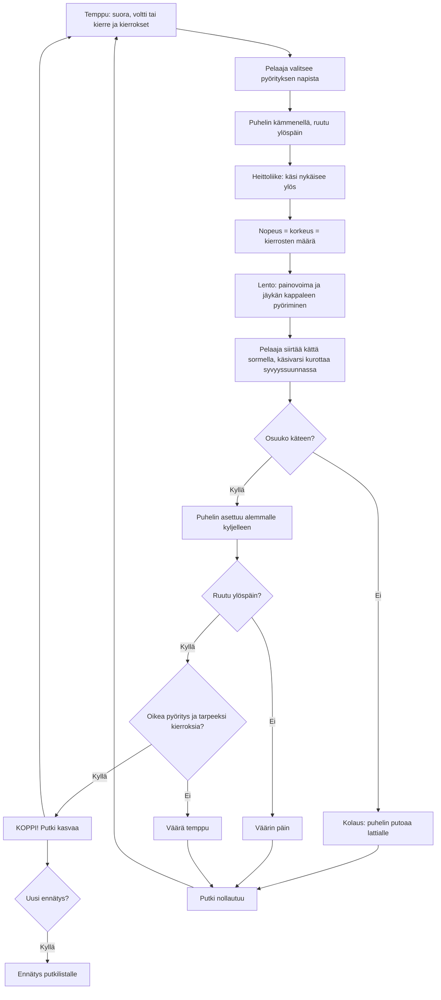

# Puhelinkoppi: one throw, from swipe to catch

How one Puhelinkoppi throw plays (v3). Each throw asks for a trick: a straight throw, a voltti
(end over end) or a kierre (about the long axis), with a number of turns. The player picks the spin
with the buttons, moves the hand with the phone in it, and flicks up: the hand's speed sets the
height, and so how many turns the phone makes. The phone flies as a real rigid box, in all three
directions and turning about all three axes: a voltti may turn into a twist by itself (the middle
axis is unstable), a kierre stays steady. The goal is the longest streak of tricks caught screen
up. (v1 and v2 had levels instead, and v1 took the spin from where the finger touched the phone.)

## Colours

- **blue**: what the player sees and does
- **amber**: a check that decides the result
- **teal**: the physics of the throw and the landing
- **violet**: the game's ask for the next throw
- **green**: the streak grows, saved on the phone and sent to the online list
- **rose**: the streak ends

## Boxes

- **Temppu: suora, voltti tai kierre ja kierrokset**: `nextTrick()` in `games/puhelinkoppi/v3/index.html`: the first three teach a straight throw, one kierre and one voltti; then they come at random, two turns from a streak of 4 (kierre) or 6 (voltti) on. Every trick can be thrown within the hand's reach (a test checks).
- **Pelaaja valitsee pyörityksen napista**: the `#spins` buttons (⬆ Suora, 🔄 Voltti, 🌀 Kierre), live only before the throw (`pick()`).
- **Puhelin kämmenellä, ruutu ylöspäin**: `newRound()`; the palm is tilted towards the player, as you hold a phone to read it.
- **Heittoliike: käsi nykäisee ylös**: `onMove()` moves the hand, and the phone in it, with the finger; `onUp()` throws when the hand was moving up faster than 1 m/s at the end, otherwise the phone stays in the hand.
- **Nopeus = korkeus = kierrosten määrä**: `throwFromSwipe()`: the phone leaves with the hand's upward speed over the last 90 ms (2–6.5 m/s) and the picked spin at a fixed rate (`SPINS`: voltti 1.7, kierre 2 turns a second), so a higher throw makes more turns.
- **Lento: painovoima ja jäykän kappaleen pyöriminen**: `physics()`: flight in all three directions (`launch()` pushes the phone a little towards the player, as the tilted palm does); Euler's equations for a 7.5 × 15.5 × 0.8 cm box (RK4, 1 ms steps) and a quaternion orientation; `launch()` adds a small random wobble, as no hand throws perfectly.
- **Pelaaja siirtää kättä sormella, käsivarsi kurottaa syvyyssuunnassa**: dragging during the flight moves the hand sideways and up or down, from 30 cm below to 60 cm above where it started (`moveHand()`). The finger has only two directions, so the arm follows the phone in depth by itself, at most 1.5 m/s and 45 cm forward or back (`step()`). Once the phone is caught the hand holds still.
- **Osuuko käteen?**: when the phone comes down to the palm, it must be within 8.5 cm sideways of the hand's middle; a phone the hand was raised past falls on.
- **Puhelin asettuu alemmalle kyljelleen**: `caught()`: the phone settles flat on whichever face points more down, keeping its heading.
- **Oikea pyöritys ja tarpeeksi kierroksia?**: `judge()`: the spin thrown must be the one asked, with at least its turns; a straight throw must make none. A turn is two times the screen changes from up to down.
- **KOPPI! Putki kasvaa**: `finish()` saves the streak (`putki-nyt`, so it survives closing the game), the record (`putki`) and catches (`kopit`) under `ai-pelit:puhelinkoppi:`. v1 and v2's `taso`, `paras` and `haasteet` stay as they are.
- **Ennätys putkilistalle**: `AiPelitScores.submit(record)` on the `putki` list (see `tuloslistat.md`).
