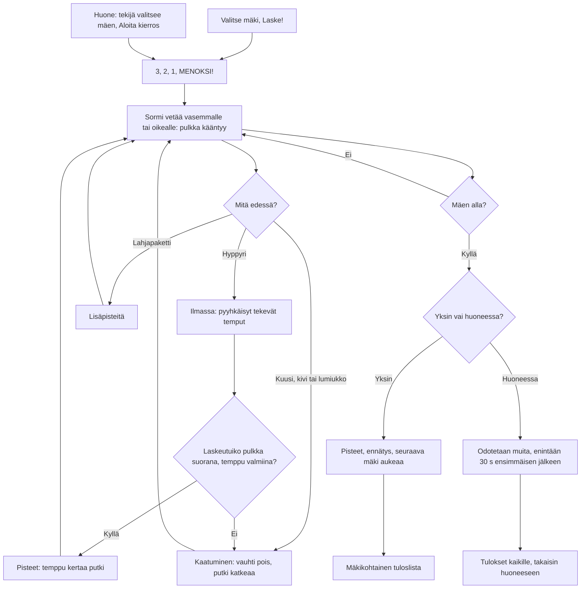

# Pulkkamäki: one run down the hill

How one run of Pulkkamäki plays (v1, #475). Each player slides down a snowy Christmas-evening hill on
a sled, seen from behind in 3D: steering between spruces and jumps on the snow, tricks in the air,
points for every trick landed and every present caught. Alone the player races three computer
sledders; in a room 2–6 phones go down the same hill at the same time, and computer sledders fill
the empty places up to four.

## Colours

- **blue**: what the player sees and does
- **amber**: a check that decides the path
- **teal**: what earns points
- **violet**: the run in a room with friends
- **rose**: a fall
- **green**: a result or a record

## Boxes

- **Valitse mäki, Laske!**: the menu offers three hills (Kotimäki, Kuusikko, Tunturi); the next one opens once the one before has scored enough. The last hill is saved as `ai-pelit:pulkkamaki:maki`.
- **Huone: tekijä valitsee mäen, Aloita kierros**: `rooms.js` with `data-min="2" data-max="6"`; under the player list the host picks the hill, the others see "Huoneen tekijä valitsee mäen.". Every phone builds the same hill from the host's hill and seed.
- **Sormi vetää vasemmalle tai oikealle: pulkka kääntyy**: on the snow, how far the finger is from where it touched down turns the sled; letting go straightens it. Gravity gives the speed, and turning hard brakes a little.
- **Ilmassa: pyyhkäisyt tekevät temput**: in the air a swipe starts a trick: up a front flip, down a back flip, left or right a spin; holding a finger still is a grab (Superman) that scores while held. A trick plays out over a set time, and the next one may follow once it is done.
- **Laskeutuiko pulkka suorana, temppu valmiina?**: landing mid-trick, mid-grab or more than a set angle askew is a fall. A generous margin, so a near miss lands (docs/making-games.md, "Be generous with timing").
- **Pisteet: temppu kertaa putki**: each trick has its points; several in one jump multiply them, and landing clean jumps in a row raises the streak (putki), which a fall resets.
- **Kaatuminen: vauhti pois, putki katkeaa**: the sled tips and the rider rolls in the snow for about a second; the trick in the air scores nothing.
- **Lahjapaketti**: presents float above some jumps and lie by the track; each one caught adds points.
- **Odotetaan muita, enintään 30 s ensimmäisen jälkeen**: each phone slides its own sled and sends it to the host ten times a second; the host slides the computer's sleds and sends every sled back. Sleds pass through each other. The run ends when everyone is down, or 30 s after the first.
- **Tulokset kaikille, takaisin huoneeseen**: the host's `deliver()` of every sled's points; each phone counts the run once (`once()`) and shows the order on the room screen.
- **Mäkikohtainen tuloslista**: `AiPelitScores.submit()` on the hill's own list (`board('maki-<n>')`), most points first.
