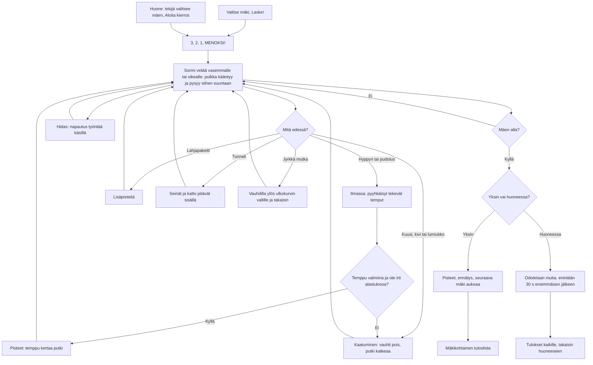

# Pulkkamäki: one run down the hill

How one run of Pulkkamäki plays (v6, #475, #480, #517). Each player slides down a snowy Christmas-evening hill on
a sled in 3D, seen through the rider's own eyes (or from behind, a menu choice): steering between spruces and jumps on the snow, tricks in the air,
points for every trick landed and every present caught. Alone the player races three computer
sledders; in a room 2–6 phones go down the same hill at the same time, and computer sledders fill
the empty places up to four.

## Colours

- **blue**: what the player sees and does
- **amber**: a check that decides the path
- **teal**: what earns points
- **violet**: the run in a room with friends
- **rose**: a fall
- **green**: a result or a record

## Boxes

- **Valitse mäki, Laske!**: the menu (`showMenu()` in `ui.js`) offers seven hills from v6 (#517; Kotimäki, Kuusikko, Tunturi, Rotko, Jyrkänne, and from v6 Mutkamäki and Luolasto, `HILLS` in `world.js`; five in v4 and v5; upright in two columns, sideways in three); the next one opens once a run on the one before scores its `open` points (2500, 4000, 3000, 4000, 4000, 4500), and a locked hill's button says so with the hill before it ("🔒 4500 p Mutkamäessä", its `at`, hidden sideways), saved as `ai-pelit:pulkkamaki:auki`. Rotko and Jyrkänne have long steep stretches (`steep`, eased in and out over their first and last quarter) and drops (`drop`, a cliff 2 m long); the sled leaves the snow when the ground falls more than 6 cm below where the slope behind it would have gone in one step (`step()`, from v4), and at over 2 m/s, so a drop throws a fast sled and a steep stretch keeps it on the snow. The last hill is saved as `ai-pelit:pulkkamaki:maki`. "📷 Silmistä" / "📷 Takaa" picks the view, saved as `ai-pelit:pulkkamaki:kamera` (`fp` or `back`); "👕 Asu" the outfit (`outfits.js`); "👥 Pelaa kavereiden kanssa" opens the room (`AiPelitRooms.open()`).
- **Huone: tekijä valitsee mäen, Aloita kierros**: `rooms.js` with `data-min="2" data-max="6"`; under the player list (`roomControls()` in `net.js`, `RM.extra()`) the host picks one of its open hills, the others see "Huoneen tekijä (<nimi>) valitsee mäen.". The host makes a sled for each player and computer sledders up to four sleds; every phone builds the same hill from the host's hill number (`buildHill(n)` is fixed per hill) and takes the sleds from the host's first message.
- **Sormi vetää vasemmalle tai oikealle: pulkka kääntyy**: on the snow, how far the finger is from where it touched down sets how fast the sled turns (`steerOf()` in `ui.js`); when the finger lifts the sled keeps the heading it has (Eero's choice: no steering by itself), also through the course's bends (from v6 Mutkamäki and Luolasto bend sharply; the sled keeps its heading in the world, so on a bend it drifts to the outer curve unless the player steers round it), at most about 75° from the course (`MAX_YAW`). After a fall it points down the course again. Gravity gives the speed, and turning hard brakes a little.
- **Seinät ja katto pitävät sisällä**: from v6 (#517) a hill's `tunnel` list (`[s, len]`; Mutkamäki two, Luolasto three) puts the course through tunnels (`tunnelAt()` in `world.js`). Inside one the sled cannot leave the course sideways: its place across stops at `width / 2 + WALL - 0.4` (`WALL` 0.5 m), and a knock at over 0.12 rad from the course costs 3 % of its speed and plays a soft thud (`wall` event); in the air it cannot rise over `ROOF - 1.3` (`ROOF` 5.2 m) above the snow, so a jump just before or in a tunnel stays low. A sled coming at a mouth from out beside the track hits the snow over the tunnel (a fall) and slides along its face to the opening. No spruce, rock or snowman stands in a tunnel or within 8 m of its mouths. `tunnels()` in `draw3d.js` draws the arch, the snow mound over it and a lamp every 10 m; snowfall stops inside.
- **Vauhdilla ylös ulkokurvin vallille ja takaisin**: from v6 (#517) a hill with `berm: true` (Mutkamäki and Luolasto) builds a snow bank on the outside of each bend (`hill.berm`, `bermAt()` in `world.js`): its height grows with how sharply the course turns (`BERM_PER_TURN`, at most `BERM_MAX` 1.7 m) and fades out near a tunnel and at the hill's end; it rises from `BERM_IN` (3.5 m) inside the course's edge and rounds off flat at twice that height, so a fast sled rides up it without being thrown. On such a hill the slope across the snow, without the jumps, turns the sled down it (`BERM_TURN`), so a sled that rode up comes back onto the course; the sled leaves the course only 2 m further out where a bank stands. Spruces and lanterns keep off the banks.
- **Hidas: napautus työntää käsillä**: from v4 (#517) a sled on the snow under `PUSH_BELOW` (10 m/s from v5; 3 in v4), not falling and not over the line, is pushed on with the hands (`pushOff()` in `world.js`; not while a room is paused): +2.5 m/s, at most up to `PUSH_MAX` 10 m/s, or `PUSH_OFF_MAX` 4.2 m/s off the course (v4: +1.6 up to 4.2 everywhere), so four quick taps bring a stopped sled to a good speed. From v5 only a tap pushes: a touch lifted within `TAP_MS` (0.3 s) that never moved as far as a swipe in any direction (`p.far`, `tapPush()` on `pointerup` in `ui.js`), so a steering drag does not; in v4 every touch on the snow pushed as it came down. Both arms reach to the snow for `pushT` (0.35 s, sent to the other phones as the sled's 20th value, so they see the arms too); the HUD says "Napauta: työnnä käsillä" under 2.2 m/s. The computer pushes too below 1.5 m/s.
- **Ilmassa: pyyhkäisyt tekevät temput**: in the air a swipe starts a trick: up a front flip, down a back flip, left or right a spin; holding a finger still is a grab (Superman) that scores while held. A trick plays out over a set time, and the next one may follow once it is done. From v4 (#517) a trick is not begun, nor queued, when the predicted time to the snow (`timeToLand()`) is less than what is left of the trick turning now plus `LAND_DONE` of the new one and 0.05 s to spare (`trickFits()`), and a grab not when less than `GRAB_LATE` (0.45 s) is left; the swipe then shows "Ei ehdi!" (not when it was refused for a grab still held, nor while a trick is still turning). The computer's tricks skip this check: it keeps its misjudgements and falls, as in v3.
- **Temppu valmiina ja ote irti alastulossa?**: `land()` in `world.js`: landing with a grab still held, or with a trick less than `LAND_DONE` (80 %) done, is a fall; a trick at least that far done counts as finished. There is no separate angle check. A generous margin, so a near miss lands (docs/making-games.md, "Be generous with timing").
- **Pisteet: temppu kertaa putki**: each trick has its points; several in one jump multiply them, and landing clean jumps in a row raises the streak (putki), which a fall resets.
- **Kaatuminen: vauhti pois, putki katkeaa**: the sled tips and the rider rolls in the snow for about a second; the trick in the air scores nothing.
- **Lahjapaketti**: presents float above some jumps and lie by the track; each one caught adds points.
- **Odotetaan muita, enintään 30 s ensimmäisen jälkeen**: `net.js`. Each phone slides its own sled and sends it to the host ten times a second (once finished, still ten times a second until it stands past the line, from v3; then each second until the host has it); the host slides the computer's sleds and sends every sled back ten times a second. From v3 (#480) every phone draws the others from `lib/sulava-1` a moment back, gliding between the spots heard (`asDrawn()` in `net.js`, swapped in for `render3d()` and `drawHUD()` in `ui.js`'s `frame()` and back after); the track keeps the place, heading and height and the turns drawn (a trick's flip and spin, the roll of a fall, the lean), and nothing carries another sled on between messages any more (v2's `coast()`), so a dropped phone's sled waits at its newest spot, and the host takes the phone's last real state back when it returns (`hello`). A guest's `p` and the host's `s` carry the sending phone's run clock (`st`, `runClock()`: `AiPelitSulava.now()` standing still while `RM.paused`, and the tracks hear and draw by it, so a pause holds every drawn sled where it is; the phones hear a pause a moment apart, so a spot heard while paused waits in the sled's `held` list, emptied on a reset, and goes on its track when the pause ends here (`heldOn()`), heard no sooner than its stamp plus the lag of the spot before the pause (`rec.lag`), so its stamp, ahead of the held clock, does not make the track draw the sled further on; the clock goes on 1 ms past the paused moment, so the first frame after it has moved on and the track eases the held spots in instead of drawing them at once; the game's rules read the newest spot at once), and the host's row of a friend's sled carries the friend's own stamp (`f`) while the friend drives it; a track starts again (`heardSpot()`) when that clock changes, as the computer takes over a friend's sled or gives it back, and the host resets it on `back`; it also starts again where a fall ends (`fell`), as the roll drops from about 1.5 turns back to 0 there (`roll` is blended straight, not as an angle). A move over `jump` = 25 m between two spots (about a second at the top speed) is drawn at once. Sleds pass through each other. The run ends on the host when everyone is down, or `LATE` = 30 s after the first (`ff` in the host's state, so every phone's HUD counts it down). While a phone is away the run waits (`RM.paused`); "Jatka ilman heitä" lets the host's computer drive its sled (`continue`), which marks it 🤖 for good; a sled already over the line is left as it is. Each take-over raises the sled's counter (`own`): a phone whose own sled comes with a higher one carries on from the host's state (after a reload or a drop, `hello`), and the host ignores a state with a lower one. A phone back after the computer drove its sled takes up the computer's run, not its own older state. A sled's message carries what its jump has earned so far (tricks done, one waiting, the grab's time), so a phone reloaded in the air still scores them on landing. A grab belongs to the finger holding it: whenever a sled changes hands (a guest taking the host's state of its own sled, the host's `hello`, `continue` and `back`), `handOver()` in `world.js` lets go of a grab still held; one held at least `GRAB_MIN` (0.2 s) counts like a finished trick, the jump's other tricks stay, and nobody falls for it (v2).
- **Tulokset kaikille, takaisin huoneeseen**: the host's `deliver()` of every sled's points, finished sleds first; each phone shows them on its end screen, saves its record and high score once (`once()`) on the hill the result names (a phone back only after the end has not heard the hill otherwise), not when the computer drove its sled, and "Takaisin huoneeseen" shows the order on the room screen (`RM.note()`, `RM.backToRoom()`). The host sends the result again to a phone back after a reload (`hello`).
- **Mäkikohtainen tuloslista**: `saveRun()` in `ui.js`: `AiPelitScores.submit()` on the hill's own list (`board('maki-<n>')`, allowed by `GAMES` in `server/api.js` as `maki-1` to `maki-7`; `maki-5` from v4, `maki-7` from v6), most points first, with hills open (`auki`) as the level (`GAMES` in `public/scores.js`; at least 1, since the game saves `auki` only once a second hill opens). Alone the run is saved at once; in a room from the host's result.
