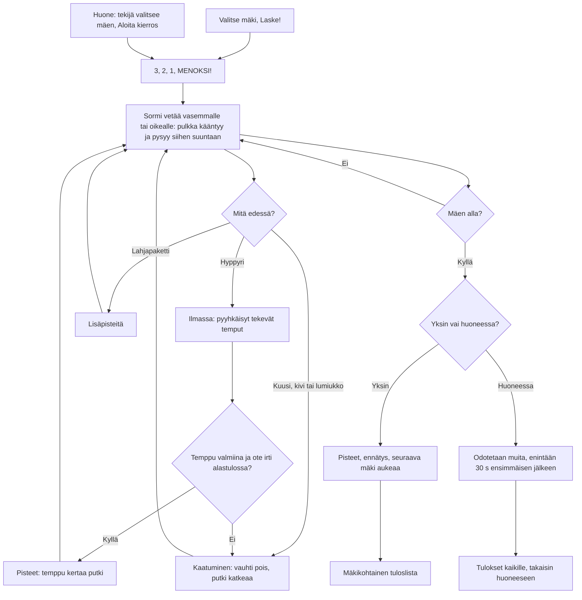

# Pulkkamäki: one run down the hill

How one run of Pulkkamäki plays (v2, #475). Each player slides down a snowy Christmas-evening hill on
a sled in 3D, seen through the rider's own eyes (or from behind, a menu choice): steering between spruces and jumps on the snow, tricks in the air,
points for every trick landed and every present caught. Alone the player races three computer
sledders; in a room 2–6 phones go down the same hill at the same time, and computer sledders fill
the empty places up to four.

## Colours

- **blue**: what the player sees and does
- **amber**: a check that decides the path
- **teal**: what earns points
- **violet**: the run in a room with friends
- **rose**: a fall
- **green**: a result or a record

## Boxes

- **Valitse mäki, Laske!**: the menu (`showMenu()` in `ui.js`) offers three hills (Kotimäki, Kuusikko, Tunturi, `HILLS` in `world.js`); the next one opens once a run on the one before scores its `open` points (2500, 4000), saved as `ai-pelit:pulkkamaki:auki`. The last hill is saved as `ai-pelit:pulkkamaki:maki`. "📷 Silmistä" / "📷 Takaa" picks the view, saved as `ai-pelit:pulkkamaki:kamera` (`fp` or `back`); "👕 Asu" the outfit (`outfits.js`); "👥 Pelaa kavereiden kanssa" opens the room (`AiPelitRooms.open()`).
- **Huone: tekijä valitsee mäen, Aloita kierros**: `rooms.js` with `data-min="2" data-max="6"`; under the player list (`roomControls()` in `net.js`, `RM.extra()`) the host picks one of its open hills, the others see "Huoneen tekijä (<nimi>) valitsee mäen.". The host makes a sled for each player and computer sledders up to four sleds; every phone builds the same hill from the host's hill number (`buildHill(n)` is fixed per hill) and takes the sleds from the host's first message.
- **Sormi vetää vasemmalle tai oikealle: pulkka kääntyy**: on the snow, how far the finger is from where it touched down sets how fast the sled turns (`steerOf()` in `ui.js`); when the finger lifts the sled keeps the heading it has (Eero's choice: no steering by itself), also through the course's bends, at most about 75° from the course (`MAX_YAW`). After a fall it points down the course again. Gravity gives the speed, and turning hard brakes a little.
- **Ilmassa: pyyhkäisyt tekevät temput**: in the air a swipe starts a trick: up a front flip, down a back flip, left or right a spin; holding a finger still is a grab (Superman) that scores while held. A trick plays out over a set time, and the next one may follow once it is done.
- **Temppu valmiina ja ote irti alastulossa?**: `land()` in `world.js`: landing with a grab still held, or with a trick less than `LAND_DONE` (80 %) done, is a fall; a trick at least that far done counts as finished. There is no separate angle check. A generous margin, so a near miss lands (docs/making-games.md, "Be generous with timing").
- **Pisteet: temppu kertaa putki**: each trick has its points; several in one jump multiply them, and landing clean jumps in a row raises the streak (putki), which a fall resets.
- **Kaatuminen: vauhti pois, putki katkeaa**: the sled tips and the rider rolls in the snow for about a second; the trick in the air scores nothing.
- **Lahjapaketti**: presents float above some jumps and lie by the track; each one caught adds points.
- **Odotetaan muita, enintään 30 s ensimmäisen jälkeen**: `net.js`. Each phone slides its own sled and sends it to the host ten times a second (once finished, each second until the host has it); the host slides the computer's sleds and sends every sled back ten times a second, and between messages a phone moves the others on as they were going (`coast()`); the host moves a phone's sled on only while its messages keep coming (500 ms), so a dropped phone's sled waits where it was, and takes the phone's last real state back when it returns (`hello`). Sleds pass through each other. The run ends on the host when everyone is down, or `LATE` = 30 s after the first (`ff` in the host's state, so every phone's HUD counts it down). While a phone is away the run waits (`RM.paused`); "Jatka ilman heitä" lets the host's computer drive its sled (`continue`), which marks it 🤖 for good; a sled already over the line is left as it is. Each take-over raises the sled's counter (`own`): a phone whose own sled comes with a higher one carries on from the host's state (after a reload or a drop, `hello`), and the host ignores a state with a lower one. A phone back after the computer drove its sled takes up the computer's run, not its own older state. A sled's message carries what its jump has earned so far (tricks done, one waiting, the grab's time), so a phone reloaded in the air still scores them on landing. A grab belongs to the finger holding it: whenever a sled changes hands (a guest taking the host's state of its own sled, the host's `hello`, `continue` and `back`), `handOver()` in `world.js` lets go of a grab still held; one held at least `GRAB_MIN` (0.2 s) counts like a finished trick, the jump's other tricks stay, and nobody falls for it (v2).
- **Tulokset kaikille, takaisin huoneeseen**: the host's `deliver()` of every sled's points, finished sleds first; each phone shows them on its end screen, saves its record and high score once (`once()`) on the hill the result names (a phone back only after the end has not heard the hill otherwise), not when the computer drove its sled, and "Takaisin huoneeseen" shows the order on the room screen (`RM.note()`, `RM.backToRoom()`). The host sends the result again to a phone back after a reload (`hello`).
- **Mäkikohtainen tuloslista**: `saveRun()` in `ui.js`: `AiPelitScores.submit()` on the hill's own list (`board('maki-<n>')`, allowed by `GAMES` in `server/api.js` as `maki-1` to `maki-3`), most points first, with hills open (`auki`) as the level (`GAMES` in `public/scores.js`; at least 1, since the game saves `auki` only once a second hill opens). Alone the run is saved at once; in a room from the host's result.
