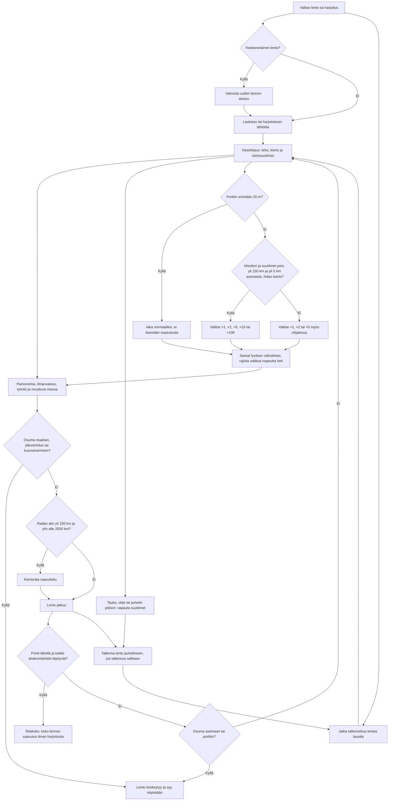

# Raketti: laukaisusta kiertoradalle ja telakointiin

Pelaaja ohjaa kaksivaiheista rakettia itse koko matkan. Sama kaksiulotteinen lentomalli laskee laukaisun, kiertoradan ja telakoinnin; näkymän vaihto ei siirrä alusta. Harjoituksista voi aloittaa kiertoradalla tai aseman lähellä, mutta niistä ei saa koko lennon saavutuksia.

## Colours

- **blue**: lennon valinta ja jatkaminen
- **violet**: pelaajan ohjaus ja tauko
- **teal**: lentomalli ja ajan kuluminen
- **rose**: vauriot ja törmäykset
- **green**: kiertorata ja telakoinnin onnistuminen
- **amber**: puhelimen tallennus

## Boxes

- **Valitse lento tai harjoitus**: `games/raketti/v2/ui.js` tarjoaa täyden laukaisun sekä erilliset kiertorata- ja telakointiharjoitukset. `physics.js:freshFlight()` antaa harjoitukselle valmiin lähtötilan, ei ohjausta lennon aikana.
- **Keskeneräinen lento?**: `ui.js:activeSaved()` ja `requestFlight()` suojaavat olemassa olevan lennon. Uusi lento vaatii vahvistuksen ennen tallennuksen korvaamista.
- **Vahvista uuden lennon aloitus**: `ui.js` näyttää `replace-panel`-ruudun. Peruuttaminen säilyttää aiemman lennon.
- **Laukaisu tai harjoituksen lähtötila**: `ui.js:startFlight()` käynnistää laukaisun täydellä teholla tai harjoituksen päämoottori sammutettuna.
- **Jatka tallennettua lentoa tauolta**: `physics.js:loadFlight()` hyväksyy vain kelvollisen tallennuksen; `ui.js` avaa sen tauolle. Jatkaminen vaatii pelaajan painalluksen.
- **Käsiohjaus: teho, kierto ja siirtosuuttimet**: `ui.js:applyPointers()` ja tehosäädin muuttavat pelaajan käskyjä. Päämoottorin irrotus on käsin tehtävä `physics.js:stageRocket()`, joka katkaisee tehon. Tyhjä polttoaine ei tuota työntöä. Ei autopilottia tai automaattista kierron pysäytystä tyhjiössä.
- **Painovoima, ilmanvastus, työntö ja muuttuva massa**: `physics.js:tick()` käyttää Maan keskeistä painovoimaa, pyörivää ilmakehää, yksinkertaistettua ilmanvastusta, raketin työntöä ja pyörimistä. `step()` jakaa ajan enintään 0,25 sekunnin osiin, moottorin tai suuttimien toimiessa ja alle kilometrin päässä asemasta enintään 0,02 sekuntiin.
- **Osuma maahan, ylikuormitus tai kuumeneminen?**: `physics.js:tick()` päättää lennon maanpintaan, yli 130 kPa:n dynaamiseen paineeseen tai yli 70 MW/m²:n paineen ja nopeuden tuloon. Viimeinen on yksinkertaistettu kuumenemisraja, ei lämpömalli.
- **Radan alin yli 150 km ja ylin alle 2000 km?**: `physics.js:orbit()` laskee radan energian ja liikemäärän perusteella. Saavutus vaatii molemmat ehdot; korkeus yksin ei riitä.
- **Kiertorata saavutettu**: `physics.js:tick()` tallentaa saavutuksen heti, jos lento ei ole harjoitus. Harjoituksen valmis kiertoratatila ei kirjaa saavutusta.
- **Lento jatkuu**: `ui.js:frame()` ja `physics.js:step()` jatkavat samaa fysikaalista tilaa. `draw.js` näyttää paikallisen lennon, ratakartan tai aseman koordinaatiston muuttamatta tilaa. `ui.js:guidance()` kertoo myös onko asema edellä vai jäljessä; ohjeen 250–400 km siirtorata lähtee aseman ollessa noin 3° edellä, ja sen kaksi polttoa lisäävät nopeutta noin 43 m/s kumpikin.
- **Portti lähellä ja kaikki telakointiehdot täyttyvät?**: `physics.js:approach()` laskee nokan sijainnin ja nopeuden suhteessa liikkuvaan porttiin. `tick()` vaatii 2. vaiheen, alle 1,2 m etäisyyden, enintään 0,25 m/s nopeuseron, enintään 5° suuntaeron, enintään 0,01 rad/s kiertoeron sekä portin lähestymispuolen.
- **Telakoitu: koko lennon saavutus ilman harjoitusta**: `physics.js:endFlight()` pysäyttää lennon, tallentaa tuloksen ja kirjaa telakoinnin vain täydestä lennosta. `ui.js:showResult()` tarjoaa uuden yrityksen.
- **Osuma asemaan tai porttiin?**: `physics.js:stationContact()` tarkistaa koko aluksen nokasta perään ja näiden välivaiheen liikeradat aseman runkoa, paneeleita ja portin rengasta vasten. `tick()` tarkistaa onnistumisen ensin. Liian nopea, vino tai pyörivä osuma ei telakoidu, eikä alus voi hypätä esteen läpi ruutujen välissä.
- **Lento keskeytyy ja syy näytetään**: `physics.js:endFlight()` katkaisee moottorin, vapauttaa ohjauksen ja tallentaa. `ui.js:showResult()` kertoo syyn ja tarjoaa uuden yrityksen.
- **Tauko, ohje tai puhelin piiloon: vapauta suuttimet**: `ui.js:showPanel()` ja `suspendFlight()` pysäyttävät ajan, vapauttavat kaikki painetut suuttimet ja hiljentävät moottorin. Myös `pointercancel` ja kadonnut osoittimen kaappaus vapauttavat painalluksen.
- **Tallenna lento puhelimeen, jos tallennus sallitaan**: `physics.js:saveFlight()` säilyttää ajan, paikan, nopeuden, asennon, kierron, polttoaineet ja vaiheen avaimella `ai-pelit:raketti:lento`. `ui.js:frame()` tallentaa kahden sekunnin välein. Tallennuksen estyminen ei pysäytä peliä. Saavutukset käyttävät erillistä `ai-pelit:raketti:saavutukset`-avainta.
- **Porttiin enintään 20 m?**: `physics.js:maxWarp()` laskee nokan etäisyyden porttiin `approach()`-funktiolla. Enintään 20 metrin etäisyydellä suurin nopeus on ×1. Raja on toteutusoletus turvalliseen loppulähestymiseen.
- **Moottori ja suuttimet pois, yli 150 km ja yli 5 km asemasta, hidas kierto?**: `physics.js:maxWarp()` sallii ×100 asti vain käynnissä olevassa vapaassa lennossa, kun kaikki ehdot ja alle 0,01 rad/s kierto täyttyvät. Muulloin yli 20 m portista suurin nopeus on ×5 myös nousussa ja ohjatessa.
- **Valitse ×1, ×2, ×5, ×10 tai ×100**: `ui.js` kierrättää ajan painikkeella sallitut nopeudet. Moottorin tai suuttimien käyttö rajoittaa ×10/×100-ajan ×5:een; ×2 ja ×5 säilyvät. Käsky ei ohjaa alusta pelaajan puolesta.
- **Valitse ×1, ×2 tai ×5 myös ohjatessa**: `ui.js` näyttää samassa painikkeessa ohjatun lennon kolme nopeutta. Vaiheen irrotus katkaisee tehon mutta säilyttää ×2/×5-ajan. Tauko, uusi lento ja tallennuksen jatkaminen alkavat ×1-ajalla.
- **Samat fysiikan välivaiheet, rajoita valittua nopeutta heti**: `physics.js:advanceFlight()` käyttää joka välivaiheella `limitWarp()`-rajaa ja samoja `flightStepLimit()`-askelia kuin normaaliaikainen `step()`. Raja vaikuttaa saman ruudun jäljellä olevaan aikaan; voimat, polttoaine ja törmäykset lasketaan edelleen jokaisella askeleella.
- **Aika normaaliksi, ei itsestään nopeutusta**: `physics.js:limitWarp()` vain laskee valittua nopeutta. `ui.js` kertoo 20 m:n rajan ajan painikkeen vieressä ja poistaa nopeutuspainikkeen käytöstä rajan sisällä. Loittoneminen ei nosta nopeutta itsestään.
