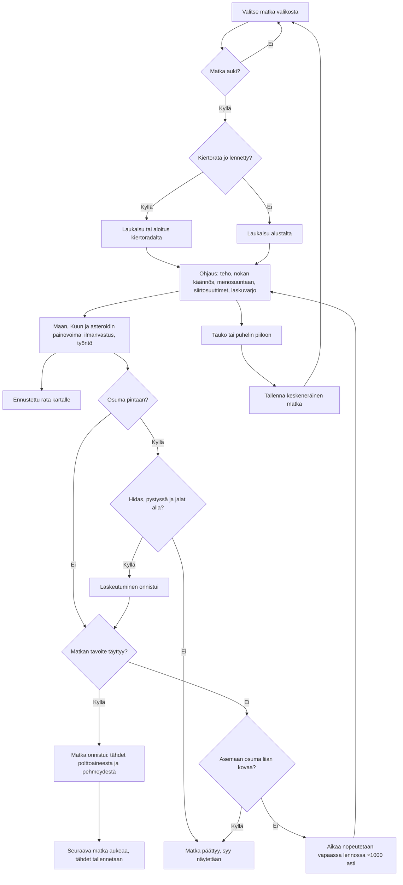

# Raketti: kuusi matkaa Maan ja Kuun välillä (v3)

Pelaaja valitsee matkan valikosta: kiertorata, asema, Kuun kiertoradalle (alle 5 minuutissa), Kuuhun, Kuusta kotiin tai pieni asteroidi. Kaikki matkat lentävät samalla pienennetyllä Maa–Kuu-mallilla, jossa alus pitää nokan suunnan itse. Matka päättyy tavoitteeseen tai onnettomuuteen, ja onnistunut matka antaa 1–3 tähteä ja avaa seuraavan.

## Colours

- **blue**: matkan valinta ja aloitus
- **violet**: pelaajan ohjaus ja tauko
- **teal**: lentomalli, ennuste ja ajan nopeutus
- **rose**: osumat ja epäonnistuminen
- **green**: tavoitteet, tähdet ja uudet matkat
- **amber**: puhelimen tallennus

## Boxes

- **Valitse matka valikosta**: `games/raketti/v3/ui.js` (`renderTrips`) näyttää kuusi matkaa listana, kunkin arvioidun keston, tähdet ja lukon. Matkat, niiden tavoitteet ja tähtirajat ovat `games/raketti/v3/trips.js`:n `TRIPS`-listassa.
- **Matka auki?**: `tripOpen`: Kiertoradalle on aina auki; muu matka aukeaa, kun listan edellisestä on vähintään yksi tähti.
- **Kiertorata jo lennetty?**: `openTrip` näyttää "Aloita kiertoradalta" muilla matkoilla kuin Kiertoradalle, kun Kiertoradalle-matkasta on tähti. Valmis rata on pyöreä 80 km rata, ja polttoainetta on 4300 m/s Δv:n verran (`freshFlight(trip, 'orbit')`). Tähdet lasketaan samoin kuin alustalta.
- **Ohjaus: teho, nokan käännös, menosuuntaan, siirtosuuttimet, laskuvarjo**: Tehon liukusäädin on neliöllinen (puoliväli = 25 %). ↶ ↷ kääntävät 15°/s ja 0,4 s jälkeen 60°/s; irrotettaessa nokka pysähtyy (`steer`). "Menosuuntaan", "Vastasuuntaan" ja "Pystyyn" kääntävät nokan lähimmän kappaleen (tai alle 20 km päässä aseman) suhteen enintään 90°/s ja pitävät sen, polttamatta moottoria. Laskuvarjo vain Maan ilmakehässä (alle 40 km); se aukeaa alle 20 km korkeudessa ja repeää yli 400 m/s vauhdissa (`openChute`).
- **Maan, Kuun ja asteroidin painovoima, ilmanvastus, työntö**: `games/raketti/v3/physics.js` laskee kaikkien kolmen kappaleen vedon joka askeleella. Maan säde 500 km ja ilmakehä 40 km; Kuun säde 80 km, 5000 km päässä; Pikkukiven säde 3 km, 2000 km päässä. Moottori kiihdyttää enintään 20 m/s². Kappaleet ovat yhdessä `BODIES`-listassa, joten myöhempi versio voi lisätä Auringon ja Marsin.
- **Ennustettu rata kartalle**: `predictPath` laskee radan noin 8 tuntia eteenpäin moottori sammuksissa samalla mallilla; `games/raketti/v3/draw.js` piirtää sen lähimmän kappaleen ympärille ja merkitsee kohteen lähimmän kohdan. Se näyttää, minne alus on menossa, mutta ei ohjaa.
- **Osuma pintaan?**: `surfaceClearance` lähimmästä kappaleesta; osuma tarkistetaan joka askeleella (`touchdown`).
- **Hidas, pystyssä ja jalat alla?**: `LANDING`: Kuussa ja Maassa ilman varjoa alas enintään 3 m/s, sivulle 2 m/s ja kallistus 15°. Pikkukivellä vauhti enintään 1 m/s ja kallistus 25°. Maahan avatulla laskuvarjolla vauhti enintään 10 m/s. Maahan laskeutuminen ennen matkan tavoitetta päättää matkan kesken.
- **Matka onnistui: tähdet polttoaineesta ja pehmeydestä**: `tripStars`: yksi tähti perillä, toinen kun Δv:tä jää vähintään matkan `dvStar` (Kiertoradalle 4300, Asemalle 3900, Kuun kiertoradalle 3300, Kuuhun 1700, Kotiin 1000, Pikkukivelle 3100 m/s), kolmas pehmeästä (puolet rajoista), telakoinnista alle 0,25 m/s tai pyöreästä radasta (eksentrisyys ≤ 0,1).
- **Asemaan osuma liian kovaa?**: Telakointi onnistuu, kun nokka on alle 3 m portista, nopeusero enintään 0,5 m/s ja suuntaero enintään 10° (`DOCK`). Muu kosketus aseman rakenteisiin on törmäys.
- **Aikaa nopeutetaan vapaassa lennossa ×1000 asti**: `maxWarp`: pinnalla ×5, mutta moottori käynnissä ×1; ilmassa ×1 alle 500 m pinnasta ja alle 50 m portista. Avatun laskuvarjon alla (moottori sammuksissa) ×100 yli 300 m korkeudessa, ×5 yli 50 m. Muuten ×5 moottorin, käännön tai siirtosuuttimien aikana, kappaleen lähellä (Maa 20 km, Kuu 5 km, Pikkukivi 2 km) tai alle 5 km asemasta; ×100 lähempänä kuin Maa 300 km, Kuu 100 km, Pikkukivi 30 km; muuten ×1000. Valittu nopeus laskee itsestään.
- **Tallenna keskeneräinen matka**: Uudet avaimet `ai-pelit:raketti:matka` (keskeneräinen lento, tarkistetaan `validFlight`illa) ja `ai-pelit:raketti:tahdet`. Vanhojen versioiden avaimia ei lueta eikä poisteta.
