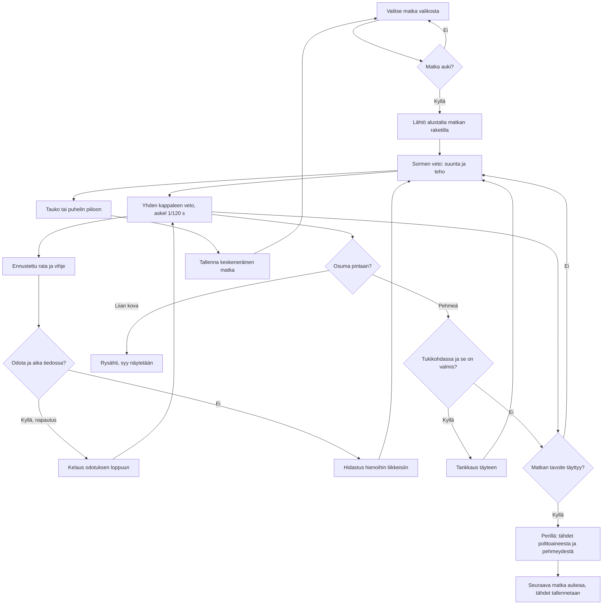

# Raketti: kymmenen matkaa, Kuun tukikohta ja Mars (v4)

Pelaaja valitsee matkan valikosta ja lentää yhdellä sormella: veto näyttää suunnan ja pituus tehon. Vihje ruudun alalaidassa kertoo seuraavan liikkeen, ja odotuksen voi kelata napautuksella. Kolme matkaa rakentavat Kuun tukikohdan osa kerrallaan, ja valmis tukikohta tankkaa Mars-matkan aluksen. Onnistunut matka antaa 1–3 tähteä ja avaa seuraavan.

## Colours

- **blue**: matkan valinta ja aloitus
- **violet**: pelaajan ohjaus ja tauko
- **teal**: lentomalli, vihjeet, kelaus ja hidastus
- **rose**: osumat ja epäonnistuminen
- **green**: tukikohta, tavoitteet, tähdet ja uudet matkat
- **amber**: puhelimen tallennus

## Boxes

- **Valitse matka valikosta**: `games/raketti/v4/ui.js` (`renderMenu`) näyttää kymmenen matkaa kahdessa sarakkeessa (nimi ja tähdet; sivuttain otsikko vasemmalla), lukitut 🔒-merkillä, ja tähtien summan, niin että kaikki mahtuu ruutuun vierittämättä. Matkat, tavoitteet ja polttoainerajat ovat `games/raketti/v4/trips.js`:n `TRIPS`-listassa: Kiertoradalle, Avaruusasemalle, Kuun kiertoradalle, Kuuhun, Kuusta kotiin, Pikkukivelle, Aurinkopaneeli Kuuhun, Polttoainetankki Kuuhun, Polttoainetehdas Kuuhun ja Marsiin. Keskeneräisen lennon voi jatkaa "Jatka: <matka>" -napista; jos sellainen on, uusi matka kysyy ensin "Uusi matka?" (`askStart`, Aloita uusi / Takaisin).
- **Matka auki?**: `tripOpen`: Kiertoradalle on aina auki; muu matka aukeaa, kun listan edellisestä on vähintään yksi tähti. Marsiin aukeaa siis vasta, kun koko tukikohta on rakennettu.
- **Lähtö alustalta matkan raketilla**: `freshFlight` panee aluksen Maan huipulle. Matkan raketti on `ROCKETS`-listasta (`physics.js`): Raketti (työntö 32, polttoaine 340 m/s), Kiitäjä aurinkopaneelille (38, 340) tai Rahtiraketti tankille ja tehtaalle (21, 400, kääntyy hitaasti). Mars-matka lähtee 40 % täydellä tankilla.
- **Sormen veto: suunta ja teho**: `setStick` (`ui.js`): vedon suunta kääntää nokkaa (raketin `turn` rad/s), ja teho kasvaa vedon pituuden neliönä 8 px:n kuolleen alueen jälkeen, täysi 80 px:ssä. Moottori työntää vain, kun nokka on alle 60° vedon suunnasta. Pinnalta alus nousee vasta, kun työntö ylös voittaa painovoiman.
- **Yhden kappaleen veto, askel 1/120 s**: `step` (`physics.js`) laskee velocity Verlet -askeleen. Vain yksi kappale vetää kerrallaan (`refAt`): Kuun (125), Pikkukiven (24) tai Marsin (500) piirin sisällä se, Maan piirissä (1100) Maa, muualla Aurinko. Maan säde 60, Kuun 16 (420 päässä), Pikkukiven 4 (250 päässä), Marsin 30.
- **Ennustettu rata ja vihje**: `predictPath` laskee radan 90 s eteenpäin (Mars-matkalla tankkauksen jälkeen 600 s; Maan piirissä silloin 0,15 s:n askelin) lähimmän kappaleen kehyksessä joka neljännellä ruudulla; välissä `carryPath` siirtää sitä kappaleen mukana, ettei rata Kuun ympärillä tärise. `hint` (`trips.js`) antaa sanan, suunnan, tehon ja merkin radalle; aloitettu jarrutus tai laskeutumisen työntö jatkuu loppuun, ettei sana vaihdu edestakaisin. Laskeutumisvihje ei koskaan työnnä kohti maata. Polton vihje antaa `gap`-luvun, joka on polton jäljellä oleva osa (m/s tai metreinä), ja `hint` laskee siitä `left`-osuuden (1 → 0) sekä `ends`-ajan (pelisekunteja polton loppuun viimeisen 0,1 s:n työnnön tahdilla). `updateHud` (`ui.js`) näyttää osuuden vihjeessä tyhjenevänä palkkina, lisää "– melkein" ja oranssin sykkeen, kun neljännes on jäljellä tai loppu on alle 0,1 pelisekunnin päässä (`nearEnd`), ja näyttää punaisen "Päästä irti", kun vihje on jo "Odota" mutta moottori käy vielä (silloin odotusta ei voi kelata). Palkiton ovat nousun "Ylös" ja "Vinosti ylös", "Hiljaa alas", "Kohti tukikohtaa", "Kohti asemaa", "Hyppää", "Vedä ylös", kiven ohitus sekä kotimatkan "Kohti Maata" ja Maata kohti jarrutus (niiden loppu luetaan radasta, joka ilmestyy vasta myöhään). Poltto, jonka `gap` on alkaessaan jo 0 tai alle, ei saa palkkia eikä hidastusta, ja metreinä mitattu `gap` (`metres`) saa `ends`-ajan vasta mitatusta tahdista. Ensimmäisen matkan oma "Päästä irti" -sana on samoin punainen.
- **Odota ja aika tiedossa?**: `canSkip`: sana on "Odota", odotusta on vähintään 2,5 s (tai aika ei ole tiedossa), eikä alus seiso pinnalla, paitsi Kuussa odottamassa Mars-ikkunaa. Vihje näyttää ajan (`waitText`: "12 s" tai "2 min 05 s") ja ⏩.
- **Kelaus odotuksen loppuun**: `warpStep`: odotus kuluu noin 1,5 sekunnissa (enintään 400-kertaisesti) ja pysähtyy 0,6 s ennen loppua; tuntematon odotus kulkee 8-kertaisesti (Mars-matkalla 40). Uusi veto tai napautus lopettaa kelauksen.
- **Hidastus hienoihin liikkeisiin**: `timeScale`, `wantsSlow` ja `tick` (`ui.js`): aika kulkee 0,35-kertaisesti korjauksissa, telakoinnissa, laskeutumisen viimeisillä 20 metrillä, pienissä työnnöissä ja odotuksen viimeisellä 1,5 sekunnilla, ja 0,5-kertaisesti moottorin käydessä. Polton aikana aika hidastuu lisää niin, että polton loppu (`ends`) kestää ruudulla `END_SECONDS` = 1,5 s, kuitenkin vähintään 0,06-kertaisesti (`SLOWEST`); hidastus tulee heti, nopeutus pehmeästi. Nokka kääntyy ruudulla yhtä nopeasti.
- **Osuma pintaan?**: `contact` (`physics.js`): yli kappaleen `land`-nopeuden (Maa 6, Kuu 5, Pikkukivi 3, Mars 5 m/s) on törmäys; puolet siitä tai alle on pehmeä. Asemaan telakoituu alle 3 m:stä enintään 3 m/s, pehmeästi 1,5 m/s.
- **Tukikohdassa ja se on valmis?**: `atBase` ja `baseReady` (`trips.js`): tukikohta on Kuun huipulla ±0,4 rad, ja se on valmis, kun kaikilla kolmella osamatkalla on tähti. Mars-matkalla (`far`) valmiiseen tukikohtaan laskeutunut alus tankataan 120 m/s sekunnissa (`REFUEL`), ja täyden tankin jälkeen `tanked` on tosi. Tukikohdan vieressä vihje on "Hyppää".
- **Matkan tavoite täyttyy?**: `goalMet`: kiertoradat (Maa: matalin 10, korkein 150; Kuu: 3 ja 80) sekunnin liitolla, telakointi, laskeutuminen oikeaan kappaleeseen, Kotiin vasta Kuussa käytyä, osamatkat vain tukikohdan alueelle, Marsiin laskeutuminen vasta tukikohdassa tankattua (`tanked`).
- **Perillä: tähdet polttoaineesta ja pehmeydestä**: `starParts`: tähti perillä, toinen kun polttoainetta jää matkan `fuel`-osuus, kolmas pehmeästä laskusta tai telakoinnista tai pyöreästä radasta (eksentrisyys ≤ 0,25).
- **Seuraava matka aukeaa, tähdet tallennetaan**: `endFlight` tallentaa paremmat tähdet avaimeen `ai-pelit:raketti:tahdet`; tulospaneelin "Seuraava matka" avaa seuraavan, jos se on auki.
- **Tauko tai puhelin piiloon**: Ⅱ-nappi, sivun piiloutuminen tai ikkunan kohdistuksen menetys (`blur`) pysäyttää lennon ja näyttää taukopaneelin. Tauolla ja valikoissa `frame` piirtää vielä kerran ja lopettaa; `play()` (Jatka, uusi lento, koon muutos `ResizeObserver`illa) käynnistää sen taas.
- **Tallenna keskeneräinen matka**: `saveFlight` kahden sekunnin välein, tauolla ja sivulta poistuttaessa (ei valikosta, joka on jo tallentanut) avaimeen `ai-pelit:raketti:matka`. `readFlight` jatkaa vain lennon, jonka kaikki luvut ovat järkeviä (nopeus enintään 2000 m/s) ja jonka matka on auki, joten v2:n tallennuksia ei lueta. Tähtiä tallennettaessa toisen välilehden voittamat tähdet säilyvät.
