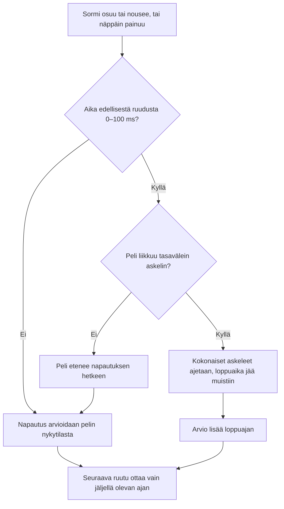

# Fair timing: a tap counts at its own moment

How the timing games judge a tap (#404). A game moves only when a frame is drawn, about 60 times a second, so a tap between two frames used to be judged at the last drawn frame, up to 17 ms before it really happened. Now the game first runs on to the moment the browser stamped on the tap, and only then judges it. Moukarinheitto v12, Seiväshyppy v15, Pituushyppy v17, Kuulantyöntö v10, Korkeushyppy v14, Keihäänheitto v16, Mäkihyppy v11, Piano v11, Trampoliini v11 and Sormiskeitti v10 do this. Ottelu plays the newest events, so it has it too.

## Colours

- **blue**: what the player does
- **amber**: a question the game asks
- **teal**: the new catching up
- **green**: as before, the tap counts and the loop goes on

## Boxes

- **Aika edellisestä ruudusta 0–100 ms?**: `catchUp(e)` in each game's `index.html`, for example `games/moukari/v12/index.html`: `e.timeStamp` and the frame's time are on the same clock. A tap the frame already passed, or a time gap after a pause, moves nothing.
- **Peli liikkuu tasavälein askelin?**: Trampoliini and Sormiskeitti run fixed physics steps; the others step by the time since the last frame.
- **Peli etenee napautuksen hetkeen**: `step()` runs once with the time up to the tap (`update()` in Piano) and the frame's last time is set to the tap's, so no time is counted twice.
- **Kokonaiset askeleet ajetaan, loppuaika jää muistiin**: `catchUp(e)` in `games/trampoliini/v11/index.html` and `games/sormiskeitti/v10/index.html`. The physics step stays as it was, so flights do not change.
- **Arvio lisää loppuajan**: Trampoliini: `J.matT + acc` and `timeToMat()`. Sormiskeitti: `part()` in `tap()`, for the board's place on the ramp and its speed at the top.
- **Seuraava ruutu ottaa vain jäljellä olevan ajan**: a frame can start just before the tap it runs after, so its time can be behind; the loop then takes no time back (`Math.max`).
