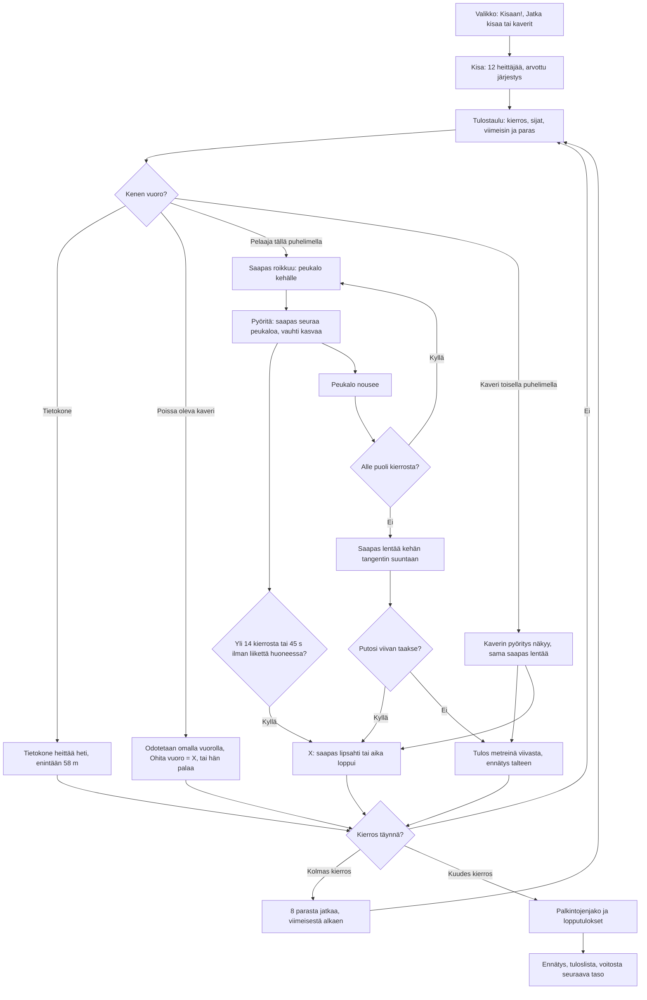

# Saappaanheitto: one throw and one meet

How Saappaanheitto plays (v1, #503). Seen from the side, the thrower stands behind the line and
swings a rubber boot round in an upright circle at arm's length, like a windmill (Eero's choice on
#503). The player draws circles with a thumb on the ring of the spin pad: the boot is always at the
thumb's angle, it goes faster the faster the thumb goes round, and lifting the thumb lets it go
along the circle's tangent. The camera then follows the boot out over the field, as in
Keihäänheitto. The meet is the shared athletics library's (`public/lib/yleisurheilu-11/kisa.js`):
twelve throwers alone against the computer, or 2–8 phones in a room with the computer filling the
rest; three rounds, then the best eight throw three more.

## Colours

- **blue**: what the player sees and does
- **violet**: someone else throwing: the computer, or a friend on another phone
- **amber**: a check that decides the path
- **teal**: the meet's rules and the measured throw
- **rose**: a foul, marked X
- **green**: the end of the meet and what it saves

## Boxes

- **Valikko: Kisaan!, Jatka kisaa tai kaverit**: `showMenu()` in `games/saappaanheitto/v1/index.html`. "Kisaan!" starts a new meet at the player's level (`taso`); "Jatka kisaa (kierros N/6)" shows when a meet alone was left unfinished (`kesken`, `K.kept()`); "👥 Pelaa kavereiden kanssa" opens the room (`public/rooms.js`, 2–8 phones); "👕 Asu" picks the athletics events' shared outfit (`data-share="yleisurheilu"`, `asut.md`). Sideways the menu is two columns.
- **Kisa: 12 heittäjää, arvottu järjestys**: `AiPelitKisa.meet()` and `rounds()` in `public/lib/yleisurheilu-11/kisa.js` (see `yleisurheilu-kirjasto.md`): the players, then computer throwers (`FOES`) up to twelve, each with a skill around `base(level)` metres (32 m at level 1, 3 m more per level up to 54 m), spread by `spread` and `jitter`.
- **Tulostaulu: kierros, sijat, viimeisin ja paras**: the library's `K.drawBoard()`, shown for 3.5 s (`BOARD_T`) before each of the player's turns; alone a tap skips it.
- **Kenen vuoro?**: the library's turn order; `newTurn()` makes the turn each phone draws (`th`), its own (`mine`) or someone else's.
- **Tietokone heittää heti, enintään 58 m**: `cpuMark()`: the skill plus a scatter of 3 m, a foul one time in eight (0.12), at least 8 m; a throw over `CPU_MAX` (58 m, about what a player reaches at the top speed and the best angle) is drawn again, as in Moukarinheitto (#404).
- **Odotetaan omalla vuorolla, Ohita vuoro = X, tai hän palaa**: the library calls `R.turns()` with the competitor on turn; the host's "Ohita vuoro" records -1 (X). The friends not on turn stand in front of the forest (`K.drawFans(x, {..., walk: true, scroll})`, `scroll` at the forest's rate, 6 px a metre, early in `drawScene()`, before the thrower) and a tap on the scene walks your own figure there (`K.tapFans()` first in `pointerdown`).
- **Saapas roikkuu: peukalo kehälle**: phase `ready`. The spin pad is under the scene upright and a column at the right edge sideways (`resize()`: `ring`, `side`); `padOn()` lights it only on the player's own turn. `valinta` plays when the turn is ready.
- **Pyöritä: saapas seuraa peukaloa, vauhti kasvaa**: phase `spin`, `spinStart()` and `spinMove()`: the boot's arm angle is the thumb's angle round the ring's middle (screen up is up); points nearer the middle than 0.3 of the ring, and jumps over a quarter turn, are left out. Every coalesced pointer event counts (`getCoalescedEvents()`). The thumb's turning speed is what it went round in the last 0.25 s (`thumbSpeed()`, `WIN_S`); the boot's speed follows `min(VMAX 28 m/s, 2.0 × rad/s) × build(laps)` with some weight (about 0.3 s up, 0.9 s down), and `build()` is half on the first lap, full after 2.5 laps, and falls past 10 laps (`TIRE`, "Käsi väsyy!"). The swing is over the top, clockwise on the screen (`dir` -1, the pad's arrows before the first lap), so the best moment is high behind the shoulder; going round anticlockwise (underarm) works too, mirrored. Each lap whooshes (`suhahdus`, pitched by speed). The scene and the pad show a green arc (the best angles, ±24° of tangent) and a yellow one (±50°) for the way the boot goes, and the HUD the speed and the laps.
- **Yli 14 kierrosta tai 45 s ilman liikettä huoneessa?**: `step()`: at 14 laps (`SLIP`) the boot slips, "Käsi väsyi: saapas lipsahti"; in a room 45 s (`TURN_MAX`) with no thumb movement is "Aika loppui". Both are `outcome(-1, why)`, sent as `rel` with `why`.
- **Peukalo nousee**: `spinEnd()` on `pointerup`/`pointercancel` of the spinning pointer: `catchUp(e)` first runs the game on to the lift's own moment (#404, `reilu-ajoitus.md`).
- **Alle puoli kierrosta?**: `spinEnd()`: a lift under half a lap (`MIN_TURN`) is a slip of the thumb, "Pyöritä ympyrää!", and the boot hangs again; in a room a `p` tells the phones watching.
- **Saapas lentää kehän tangentin suuntaan**: `letGo()`, `throwNow()` and `boot()`: from the boot's spot on the circle (shoulder at −1.1 m, 1.45 m high, the hand 0.55 m from it), at its speed, along the tangent; the thrower's arm halves how far that is from the best 43° (`launchDeg()`, `HELP`). The flight has gravity and air drag (`flySub()`, 1/240 s steps): about 59 m at 28 m/s and 43°. Over the top, too early (still rising behind) sends it up and back, too late (coming down in front) low into the ground. In flight it keeps the turn it was held with and tumbles on the way it was swung. Angle and speed are rounded before they are sent (`rel`), so every phone flies the same boot.
- **Putosi viivan taakse?**: `flight()`: a boot landing at or behind the line (x ≤ 0) is a foul, "Saapas ei ylittänyt viivaa". No sector: the side view has none (assumed, #503).
- **Kaverin pyöritys näkyy, sama saapas lentää**: the thrower's phone sends its boot angle, speed, phase, direction and laps twelve times a second (`p`) and the release (`rel`); `watchFrom()` draws it, and `throwNow()` flies the same boot to the same mark.
- **Tulos metreinä viivasta, ennätys talteen**: `landed()` (the `tomahdys` thud, the quiet `onnistui` at 0.3 for the player's own throw) and `K.record()`; the mark goes to the meet with `K.report()` after 2.4 s (`LAND_T`).
- **8 parasta jatkaa, viimeisestä alkaen**: the library's `rounds()` format.
- **Palkintojenjako ja lopputulokset**: `K.drawPodium()` at the end of `draw()`, the medal tune per medal (`chime`, `mitali`); a tap finishes or leaves it (`K.skip()`). A friend's "📣 Kannusta" is the quiet `onnistui` at 0.08 (`cheerSound`).
- **Ennätys, tuloslista, voitosta seuraava taso**: the library saves `kisat`, `voitot`, `taso` and `ennatys` under `ai-pelit:saappaanheitto:`, and sends the meet's best throw with `AiPelitScores.submit()` (`saappaanheitto` in `public/scores.js` and `server/api.js`, `main`, metres, level `taso`; see `tuloslistat.md`).
