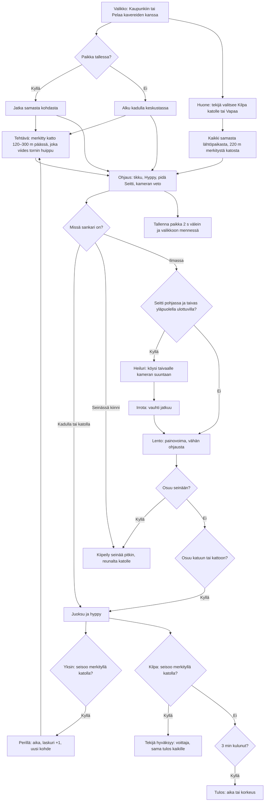

# Seittisankari: kiipeily ja seittiheilunta pilvenpiirtäjissä

3D-peli (#529). v1 toi vapaan kaupungin ja kavereiden kanssa pelaamisen (Eeron valinta), v2 tehtävät ("mene tänne", nuoli näyttää suunnan): pelaaja juoksee kadulla ja katoilla, kiipeää minkä tahansa talon seinää pitkin ja heilahtaa seitillä talosta toiseen noin 1,7 km leveässä kaupungissa. Kavereiden kanssa kisataan satunnaisen talon katolle samasta lähtöpaikasta, tai liikutaan vapaasti yhdessä.

## Colours

- **blue**: valikko ja alku
- **violet**: pelaajan ohjaus, juoksu ja kiipeily
- **teal**: seitti, heilunta ja lento
- **green**: kavereiden kanssa: kisa katolle
- **rose**: yksin pelattavat tehtävät (v2)
- **amber**: tallennus

## Boxes

- **Valikko: Kaupunkiin tai Pelaa kavereiden kanssa**: `#free` ja `#friends` tiedostossa `games/seittisankari/v2/index.html`; ei ilmapalloja eikä ennätyslistaa.
- **Ohjaus: tikku, Hyppy, pidä Seitti, kameran veto**: vasen peukalo liikuttaa (tikku syntyy kosketuskohtaan), oikean alakulman napit Hyppy ja Seitti, toinen peukalo pidetyn Seitin vieressä hyppää, veto muualla kääntää kameraa (`games/seittisankari/v2/ui.js`). Ensimmäisellä kerralla ohjeet näkyvät 16 s (`ai-pelit:seittisankari:ohje`).
- **Kiipeily seinää pitkin, reunalta katolle**: seinään osuessa sankari tarttuu siihen ja kiipeää 6 m/s kädet edellä; yläreunassa hän nousee katolle, Hyppy ponnistaa irti (`stepHero()` tiedostossa `games/seittisankari/v2/world.js`).
- **Seitti pohjassa ja taivas yläpuolella ulottuvilla?**: `aimAnchor()`: seitti tarttuu taivaalle 45 m eteen kameran suuntaan ja 180 m ylös, enintään 160 m lähitalojen yläpuolelle (vähintään 280 m); jos kohta jäisi alle 6 m sankarin yläpuolelle, seittiä ei tule. Seinässä seitti lähtee seinästä poispäin.
- **Heiluri: köysi taivaalle kameran suuntaan**: köysi pitää pituutensa, eikä heilahdus lisää vauhtia tyhjästä; matalalla köysi kelautuu 20 m/s, jotta sankari ei raahaa katua. Seitti lähtee sankarin oikeasta kädestä (`games/seittisankari/v2/draw3d.js`).
- **Tehtävä: merkitty katto 120–300 m päässä, joka viides tornin huippu**: `pickTarget()` tiedostossa `games/seittisankari/v2/round.js`: talo 20–150 m korkea, ei torni, vähintään 20 m kaupungin reunasta; jos sopivaa ei ole, torni. Katolla lippu ja valopylväs, ruudulla "Mene merkitylle katolle! N m" (lähellä "↑ N m"), nuoli kameran suunnasta, aika ja ✔-laskuri (`drawGoal()` tiedostossa `ui.js`).
- **Yksin: seisoo merkityllä katolla?**: `onTop()`: sankari seisoo katolla (ei seinässä eikä ilmassa) talon rajojen sisällä.
- **Perillä: aika, laskuri +1, uusi kohde**: "Perillä!" (tornissa "Tornin huipulla!") 2,5 s, laskuri `ai-pelit:seittisankari:tehtavat`, uusi kohde merkitään heti.
- **Tallenna paikka 2 s välein ja valikkoon mennessä**: `ai-pelit:seittisankari:kierros` = `{h: sankarin paikka, g: merkitty talo, gt: aika}`, joten uudelleenlataus jatkaa samasta kohdasta ja samalla kohteella; v1:n tallennus (`{h}`) aukeaa, ja v2 merkitsee uuden kohteen. Puhelimen kääntö pitää kierroksen.
- **Huone: tekijä valitsee Kilpa katolle tai Vapaa**: `NET_MODES` tiedostossa `games/seittisankari/v2/net.js`; kilpa kestää 180 s.
- **Kaikki samasta lähtöpaikasta, 220 m merkitystä katosta**: `pickGoal()` arpoo talon (30–140 m, ei torni, kaukana reunasta), `startSpot()` laittaa kaikki samaan katukohtaan riviin 1,5 m välein kadun suuntaan. Vapaassa tilassa sama paikka 30 m tornista. Katolla on lippu ja keltainen valopylväs, ja ruudulla nuoli osoittaa sinne.
- **Tekijä hyväksyy: voittaja, sama tulos kaikille**: katolla seisova puhelin pyytää voittoa 0,5 s välein; tekijä hyväksyy, jos sankari on sen omassa näkymässä katon päällä (`hostClaim()`), eikä kierros ole tauolla tai ohi. Tulos lähtee kaikille `deliver()`-viestinä.
- **Tulos: aika tai korkeus**: katolle ehtineet ajan mukaan, muut korkeuden mukaan (`standings()`).
