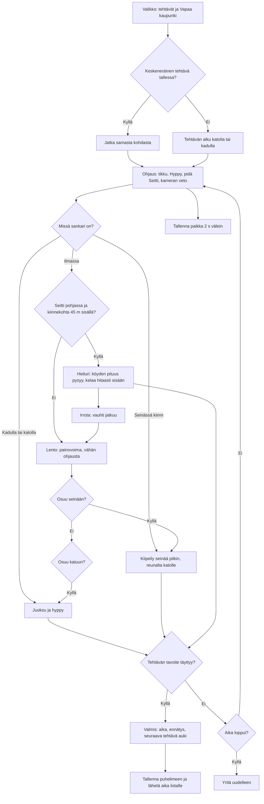

# Seittisankari: kiipeily ja seittiheilunta pilvenpiirtäjissä

Suunnitelma uudesta 3D-pelistä (#529). Pelaaja liikkuu yhdessä kaupungissa: juoksee kadulla ja katoilla, kiipeää minkä tahansa talon seinää pitkin ja heilahtaa seitillä talosta toiseen. Tehtävät ovat lyhyitä ja ajastettuja; putoaminen kadulle ei ole kuolema, vain hukattua aikaa.

## Colours

- **blue**: valikko ja tehtävän aloitus
- **violet**: pelaajan ohjaus, juoksu ja kiipeily
- **teal**: seitti, heilunta ja lento
- **green**: tavoite ja onnistuminen
- **rose**: aika loppui
- **amber**: tallennus ja ennätyslista

## Boxes

- **Valikko: tehtävät ja Vapaa kaupunki**: seitsemän tehtävää järjestyksessä, seuraava aukeaa edellisen läpäisystä; Vapaa kaupunki on auki alusta asti. Suunnitelma: `games/seittisankari/v1/ui.js`.
- **Ohjaus: tikku, Hyppy, pidä Seitti, kameran veto**: vasen peukalo liikuttaa (tikku syntyy kosketuskohtaan), oikean alakulman napit Hyppy ja Seitti, veto muualla oikealla puolella kääntää kameraa. Kamera kääntyy itsestään liikesuuntaan.
- **Kiipeily seinää pitkin, reunalta katolle**: seinään osuessa sankari tarttuu siihen; tikku liikuttaa seinän pinnalla, yläreunassa hän nousee katolle, Hyppy ponnistaa irti seinästä. Talot ovat suorakulmaisia laatikoita, joten seinä on aina yksi tasopinta. Suunnitelma: `hero.js`.
- **Seitti pohjassa ja kiinnekohta 45 m sisällä?**: peli näyttää koko ajan merkin kohdassa, johon seitti tarttuisi: korkein talon kulma tai reuna edessä ja yläpuolella, kameran suunnassa. Ilman kohdetta (aukea paikka) nappi on himmeä.
- **Heiluri: köyden pituus pysyy, kelaa hitaasti sisään**: köysi pitää etäisyyden kiinnekohtaan, joten sankari heilahtaa kaarella; köysi lyhenee 2 m/s, jotta seitillä voi myös nousta.
- **Tehtävän tavoite täyttyy?**: tavoite on tehtäväkohtainen: lippu katolla, kissa antennista, ilmapallot, varkaan kiinniotto seitillä, karanneet dronet. Suunnitelma: `missions.js`.
- **Tallenna puhelimeen ja lähetä aika listalle**: avoimet tehtävät `ai-pelit:seittisankari:taso`, parhaat ajat `ai-pelit:seittisankari:ajat`, ja `AiPelitScores.submit()` tehtävän omalle listalle (pienin aika paras).
- **Tallenna paikka 2 s välein**: `ai-pelit:seittisankari:kierros` pitää tehtävän, ajan ja sankarin paikan, joten uudelleenlataus tai puhelimen kääntö jatkaa samasta kohdasta.
