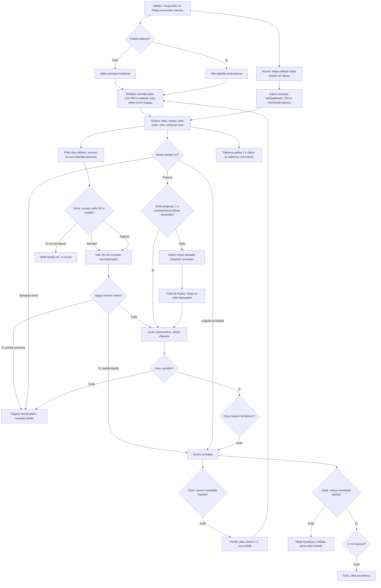

# Seittisankari: kiipeily ja seittiheilunta pilvenpiirtäjissä

3D-peli (#529). v1 toi vapaan kaupungin ja kavereiden kanssa pelaamisen (Eeron valinta), v2 tehtävät ("mene tänne", nuoli näyttää suunnan), v3 vetoseitin (#560: tähtää, ammu seinään ja vedä itsesi sinne, myös ilmasta): pelaaja juoksee kadulla ja katoilla, kiipeää minkä tahansa talon seinää pitkin ja heilahtaa seitillä talosta toiseen noin 1,7 km leveässä kaupungissa. Kavereiden kanssa kisataan satunnaisen talon katolle samasta lähtöpaikasta, tai liikutaan vapaasti yhdessä.

## Colours

- **blue**: valikko ja alku
- **violet**: pelaajan ohjaus, juoksu ja kiipeily
- **teal**: seitti, heilunta ja lento
- **green**: kavereiden kanssa: kisa katolle
- **rose**: yksin pelattavat tehtävät (v2)
- **amber**: tallennus

## Boxes

- **Valikko: Kaupunkiin tai Pelaa kavereiden kanssa**: `#free` ja `#friends` tiedostossa `games/seittisankari/v3/index.html`; ei ilmapalloja eikä ennätyslistaa.
- **Ohjaus: tikku, Hyppy, pidä Seitti, Veto, kameran veto**: vasen peukalo liikuttaa (tikku syntyy kosketuskohtaan), oikean alakulman napit Hyppy, Seitti ja Veto (v3), toinen peukalo pidetyn Seitin vieressä hyppää, veto muualla kääntää kameraa (`games/seittisankari/v3/ui.js`). Ensimmäisellä kerralla ohjeet näkyvät 16 s (`ai-pelit:seittisankari:ohje`).
- **Kiipeily seinää pitkin, reunalta katolle**: seinään osuessa sankari tarttuu siihen ja kiipeää 6 m/s kädet edellä; yläreunassa hän nousee katolle, Hyppy ponnistaa irti (`stepHero()` tiedostossa `games/seittisankari/v3/world.js`).
- **Seitti pohjassa, 1 s irrotuksesta ja taivas ulottuvilla?**: v3:ssa vähintään 1 s edellisestä irrotuksesta (`WEB_CD`). `aimAnchor()`: seitti tarttuu taivaalle 45 m eteen kameran suuntaan ja 180 m ylös, enintään 160 m lähitalojen yläpuolelle (vähintään 280 m); jos kohta jäisi alle 6 m sankarin yläpuolelle, seittiä ei tule. Seinässä seitti lähtee seinästä poispäin.
- **Heiluri: köysi taivaalle kameran suuntaan**: köysi pitää pituutensa, eikä heilahdus lisää vauhtia tyhjästä; matalalla köysi kelautuu 20 m/s, jotta sankari ei raahaa katua. Seitti lähtee sankarin oikeasta kädestä (`games/seittisankari/v3/draw3d.js`).
- **Pidä Veto: tähtäin, sormen liu'utus kääntää kameraa**: Veto-nappi Seitin vieressä (`buttons()` tiedostossa `games/seittisankari/v3/ui.js`). Pohjassa kamera siirtyy lähemmäs sankarin oikean olan yli (`aimEye()` tiedostossa `world.js`, `place()` tiedostossa `draw3d.js`), ja tähtäin näkyy osumakohdassa: vihreä kun osuu seinään tai kattoon, harmaa kun ei. Samalla sormella liu'uttaessa kamera kääntyy, ja ylöspäin voi katsoa jyrkemmin kuin tavallisesti. Seinässä kamera kääntyy noin 0,3 s:ssa suoraan seinästä poispäin ja vaakatasoon (`aimTurn` ja `stepCam()` tiedostossa `ui.js`), ja kamera siirtyy 1,8 m irti seinästä, jottei se mene talon sisään.
- **Irrota: osuuko säde 60 m sisällä?**: `aimPull()` tiedostossa `games/seittisankari/v3/world.js`: säde kameran suuntaan sankarin rinnasta, ensimmäinen talo 60 m sisällä.
- **Veto 30 m/s suoraan osumakohtaan**: tila `pull` `stepHero()`:ssa: ei painovoimaa, seitti piirtyy kädestä osumakohtaan (myös kavereille). Kesken heilunnan, kiipeilyn, hypyn tai juoksun.
- **Seitti lentää ohi, ei muuta**: lyhyt seittiviiva ilmaan, sankarin liike ei muutu.
- **Irrota tai Hyppy: hyppy ja voltti taaksepäin**: Seitin irrotus tai Hyppy heilunnan aikana hyppää aina (`webJump()`: pystyvauhtiin +14,6 m/s, vähintään tavallisen hypyn 18,2 m/s), ja sankari tekee voltin taaksepäin 0,7 s:ssa. Seuraava heiluriseitti tarttuu vasta 1 s:n päästä (`WEB_CD`), jottei toistuvilla painalluksilla voi nousta taivaalle; Seitti-nappi on sen ajan harmaa (`poseHero()` tiedostossa `draw3d.js`, myös kavereiden ruudulla). Hypyt nousevat v3:ssa kolme kertaa v2:n korkeuden, noin 5,9 m.
- **Hyppy kesken vedon?**: Hyppy irrottaa vedosta ja vauhti jatkuu (linko). Perillä sankari tarttuu seinään osumakohdassa tai laskeutuu katolle.
- **Tehtävä: merkitty katto 120–300 m päässä, joka viides tornin huippu**: `pickTarget()` tiedostossa `games/seittisankari/v3/round.js`: talo 20–150 m korkea, ei torni, vähintään 20 m kaupungin reunasta; joka viides on torni, jos se on enintään 600 m päässä (muuten tavallinen katto); jos sopivaa ei ole, lähin vähintään 120 m päässä oleva talo, eikä koskaan juuri saavutettu katto. Katolla lippu ja valopylväs, ruudulla "Mene merkitylle katolle! N m" (lähellä "↑ N m", katon yläpuolella "↓ N m"), nuoli kameran suunnasta, aika ja ✔-laskuri (`drawGoal()` tiedostossa `ui.js`).
- **Yksin: seisoo merkityllä katolla?**: `onTop()`: sankari seisoo katolla (ei seinässä eikä ilmassa) talon rajojen sisällä.
- **Perillä: aika, laskuri +1, uusi kohde**: "Perillä!" (tornissa "Tornin huipulla!") 2,5 s, laskuri `ai-pelit:seittisankari:tehtavat`, uusi kohde merkitään heti.
- **Tallenna paikka 2 s välein ja valikkoon mennessä**: `ai-pelit:seittisankari:kierros2` = `{h: sankarin paikka, g: merkitty talo, gt: aika}` (oma avain, jotta puhelimen välimuistissa vielä oleva v1 ei kirjoita sen yli), joten uudelleenlataus jatkaa samasta kohdasta ja samalla kohteella; jos v2 ei ole vielä tallentanut, v1:n `ai-pelit:seittisankari:kierros` (`{h}`) aukeaa, ja v2 merkitsee uuden kohteen. Puhelimen kääntö pitää kierroksen.
- **Huone: tekijä valitsee Kilpa katolle tai Vapaa**: `NET_MODES` tiedostossa `games/seittisankari/v3/net.js`; kilpa kestää 180 s.
- **Kaikki samasta lähtöpaikasta, 220 m merkitystä katosta**: `pickGoal()` arpoo talon (30–140 m, ei torni, kaukana reunasta), `startSpot()` laittaa kaikki samaan katukohtaan riviin 1,5 m välein kadun suuntaan. Vapaassa tilassa sama paikka 30 m tornista. Katolla on lippu ja keltainen valopylväs, ja ruudulla nuoli osoittaa sinne.
- **Tekijä hyväksyy: voittaja, sama tulos kaikille**: katolla seisova puhelin pyytää voittoa 0,5 s välein; tekijä hyväksyy, jos sankari on sen omassa näkymässä katon päällä (`hostClaim()`), eikä kierros ole tauolla tai ohi. Tulos lähtee kaikille `deliver()`-viestinä.
- **Tulos: aika tai korkeus**: katolle ehtineet ajan mukaan, muut korkeuden mukaan (`standings()`).
