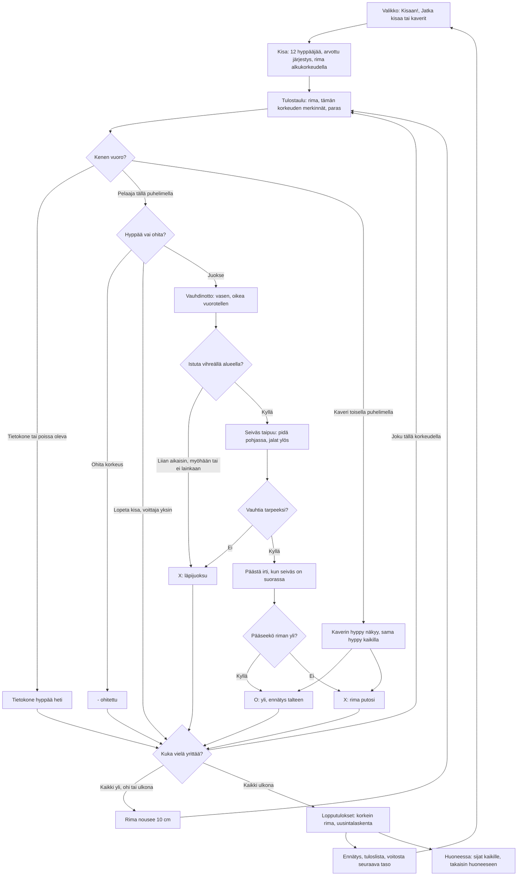

# Seiväshyppy: one vault and one meet

How Seiväshyppy plays (v1). A meet has twelve vaulters: the player and eleven computer vaulters
alone, or 2–8 phones in a room with the computer filling the rest. The bar starts at the level's
first height and rises 10 cm at a time. At each height everyone still trying takes a first attempt
in a drawn order, then those who failed a second, then a third. Anyone may pass a height, even after
failing at it; three failures in a row, at one height or over several, and they are out. The meet
goes on until everyone is out. On their turn the player runs up by tapping the left and right foot
in turn, presses "Istuta" in the green zone to plant the pole, holds it to swing the legs up, and
lets go when the pole is straight. The computer's attempts are worked out at once.

## Colours

- **blue**: what the player sees and does
- **violet**: someone else vaulting: the computer, or a friend on another phone
- **amber**: a check that decides the path
- **teal**: the meet's rules and a cleared or passed height
- **rose**: a failed attempt, marked X
- **green**: the end of the meet and what it saves

## Boxes

- **Valikko: Kisaan!, Jatka kisaa tai kaverit**: `showMenu()` in `games/seivashyppy/v1/index.html`. "Kisaan!" starts a new meet at the player's level (`taso`), the menu shows its first height; "Jatka kisaa (rima N m)" shows when a meet alone was left unfinished (`kesken`, saved after each of the player's attempts); "👥 Pelaa kavereiden kanssa" opens the room (`public/rooms.js`, 2–8 phones). The menu shows meets, wins and the record (`kisat`, `voitot`, `ennatys`).
- **Kisa: 12 hyppääjää, arvottu järjestys, rima alkukorkeudella**: `newComp()`: the players, then computer vaulters up to twelve (`FIELD`), each with a skill around `base(level)` (4,00 m at level 1, 20 cm more per level up to 5,90 m); the first height is 80 cm under it (`h0Of()`), the bar then rises `STEP_H` (10 cm). `cpuPlan()` picks where each computer vaulter comes in (50–80 cm under its skill) and a few heights it passes. The order (`order`) is drawn once.
- **Tulostaulu: rima, tämän korkeuden merkinnät, paras**: `drawBoard()`, shown for 3.5 s (`BOARD_T`) before each player's attempt; alone a tap skips it. Each row shows the place, the marks at this height (O, X, - for a pass; "ulos" when out) and the best height; "NM" (no mark) before any. The foot line says who is next and how many attempts they have left (`TRIES - cons`).
- **Kenen vuoro?**: `advance()` makes every computer attempt up to the next player on a phone; a round at a height is `comp.q`, the vaulters still `trying()` there, in the drawn order. `follow()` makes the turn each phone draws (`th`), its own (`mine`) or someone else's.
- **Tietokone hyppää heti**: `cpuTry()`: clears when its skill plus a scatter of 13 cm reaches the bar; a run-through one time in twenty. In a room the host's "Jatka ilman heitä" hands an away phone's attempts to the computer (`R.on('continue')`, from the height it is at) until it is back (`R.on('back')`); while a phone is away the meet waits (`R.paused`).
- **Hyppää vai ohita?**: before the first foot tap the "⏭ Ohita korkeus" button (`passBox`, acts when the finger lifts on it) passes this height, `pass()`; passing the lowest heights is how the player picks the height to start at. Passing after a failure keeps the failure: the next height then has fewer attempts left. The player alone at the top, everyone else out, sees "🏁 Lopeta kisa" instead (`soleWinner()`), and keeps the win.
- **- ohitettu**: `apply()` with `-`: no attempt, failures in a row unchanged.
- **Vauhdinotto: vasen, oikea vuorotellen**: `press()`: a step on the other foot adds speed, more the slower the vaulter goes (as in Aitajuoksu and Keihäänheitto), the same foot twice slows; about 8 m/s at eight taps a second. The bar in the score panel shows the speed; the runway shows the take-off zone in green, brighter within 30 cm of the best spot (`TAKEOFF`, 4 m before the box).
- **Istuta vihreällä alueella?**: `hold()`: pressing the middle pad (upright), the top pad of either side column (sideways), or anywhere on the scene (either way, `padAt()`) plants the pole, once the run has begun. A press while still standing at the start, or more than 3 m short of the green zone (`PLANT_FROM`, 7.8 m before the spot), does nothing: it is a stray tap (skipping the standings, missing the pass button), not a plant. Just too early, up to 3 m short of the zone (more than 80 cm, `PLANT_OK`, before the spot), is "Liian aikaisin: läpijuoksu", past it "Liian myöhään: läpijuoksu"; running on past the zone without a press is "Läpijuoksu: seiväs jäi istuttamatta" (`step()`). Each is a failed attempt, as under the rules. In a room 45 s with no tap (`TURN_MAX`) is "Aika loppui".
- **Seiväs taipuu: pidä pohjassa, jalat ylös**: `posePole()` and `hipAt()`: over one second (`T_POLE`) the pole bends and straightens and lifts the vaulter's hips by the run's energy, `v²/2g`, times the plant's quality (`plantQ()`, 1 within 30 cm, down to 0.7 at the zone's edge). While the pad is held the legs swing up (`sw`, full after 0.7 s, `SWING_T`). Letting go of the planting press within 0.12 s (`TAP_MIN`) does not push off; pressing again swings on. The score panel shows the pole straightening, green where letting go pushes off.
- **Vauhtia tarpeeksi?**: under 4.5 m/s (`VSTALL`, with the plant's quality) the pole never stands up: "Liian hidas: seiväs ei noussut pystyyn".
- **Päästä irti, kun seiväs on suorassa**: `letGo()` and `vaultResult()`: the height over the bar is where the hips are when let go, plus up to 50 cm of push (`PUSH`) for letting go within 0.4 s of the pole being straight (`PUSH_W`), less up to 50 cm when the legs did not swing up (`LEGS`). Holding on half a second past straight lets go anyway (`HANG`). So speed matters most: 8.3 m/s with a perfect plant, swing and push clears about 5,00 m, 7 m/s about 4,00 m.
- **Pääseekö riman yli?**: `vaultNow()`: cleared when that height reaches the bar; within 4 cm "Rima heilui, mutta pysyi!". The flight (`a.fly`) is drawn from the same numbers, and the bar falls when it is not cleared.
- **Kaverin hyppy näkyy, sama hyppy kaikilla**: the vaulter's phone sends where its vaulter is twelve times a second (`p`), the plant (`pl`) and the let-go with its four numbers, the plant spot, speed, swing and time (`rel`); the host passes them on and every phone works out the same vault with `vaultNow()`.
- **O: yli, ennätys talteen**: `landed()`: a new record (`ennatys`, the highest bar cleared) is saved at once. The vaulter's phone reports the outcome (`res`); the host records it once (`seq`, `record()`) and sends the meet to everyone (`c`).
- **X: läpijuoksu** and **X: rima putosi**: `outcome()` or `vaultNow()`; `apply()` adds X and counts the failures in a row (`cons`); the third is out (`out`).
- **Kuka vielä yrittää?**: `advance()`: the next round at this height while someone is still trying there; otherwise the bar rises (`comp.hi`); when everyone is out (or the bar would pass 7 m) the meet is over. With no player on a phone left in, the rest is vaulted at once.
- **Lopputulokset: korkein rima, uusintalaskenta**: `standings()` and `cmp()`: the highest bar cleared, then fewer failures at it, then fewer failures in all up to it (the countback); still level, the place is shared (`placeOf()`). `over()` and `netEnd()` show them with 🥇🥈🥉 for a few seconds.
- **Ennätys, tuloslista, voitosta seuraava taso**: `netEnd()` saves `kisat`, and alone a first place adds `voitot` and the next level (`taso`); the meet's best height goes to the high-score list with `AiPelitScores.submit()` (`seivashyppy` in `public/scores.js` and `server/api.js`, see `tuloslistat.md`).
- **Huoneessa: sijat kaikille, takaisin huoneeseen**: the host sends the results with `R.deliver()`; each phone saves its own meet once (`R.once()`), shows its place and the top eight in the room (`afterEnd()`, `R.note()`, `R.backToRoom()`).
