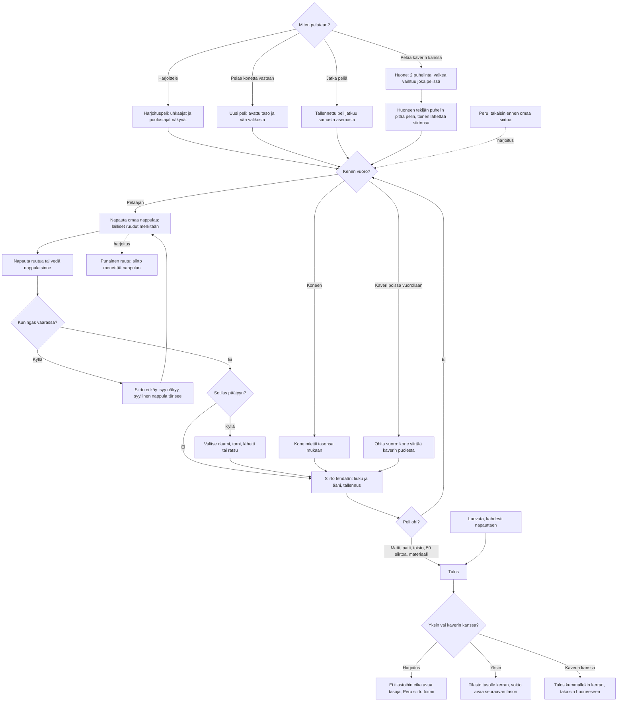

# Shakki: one game, from the menu to the result

How a game of Shakki plays (#465). A flat board seen from above, the player's own colour at the
bottom. Alone the player meets the computer at one of five levels; with a friend, two phones play
each other through the shared room library (see `moninpeli.md`), the host's phone keeping the
game. A tap on a piece shows where it may go; a tap on one of those squares, or a drag there,
moves it. Harjoittele (v3) is the same game alone with unlimited undo and the threats on the board,
and it counts for nothing.

## Colours

- **blue**: what the player sees and does
- **amber**: a check that decides the path
- **teal**: the computer thinking
- **violet**: playing in a room
- **green**: the result and the statistics
- **rose**: giving up

## Boxes

- **Miten pelataan?**: the menu in `games/shakki/v3/index.html`, drawn by `menu()` in `game.js`: the computer's level (five buttons, saved as `ai-pelit:shakki:taso`, Aloittelija by default; only Aloittelija is open at first, and `unlocked(l)` opens a level once the level before it has a win in its `tilasto:<level>`; a tap on a locked one 🔒 says which win opens it and chooses nothing, and a saved level that is not open falls back to the highest open one in `levelNow()`), the player's colour (Valkea, Musta or Arvo, saved as `ai-pelit:shakki:vari`), the chosen level's wins, losses and draws (`tilasto:<level>`), **Pelaa konetta vastaan** (`newSoloGame()`), **Jatka peliä** when a game alone was left unfinished (`ai-pelit:shakki:peli`, checked by `validSave()`), and **👥 Pelaa kaverin kanssa** (`AiPelitRooms.open()`).
- **Harjoituspeli: uhkaajat ja puolustajat näkyvät** (v3): **🎓 Harjoittele** in the menu calls `newSoloGame(true)`, a game alone against the chosen level with `practice: true`, saved with it (the menu then reads "Jatka harjoitusta"); the name line says "🎓 Harjoitus" and Luovuta gives way to **↶ Peru**. `drawGuards()` in `draw.js` puts a badge "attackers:defenders" (`guardInfo()` in `engine.js`, from `attackersOf()`, pins ignored; a king attacks only an unguarded piece and takes back only after the one attacker took) on every piece but a king that is attacked, and a frame on a piece the other side wins material by taking (`hanging()`: `captureGain()` takes and takes back on that square with the cheapest legal piece, each side free to stop, and a trade within `EVEN` = 50 points, a bishop for a knight, wins nothing): red on the player's own, green on the opponent's (Eero's choice). A tapped piece (`inspect`: any opponent's piece, or the player's own when it is not their turn; the selected piece on their turn) gets red lines from its attackers and green ones from its defenders, and the line under the board names them (`infoText()`; a selected piece's refused capture still gives the v2 reason first), with what it threatens and, when it is lost, the trade in pawns (`threat()`: "⚠ Sotilas h6 lyö sen: menetät 3, saat takaisin 1", or "Voit voittaa sen: …").
- **Punainen ruutu: siirto menettää nappulan** (v3, practice only): for the selected piece `risks()` in `game.js` asks `exposedBy()` in `engine.js` about each of its moves: the moved piece lost at once on its new square (`landsBadly()`: the other side wins more by taking it than the move took, an en passant pawn included, beyond `EVEN`), or another own piece, not the king, safe before and hanging after (the defence the move takes away). Such a move's dot or ring is red, the pieces it would leave hanging get a dashed orange frame, and the line under the board says "Varo punaisia ruutuja: …".
- **Peru: takaisin ennen omaa siirtoa** (v3, practice only): `undo()` cuts the moves back to the player's turn before their last move (`undoTarget()`), as many times as there are moves, also from the end card (**↶ Peru siirto**, which takes the result away), stops the computer's thinking and saves.
- **Ei tilastoihin eikä avaa tasoja, Peru siirto toimii** (v3): `finish()` counts no `tilasto:<level>` and opens no level for a practice game; the end card says "Harjoituspeli: ei tilastoihin eikä avaa tasoja." and the game stays saved (`keepSolo()` keeps an ended practice game), so it can be undone even after a reload.
- **Uusi peli: avattu taso ja väri valikosta**: `newSoloGame()`; Arvo picks white or black at random. The board turns so the player's colour is at the bottom (`flipped()` in `draw.js`). Playing black, the computer moves first.
- **Tallennettu peli jatkuu samasta asemasta**: `keepSolo()` saves the moves from the start (UCI strings), the level and the colours after every move and on `pagehide`; `resumeSolo()` replays them with `playGame()` in `engine.js`. A save that no longer replays is dropped. An ended game deletes its save.
- **Huone: 2 puhelinta, valkea vaihtuu joka pelissä**: `rooms.js` with `data-min="2" data-max="2"` and the voice chip at `bottom-left`, off the board. The host saves who had white under `ai-pelit:shakki:valkea:<room code>` and gives white to the other player next game.
- **Huoneen tekijän puhelin pitää pelin, toinen lähettää siirtonsa**: the host sends `state` (the moves, both players, the result) after every change and to a returning phone (`hello`). The guest shows its own move at once and sends `move` with the ply it was made on; the host plays it only when it comes from the player on turn, at that ply, while the round is not paused, and is legal (`receive()`); any other move, or one after the game ended, is answered with the host's state, so the guest drops the move it showed. `turns()` makes the room wait only for the phone on turn; while it waits the status reads "Peli odottaa…".
- **Kenen vuoro?**: `derived.pos.turn` against the player's colour; `myTurn()` is false while the computer thinks or the room is paused.
- **Napauta omaa nappulaa: lailliset ruudut merkitään**: `pointerdown` on the canvas selects the player's own piece (`selected`); `draw()` marks its legal moves from `legalMoves()` with a dot on an empty square and a ring on a capture, and the last move and a king in check on the board.
- **Napauta ruutua tai vedä nappula sinne**: a tap on a marked square (`pointerdown`), or lifting a dragged piece on one (`pointerup`), calls `tryMove()`.
- **Kuningas vaarassa?** and **Siirto ei käy: syy näkyy, syyllinen nappula tärisee** (v2): a tap or drag on a square the selected piece may not go to asks `whyIllegal()` in `engine.js`. It answers only when the king's safety refuses the move: the piece is pinned (its move is in `pseudoMoves()` but leaves the king attacked), the king is in check and the move does not answer it, the king would step onto an attacked square, or castling (rights kept, nothing between) is refused in check, across an attacked square or onto one (the square crossed is blamed first). Then `explain()` in `game.js` shows the reason under the board (`#lastMove.why`, and sideways in `#paStatus`) for `WHY_MS` (4 s), plays `virhe` quietly, the attacking pieces (`attackersOf()`) shake for `SHAKE_MS` (0.7 s, `shakeOf()` in `draw.js`) and the king in danger glows like a check. A piece that has no move at all for that reason says it as soon as it is chosen. A new game, the menu, or a guest's board replaced by the host's state clears it, and a drag says nothing while the room waits (`myTurn()`). A move against a piece's own way of moving (a knight's L, a piece in the way, castling after the king moved) is refused quietly, as in v1 (Eero's choice). The next tap, or a move, clears it.
- **Sotilas päätyyn?** and **Valitse daami, torni, lähetti tai ratsu**: a move with a promotion opens `#promo` (`askPromotion()`), four drawn pieces and Peru.
- **Kone miettii tasonsa mukaan**: `maybeComputer()` waits 380 ms for the slide, then `computerMove()` in `engine.js`: alpha-beta search with captures searched to the end, material and piece-square tables. `LEVELS` sets each level's depth, random error and time limit: Aloittelija 1 move with large error and a 25 % random move, Helppo 1 with smaller error and 8 %, Keskitaso 2, Vaikea 3, Mestari up to 5 moves; each stops itself at 0.3–1.6 s.
- **Ohita vuoro: kone siirtää kaverin puolesta**: the room's "Ohita vuoro" (`on('skip')`) makes the host play one Keskitaso move for the away player, with the notice "Kone siirsi pelaajan … puolesta."
- **Siirto tehdään: liuku ja ääni, tallennus**: `play()`: the piece slides in 170 ms (the board is drawn only then and on a change), `puu` for a move, `osuma` for a capture, `naksu` for check, from `lib/aanet-5/`. The status line shows the last move in Finnish notation (`moveText()`: K, D, T, L, R).
- **Peli ohi?**: `gameStatus()` in `engine.js`: mate, stalemate, the same position three times, 50 moves with no capture or pawn move, or too little material to mate.
- **Luovuta, kahdesti napauttaen**: the first tap turns the button to "Varmasti?" for 3 s, the second gives up (`resign()`); a guest sends `resign` to the host.
- **Tulos**: `finish()` shows `#end` over the board with the result and why; "Katso lautaa" hides it to see the final position, and "Tulos" brings it back.
- **Tilasto tasolle kerran, voitto avaa seuraavan tason**: alone, `bump('tilasto:<level>')` counts the win, loss or draw once, when the game ends. A first win against a level opens the next one: `finish()` saves it as the chosen level (`taso`), and the end card says "🔓 Uusi taso auki: <level>!".
- **Tulos kummallekin kerran, takaisin huoneeseen**: the host `deliver()`s the result and ends the round; each phone counts it once in `ai-pelit:shakki:kaverit` (`once(round)`), and "Takaisin huoneeseen" calls `backToRoom()`.
