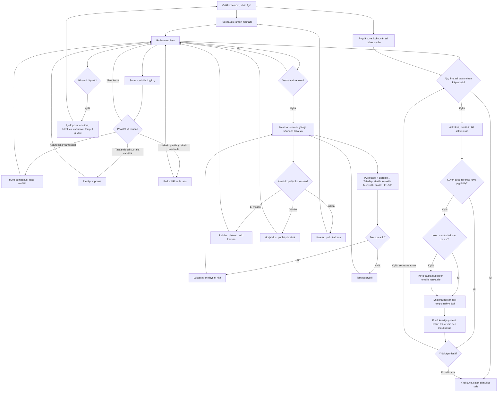

# Skuutti: one run in the halfpipe

How a Skuutti run plays (v1). The rider drops into a halfpipe and has one minute. A finger
down crouches and letting go while climbing a wall is a pump, so each good pump goes faster and
higher; over the coping a swipe asks for a trick, and every trick must be turned all the way
before the wheels touch. A higher record opens more tricks and scooter colours. From v2 (#228)
the run sounds with recorded effects from the shared sound library (see `aanikirjasto.md`) through
`sound()`; each falls back to v1's beep when nothing played. Each box below names its sound.

v3 (#337, `aanet-4`) has no crowd: a wobble is only the wheels' landing, no "ooh"; a trick is the quiet `onnistui` blip at 0.3.

v4 (#355) loads `aanet-5`, where the sounds Eero still found too loud are swapped for softer ones he picked by ear, or play quieter (the winning and losing tunes); nothing else changed.

v5 (#414) draws less and looks the same, 30 even pictures a second during a run. What never moves is on a canvas of its own, drawn once for each screen size, and the loop runs only during a run; the boxes from "Pyydä kuva" on show it.

## Colours

- **blue**: what the player does
- **amber**: a check that decides what happens
- **teal**: the riding and flying itself
- **violet**: the menu
- **green**: points, a record or something opened
- **rose**: a fall or a locked trick

## Boxes

- **Valikko: temput, värit, Aja!**: `showMenu()` in `games/skuutti/v5/index.html` (v1 is the same without the recorded sounds): the tricks (`TRICKS`) open ones with their swipe, locked ones with the record they need; the colours (`COLORS`, the pick saved as `ai-pelit:skuutti:vari`); and the next thing the record opens.
- **Pudottaudu rampin reunalta**: `dropIn()`: standing still on the coping, at the start on the left, after a fall on the side of the fall.
- **Rullaa rampissa**: `ride()`: the halfpipe is a flat bottom, a quarter circle up each side and a short straight wall (`at()`, `FLAT`, `R`, `VERT`); gravity along the surface, rolling and air drag against it. Rolling alone never reaches the coping again. Sound: the `rullaus` loop (`wheelSound()`, each frame), louder and higher with the speed, silent in the air, after a fall and in the menu.
- **Sormi ruudulla: kyykky**: the canvas's `pointerdown`; while a finger is down the rider crouches and the part of the wall ahead where a pump is best shows green.
- **Päästät irti missä?**: `pump()` and `pumpQuality()`: the last finger lifting. Climbing the curve is a full pump (`PUMP`, 1.6 m/s); low in the curve, on the flat or the straight wall less; going down nothing; one pump each way up a wall; a tap shorter than 0.12 s is half. No pump takes the energy over `VMAX`, so the highest air is about 2.8 m (1.5 s). Sound: a quiet `suhahdus`, a little louder for a better pump.
- **Potku: liikkeelle taas**: `pump()`: slower than 0.6 m/s on the flat, letting go kicks the rider off at 2.6 m/s. Sound: a quiet `suhahdus`.
- **Ilmassa: suoraan ylös ja käännös takaisin**: `launch()` and `air()`: the rider leaves the wall straight up and comes back down to the same coping; the drawing (`drawRider()`) eases towards upright and turns round at the top. Sound: `suhahdus` at the take-off.
- **Pyyhkäise: ↑ Barspin, ↓ Tailwhip, sivulle keskelle Takavoltti, sivulle ulos 360**: `pointermove` (26 px makes a swipe, one trick a finger) and `trick()`. Sideways is read against the wall the rider is over (`P.side`), so the menu says it in words, not with one arrow. Bars, deck, the 360 and the back flip each have their own count (`barTo`, `whipTo`, `spinTo`, `flipTo`) and turn at the same time; the same trick again turns after the first, and no trick undoes another. Sound: a quick `suhahdus` for each trick asked. The four are the ones Eero picked (barspin, tailwhip, 360, back flip).
- **Temppu auki?**: `isOpen()`: the record (`ai-pelit:skuutti:ennatys`) against the trick's `need`: Barspin and Tailwhip from the start, 360 at 600 p, Takavoltti at 1500 p.
- **Alastulo: paljonko kesken?**: `land()`: the most of a turn still to go on any of the four: up to 0.08 clean, up to 0.25 a wobble, more a fall (`CLEAN`, `SLOPPY`). Sound: `lasku` when the wheels touch; a wobble adds the crowd's `ohhoo`, a fall is `rima` (`fall()`), the metal clatter of the scooter going down. From v3 (#337) a wobble is `lasku` only, no `ohhoo`.
- **Puhdas: pisteet, putki kasvaa**: `score()`: the tricks' points, ×1.5, ×2… for each more in the same air, 20 a metre of height, +10 % for each clean air in a row (at most double); the same air as the last one pays half, a wobble half. Sound: a clean trick adds `onnistui`.
- **Ajo loppuu: ennätys, tuloslista, avautuvat temput ja värit**: `finish()`: a run is 60 s (`RUN`); an air under way still lands and counts. Saves the record, sends the points with `AiPelitScores.submit()` (`skuutti` in `public/scores.js` and `server/api.js`, see `tuloslistat.md`) and names what the new record opened. Sound: `voitto` for a new record, otherwise `tappio`. This game keeps its own score entry; the shared registry’s new `minigolf` entry (#340, lowest stroke total on `main`) does not change it. Kiekkoammunta v1 adds independent `trap` and `skeet` score entries (Trap first, N/25); this box’s existing behavior is unchanged. Frisbeegolf v1 adds its own `main` entry to these registries: lowest strokes against par wins, displayed as `E`, `−2` or `+5`; this box keeps its existing behavior. Frisbeegolf now uses its separate `v3` leaderboard; versions 1–2 are not accepted there (#338). From v5 (#429) its rounds go to a new `v5` list, the shelf's first, and the `v3` list stays for v3–v4.
- **Pyydä kuva: koko, väri tai paluu sivulle**: `ask()` in `games/skuutti/v5/index.html` asks for one `frame()` with a picture owed (`owed`): called from `showMenu()` (so also a picked colour), `startRun()`, the window's `resize`, the `ResizeObserver` on `#c`, and `back()` on `visibilitychange` and `pageshow`.
- **Ajo, ilma tai kaatuminen käynnissä?**: `phase !== 'menu'`, so `ride`, `air` and `down` all run the loop.
- **Yksi kuva, sitten silmukka seis**: the last `frame()` draws the menu's picture and `wheelSound()` quietens the wheels; nothing runs until the next `ask()`. `startRun()` sets `lastT` and `acc` again, so time in the menu is not played.
- **Askeleet, enintään 60 sekunnissa**: `frame()`: as many fixed 1/60 s `step()`s as the time since the last frame holds, which on a 120 Hz screen is none every other frame. Physics, touches and sounds keep this pace whatever is drawn.
- **Kuvan aika, tai onko kuva pyydetty?**: `owed || (phase !== 'menu' && t - drawnT >= EVERY)` in `frame()`: `draw()` and `wheelSound()` run 30 times a second on any screen, or at once after an `ask()`. The steps stay at 60 a second. On the test phone any picture moving 60 times a second cost 30 % or more of the processor; 30 a second cost 28 %, under v4's 30 %.
- **Koko muuttui tai sivu palasi?**: `sceneDrawn` is false after `resize()` changed the canvases' size, or after `back()`, as a page coming back may have lost its pictures.
- **Piirrä tausta uudelleen omalle kankaalle**: `drawScene()` and `drawRamp()` on `#scene`, under `#c`: sky, city, fence, ground and ramp. Filling the sky's full-screen gradient every frame was what held the test phone at 30 frames a second.
- **Tyhjennä pelikangas: ramppi näkyy läpi**: `draw()` clears `#c`, which is transparent over `#scene`. Copying a finished picture of the scene each frame instead reached only 42 frames a second.
- **Piirrä kuski ja pisteet, palkin teksti vain sen muuttuessa**: `drawLive()` (the green pump zone, the copings), `drawRider()`, `drawHud()`. The strip's text is written by `drawStrip()` only when the time, points or record change (`hudKey`) and copied the rest of the time; pops and the first seconds' hint are drawn each frame.
- **Yhä käynnissä?**: the end of `frame()`: `next()` asks for the next frame while `phase !== 'menu'`, in the air and after a fall as well as on the ramp; `ask()` is `next()` with a picture owed.
