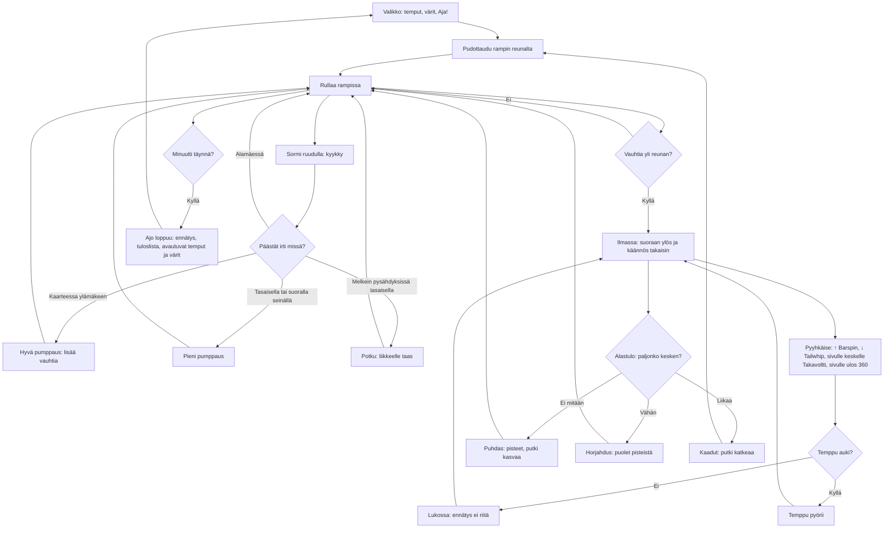

# Skuutti: one run in the halfpipe

How a Skuutti run plays (v1). The rider drops into a halfpipe and has one minute. A finger
down crouches and letting go while climbing a wall is a pump, so each good pump goes faster and
higher; over the coping a swipe asks for a trick, and every trick must be turned all the way
before the wheels touch. A higher record opens more tricks and scooter colours.

## Colours

- **blue**: what the player does
- **amber**: a check that decides what happens
- **teal**: the riding and flying itself
- **violet**: the menu
- **green**: points, a record or something opened
- **rose**: a fall or a locked trick

## Boxes

- **Valikko: temput, värit, Aja!**: `showMenu()` in `games/skuutti/v1/index.html`: the tricks (`TRICKS`) open ones with their swipe, locked ones with the record they need; the colours (`COLORS`, the pick saved as `ai-pelit:skuutti:vari`); and the next thing the record opens.
- **Pudottaudu rampin reunalta**: `dropIn()`: standing still on the coping, at the start on the left, after a fall on the side of the fall.
- **Rullaa rampissa**: `ride()`: the halfpipe is a flat bottom, a quarter circle up each side and a short straight wall (`at()`, `FLAT`, `R`, `VERT`); gravity along the surface, rolling and air drag against it. Rolling alone never reaches the coping again.
- **Sormi ruudulla: kyykky**: the canvas's `pointerdown`; while a finger is down the rider crouches and the part of the wall ahead where a pump is best shows green.
- **Päästät irti missä?**: `pump()` and `pumpQuality()`: the last finger lifting. Climbing the curve is a full pump (`PUMP`, 1.6 m/s); low in the curve, on the flat or the straight wall less; going down nothing; one pump each way up a wall; a tap shorter than 0.12 s is half. No pump takes the energy over `VMAX`, so the highest air is about 2.8 m (1.5 s).
- **Potku: liikkeelle taas**: `pump()`: slower than 0.6 m/s on the flat, letting go kicks the rider off at 2.6 m/s.
- **Ilmassa: suoraan ylös ja käännös takaisin**: `launch()` and `air()`: the rider leaves the wall straight up and comes back down to the same coping; the drawing (`drawRider()`) eases towards upright and turns round at the top.
- **Pyyhkäise: ↑ Barspin, ↓ Tailwhip, sivulle keskelle Takavoltti, sivulle ulos 360**: `pointermove` (26 px makes a swipe, one trick a finger) and `trick()`. Sideways is read against the wall the rider is over (`P.side`), so the menu says it in words, not with one arrow. Bars, deck, the 360 and the back flip each have their own count (`barTo`, `whipTo`, `spinTo`, `flipTo`) and turn at the same time; the same trick again turns after the first, and no trick undoes another. The four are the ones Eero picked (barspin, tailwhip, 360, back flip).
- **Temppu auki?**: `isOpen()`: the record (`ai-pelit:skuutti:ennatys`) against the trick's `need`: Barspin and Tailwhip from the start, 360 at 600 p, Takavoltti at 1500 p.
- **Alastulo: paljonko kesken?**: `land()`: the most of a turn still to go on any of the four: up to 0.08 clean, up to 0.25 a wobble, more a fall (`CLEAN`, `SLOPPY`).
- **Puhdas: pisteet, putki kasvaa**: `score()`: the tricks' points, ×1.5, ×2… for each more in the same air, 20 a metre of height, +10 % for each clean air in a row (at most double); the same air as the last one pays half, a wobble half.
- **Ajo loppuu: ennätys, tuloslista, avautuvat temput ja värit**: `finish()`: a run is 60 s (`RUN`); an air under way still lands and counts. Saves the record, sends the points with `AiPelitScores.submit()` (`skuutti` in `public/scores.js` and `server/api.js`, see `tuloslistat.md`) and names what the new record opened.
