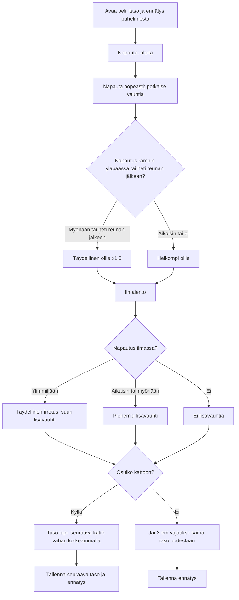

# Sormiskeitti: one round, from push to ceiling

How one round of Sormiskeitti plays from v2 on. Taps push the board along the table, one tap on
the ramp is the ollie, and from v2 one tap in the air lets the fingers go, which flicks the board
higher. Each level's ceiling now grows toward a top that good play can still reach, so no level
is impossible as level 8 was in v1. From v3 the level and the record are saved on the phone, so
closing the game no longer loses them. From v4 a tap just after the lip still counts as a
perfect ollie, because the green zone lasts only about 100 ms at full speed.

## Colours

- **blue**: the player's taps on the table
- **amber**: a check that decides the path
- **teal**: the ollie and the flight, as in v1, and the saved progress (v3)
- **violet**: the new mid-air let-go (v2)
- **green**: level passed
- **rose**: level failed, try again

## Boxes

- **Täydellinen irrotus: suuri lisävauhti**: `tap()` in `games/sormiskeitti/v2/index.html`: when the board's upward speed is within 1 of zero (the top of the flight) it gets `LETGO_BEST` (9) more speed; the "IRTI!" hint shows just before.
- **Pienempi lisävauhti**: further from the top the boost falls by 1.2 per unit of speed, down to `LETGO_MIN` (3). Only one let-go per flight.
- **Taso läpi: seuraava katto vähän korkeammalla**: `ceilH()`: each level closes 15 % of the gap to `CEIL_TOP` (60 cm), so level 8 is 46 cm instead of v1's 57 cm, which no tapping could reach.
- **Avaa peli: taso ja ennätys puhelimesta**: v3 reads `ai-pelit:sormiskeitti:level` and `ai-pelit:sormiskeitti:best` from `localStorage` (`load()`); with nothing saved it starts at level 1.
- **Tallenna seuraava taso ja ennätys**: `finish()` saves the record every round and, on a win, the next level, so a reload starts there.
- **Napautus rampin yläpäässä tai heti reunan jälkeen?**: `tap()`: on the ramp, past 1.3 rad (v3: 1.42) is perfect and past 1.1 good; from v4 a tap up to `OLLIE_GRACE` (8) frames after the lip is a perfect ollie too, and the flight so far is redone as if it had been at the lip. Only after that does a tap mean the let-go.
