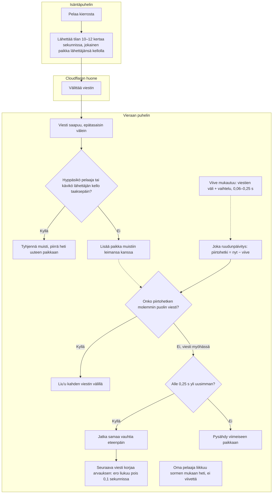

# Sulava liike: toisten pelaajien piirtäminen huoneessa

How a phone in a room draws the other players smoothly between the host's messages (#480).
Each phone keeps the last few positions it heard for every other player and draws them a short
moment in the past, gliding between the two messages around that moment, so an uneven gap between
messages no longer shows as a jerk. The shared part is `public/lib/sulava-1/sulava.js`; the game
sends as often as before, adds the sending phone's clock to each spot, and draws the others from it.
Last Signal v17 is the first game on it, Kirkkis v12 the second; the other room games with moving players follow, most-played first.

## Colours

- **blue**: the host phone's own game code, unchanged
- **violet**: the room on Cloudflare (`rooms/`), unchanged
- **teal**: a message arriving on a guest, stored by `sulava.js`
- **amber**: drawing each frame, done by `sulava.js`
- **green**: the phone's own player, which stays as it is now

## Boxes

- **Lähettää tilan 10–12 kertaa sekunnissa, jokainen paikka lähettäjänsä kellolla**: the send rate stays as it was. Last Signal v17: `mine()` and `subPack()` in `games/last-signal/v17/play.js` add `stamp()` (the phone's `AiPelitSulava.now()`); a host forwards a friend's spot in `snapshot()` as it came (`o.tx`, `o.ty`, `o.ta`, `o.hoseIn`) with the friend's own stamp (`o.st`), and SISU as the friend at the helm sent it (`net.subT`), so a repeated spot is heard once and no phone smooths twice. Kirkkis v12: `kme`, `kr` and `ks` carry `s` (`AiPelitSulava.now()`), and `stateOf()` adds a friend's own stamp (`ts`) as each row's seventh, null for the host's and the computer's players, whose time is the message's `s`; a guest snaps a person's track when that source changes (the computer takes over a friend or gives them back, `guestState()`), and the host resets it on `on('back')`. When the round itself moves or stops someone ("Kaikki pelastettu!" puts the seeker back at the base; Hippa freezes the one tagged), every phone forgets that person's spots (`restart()` in `show()`), because a friend's next rows still carry their last stamp: the newest spot is drawn as it is until a new one starts the glide.
- **Hyppäsikö pelaaja tai kävikö lähettäjän kello taaksepäin?**: `push()` in `public/lib/sulava-1/sulava.js` starts the track again when the move from the last spot is longer than its `jump` (Last Signal: 8 m for a person, 40 m for SISU; Kirkkis: 3 m), or the stamp is over a second older than the newest (the sender's page reloaded). The game calls `snap()` itself on a jump it knows of (Last Signal: a change of place, `setOther()`; SISU at rest, its speed 0 after the driver let go and its spot the one heard last, `setSubT()` and `stopSub()`; with no speed but a new spot, drawn to an opening's middle, it glides, so it is not driven on past where it stopped). Last Signal also keeps a diver's hose points with their stamps and draws the ones of the moment drawn (`tr.time`), so the hose waits with the body it ends at.
- **Lisää paikka muistiin leimansa kanssa**: keeps the last 8 spots; a spot older than or equal to the newest is dropped. Each track learns its own offset to the sender's clock, the smallest (arrival − stamp) of the last 2 s, so phones' clocks are never compared.
- **Viive mukautuu: viestien väli + vaihtelu, 0,06–0,25 s**: the delay is the usual gap between spots plus twice how late they usually come (over the earliest of the last 2 s), limited to `minDelay`–`maxDelay` (0.06–0.25 s), so a steady connection waits less.
- **Liu'u kahden viestin välillä**: `at()`: a straight-line blend of the track's `keys`; keys named in `angles` take the short way round. The moment drawn follows a change of offset or delay at most 20 % faster or slower than real time, and jumps to it after a frame gap over a second (the page slept); then, until a new spot comes, the player waits at the newest spot known instead of going on past it.
- **Jatka samaa vauhtia eteenpäin**: extrapolates from the last two spots, at most `extra` (0.25 s) past the newest, and not at all when those two are over 0.5 s apart. When a spot then comes that says the guess was off (the player had started or stopped), the difference between what was drawn and what the spots now say is drawn away over about 0.1 s (`EASE`), not in one frame.
- **Seuraava viesti korjaa arvauksen: ero liukuu pois 0,1 sekunnissa**: when a spot comes after a frame drawn on that guess, `at()` works out what that frame should have drawn by the spots now known and draws the difference away over about 0.1 s (`EASE`), instead of in one frame (a player who had started or stopped walking).
- **Oma pelaaja liikkuu sormen mukaan heti, ei viivettä**: the phone's own kart or player is never passed through the library. Kirkkis v12's host keeps a friend's newest spot for its rules (seeing, naming, tagging) and only draws the smoothed one: `frame()` puts it in place for `draw()` and back after.
